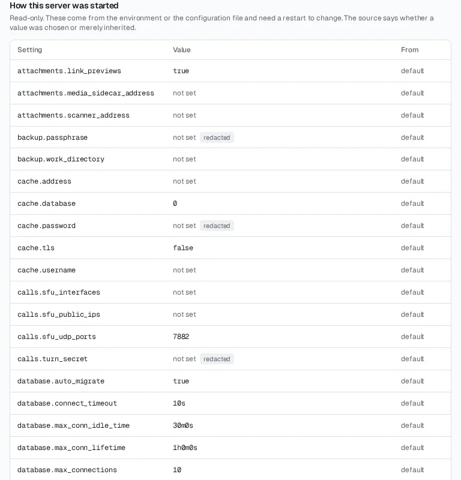
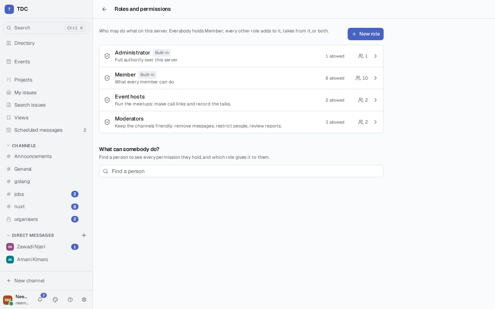
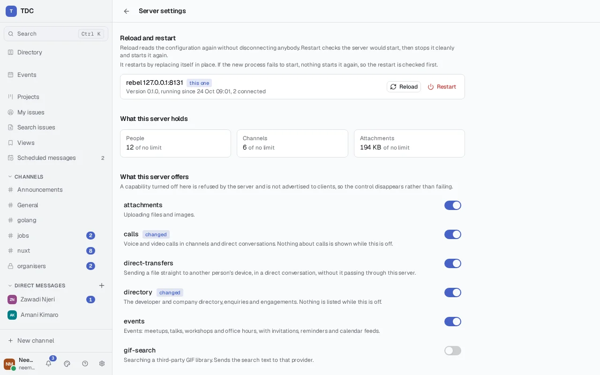
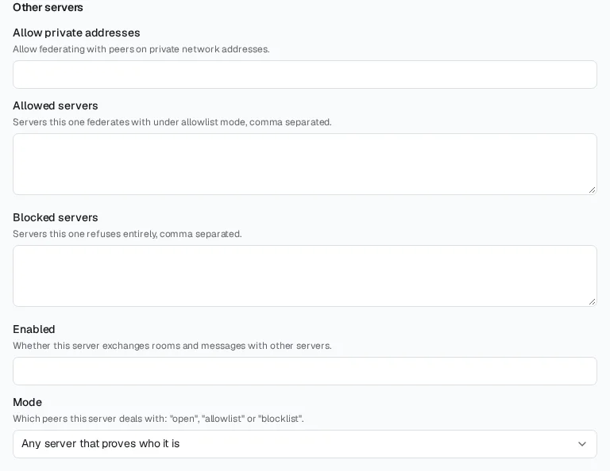
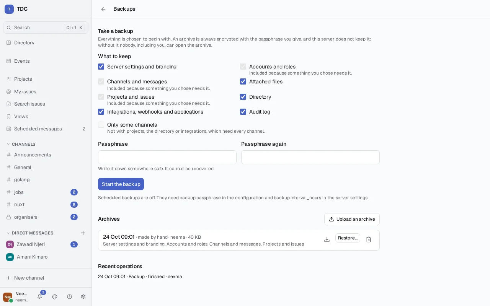
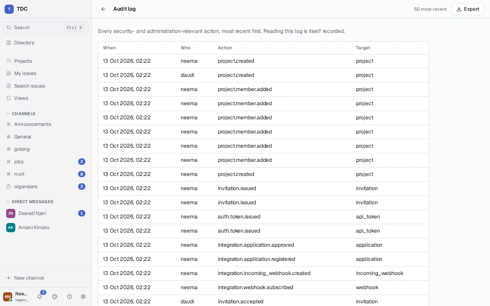

# Hosting a TDC server

Everything needed to run a TDC server for other people: getting it up, putting
TLS in front of it, backing it up, restoring it, reloading and restarting it,
and keeping it current.

The premise throughout is that this costs nothing to run. A working server needs
Docker and a machine; it needs no account with anybody, no API key and no paid
service. Everything optional is genuinely optional, and the server starts and
behaves correctly with all of it switched off, which is the default.

## What you need

A machine with Docker and the Compose plugin, and somewhere between one and two
gigabytes of memory to give it. The server itself targets under a gigabyte;
Postgres wants its own share, and attachments want disk rather than memory.

A domain name, if anybody outside the machine is going to use it. TLS needs one,
and so does the canonical address.

## Getting it running

```sh
git clone https://github.com/AnoRebel/tdc
cd tdc
docker compose up -d
```

That is the whole product on <http://localhost:8080>: the web application and
the API on one port, with Postgres behind them. The schema, the attachment store
and the server's signing key are all created on first start, so there is nothing
to prepare beforehand.

One origin is deliberate rather than convenient. The session cookie is HttpOnly
and `SameSite=Lax`; served from a different host to the API, a browser treats it
as third-party and declines to send it back. Serving both from one port also
means no CORS preflight on every request and one thing to expose.

Open it in a browser. A server with no accounts leads to first-run setup, which
creates the administrator. That path closes the moment an account exists, so it
cannot later be used to grant administration to somebody who turns up
afterwards, and there is no default credential at any point.

### Before anybody else uses it

The shipped `compose.yaml` runs unedited so that you can look at the thing
before committing to it. Three things in it are marked `CHANGE ME` — the
database password in both places it appears — and they, with one more beside
them, matter before anybody else connects.

**`TDC_SERVER_CANONICAL_ADDRESS`** — how this server is known. Set it to the
name people will actually type, `chat.example.org`. It is never inferred from a
request header, which is what keeps it correct behind a proxy, and it is the
host part of every `user@server` address the server hands out. Left unset, the
server warns at startup and calls itself `localhost`.

**The database password** — it appears twice, in `POSTGRES_PASSWORD` and inside
`TDC_DATABASE_URL`, and both must agree. The shipped value is published in a
file in a public repository and is therefore not a secret.

**`TDC_SERVER_SECURE_COOKIES`** — the compose file sets it to `false`, because
the local stack is plain HTTP and a `Secure` cookie there would be set and then
never sent back. **Remove that line for any deployment served over HTTPS.**
Leaving it means session cookies travel in the clear and can be read by anybody
on the same wire.

**`TDC_SERVER_ALLOWED_ORIGINS`** — not marked, but set in the shipped file for
local development, where the web app runs on port 3000. A normal deployment
serves the app from the same origin as the API and wants this empty.

Two more things to do to the file for a real deployment. Remove the published
port on the database — the server reaches it over the compose network and
nothing outside the host needs to. And decide what to do about the server's own
port: with a reverse proxy in front, bind it to loopback with
`127.0.0.1:8080:8080` so that nothing reaches the server except through the
proxy.

## Configuring it

Settings come from a file or from the environment, and the environment wins. An
environment variable is the setting's name in capitals with dots as underscores
and a `TDC_` prefix: `storage.backend` is `TDC_STORAGE_BACKEND`.

The container is configured entirely by environment; it has no config file and
no flag for one. Running the binary outside a container, `-config <path>` names
a file, whose format is one `section.key = value` per line with `#` for
comments. It is optional — environment alone is enough.

**Every problem is reported at once.** A configuration with five mistakes in it
names all five and refuses to start, rather than making you restart five times
to find them one at a time. Secrets are redacted wherever configuration is
displayed, so a database URL shows its host and database name and not its
password.



The settings an operator is most likely to touch:

| Setting                    | Default              | What it does                                         |
| -------------------------- | -------------------- | ---------------------------------------------------- |
| `server.canonical_address` | —                    | How this server is known. Set it.                    |
| `server.address`           | `:8080`              | What to listen on                                    |
| `server.name`              | `TDC`                | What it calls itself                                 |
| `server.secure_cookies`    | `true`               | Session cookies only over TLS                        |
| `server.session_lifetime`  | `720h`               | How long a session lasts unrenewed                   |
| `server.keepalive`         | `45s`                | How often an idle live connection is pinged          |
| `server.allowed_origins`   | —                    | Browser origins allowed to call the API cross-origin |
| `server.default_language`  | `en`                 | Interface language for somebody who has not chosen   |
| `database.url`             | —                    | Required; `postgres://…`                             |
| `database.auto_migrate`    | `true`               | Apply pending migrations at startup                  |
| `storage.backend`          | `local`              | `local`, `s3-aws` or `s3-minio`                      |
| `storage.directory`        | `./data/attachments` | Where files live under `local`                       |
| `log.level`                | `info`               | `debug`, `info`, `warn`, `error`                     |
| `log.format`               | `json`               | `json` or `text`                                     |

Two settings exist for local development and should never be on in a deployment
anybody else uses: `server.expose_internal_errors`, which returns internal error
detail to callers, and `server.secure_cookies = false`. The server warns about
both at startup, along with an unset canonical address and a database URL with
TLS disabled. Read the startup log the first time; it is telling you what it
thinks is wrong.

The rest, which most servers leave alone:

| Setting                             | Default                                  | What it does                                                    |
| ----------------------------------- | ---------------------------------------- | --------------------------------------------------------------- |
| `server.description`                | `A Tanzania Developers Community server` | How it describes itself                                         |
| `server.read_timeout`               | `15s`                                    | How long reading a request may take                             |
| `server.write_timeout`              | `30s`                                    | How long writing a response may take                            |
| `server.idle_timeout`               | `120s`                                   | How long an idle connection is kept open                        |
| `server.shutdown_timeout`           | `20s`                                    | How long requests are given to finish when stopping             |
| `server.expose_internal_errors`     | `false`                                  | Return internal error detail to callers; development only       |
| `server.web_root`                   | `/usr/share/tdc/web`                     | Where the built web application is served from                  |
| `server.multi_node`                 | `false`                                  | See [Running more than one node](#running-more-than-one-node)   |
| `server.restart_method`             | `auto`                                   | See [Reload and restart](#reload-and-restart)                   |
| `database.max_connections`          | `10`                                     | Largest the connection pool grows                               |
| `database.min_connections`          | `2`                                      | Connections kept open; not more than the maximum                |
| `database.connect_timeout`          | `10s`                                    | How long connecting to the database may take                    |
| `database.max_conn_lifetime`        | `1h`                                     | When a pooled connection is replaced                            |
| `database.max_conn_idle_time`       | `30m`                                    | When an unused pooled connection is closed                      |
| `storage.s3.endpoint`               | —                                        | Required under `s3-aws` and `s3-minio`                          |
| `storage.s3.bucket`                 | —                                        | Required under `s3-aws` and `s3-minio`                          |
| `storage.s3.access_key`             | —                                        | Required under `s3-aws` and `s3-minio`; redacted                |
| `storage.s3.secret_key`             | —                                        | Required under `s3-aws` and `s3-minio`; redacted                |
| `storage.s3.region`                 | `us-east-1`                              | The bucket's region                                             |
| `storage.s3.path_style`             | `true`                                   | Address the bucket in the path rather than the hostname         |
| `attachments.scanner_address`       | —                                        | A clamd `host:port`. Empty is no malware scanning               |
| `attachments.scanner_timeout`       | `30s`                                    | How long one scan may take                                      |
| `attachments.scanner_fail_open`     | `false`                                  | Accept a file when the scanner cannot be reached                |
| `attachments.media_sidecar_address` | —                                        | Make previews in another container. Empty does it in-process    |
| `attachments.media_sidecar_timeout` | `30s`                                    | How long one request to the sidecar may take                    |
| `attachments.link_previews`         | `true`                                   | Allow link previews at all; the `link-previews` feature as well |
| `push.vapid_public`                 | —                                        | Notifications to closed browsers. Empty is no push              |
| `push.vapid_private`                | —                                        | Its private half; redacted                                      |
| `push.subject`                      | —                                        | A `mailto:` or `https:` address a push service can reach you at |
| `gifs.provider`                     | —                                        | `tenor` or `giphy`; empty is no GIF search                      |
| `gifs.api_key`                      | —                                        | Required with a provider; redacted                              |
| `gifs.content_filter`               | —                                        | Empty is the strictest each provider offers                     |
| `gifs.timeout`                      | `5s`                                     | How long one search may take                                    |

`tdc-server -push-keys` prints a new key pair, and a subject to fill in, as
`TDC_PUSH_*` lines.

Attachment storage, malware scanning, the media sidecar, link previews and GIF
search are all covered in the repository's [README](../README.md), which is the
reference for what each costs and what is lost by leaving it off. The short
version is that nothing reaches outside the machine by default: GIF search
needs a provider, a key and the `gif-search` feature, and link previews the
`link-previews` feature, and both features are off until you switch them on.

### Signing in through another service

Nothing is configured by default: a stock server signs people in with a username
and a password and involves nobody else. Providers are added by naming them in
`oauth.providers`, and each name opens a namespace of its own — a provider
called `forgejo` is configured under `oauth.forgejo.*`, which is
`TDC_OAUTH_FORGEJO_*` in the environment.

| Setting                      | What it is                                         |
| ---------------------------- | -------------------------------------------------- |
| `oauth.providers`            | Comma-separated names, e.g. `forgejo,github`       |
| `oauth.<name>.label`         | What appears on the button; defaults to the name   |
| `oauth.<name>.client_id`     | The application identifier the provider issued you |
| `oauth.<name>.client_secret` | The secret it issued you                           |
| `oauth.<name>.auth_url`      | Where somebody is sent to approve                  |
| `oauth.<name>.token_url`     | Where the approval is exchanged for a token        |
| `oauth.<name>.user_url`      | Where the signed-in account is read from           |
| `oauth.<name>.scopes`        | Comma-separated, e.g. `openid,email`               |

All five of the required settings must be present and every endpoint must be
`https`, or the server names what is missing and refuses to start. The endpoints
are stated rather than discovered, which is why a self-hosted Forgejo, Gitea or
Keycloak is configured exactly like a commercial provider, and why a server with
no outbound connection at startup starts anyway.

**The redirect URL to register with the provider** is your canonical address
followed by `/api/auth/oauth/callback`. It is built from
`server.canonical_address` and never from a request header, so it stays right
behind a proxy — and so nobody can choose where an authorization code is
delivered.

**What happens when an email matches an existing account.** If the provider says
it has verified the address, the person is offered the chance to connect the two
and must sign in to the existing account once to accept. If the provider has not
verified it, nothing is linked and they get a new account. That second case is
not a limitation to work around: a provider where anybody can set an unverified
address to anything would otherwise be a way into any account on your server.

### Running more than one node

One process is the ordinary deployment and needs nothing here. Two or more
behind a load balancer need two settings, and they go together:

| Setting             | What it does                                                                                  |
| ------------------- | --------------------------------------------------------------------------------------------- |
| `server.multi_node` | Share events between nodes, so a message sent through one reaches people connected to another |
| `cache.address`     | Share rate-limit counters, so a limit is one limit rather than one per node                   |

**Setting one without the other is a mistake the server warns about.** Events
without a shared cache means every rate limit is enforced once per node — five
sign-in attempts becomes five per node, which nobody notices until it is being
exploited. A shared cache without events means the limits are right and half
your community sees a conversation that appears to have stopped.

Events travel over Postgres's own `LISTEN`/`NOTIFY` rather than a queue you
install: you are already running Postgres. The notification carries the event's
identity, and each node reads the event from the database — so nothing is lost
to the eight-kilobyte limit on a notification, however long the message.

**An application's private answer to a press crosses nodes without being
stored.** It is meant for one person, so it never enters the log; it travels
in the notification itself, which Postgres holds in memory only until every
node has read it — no table, no write-ahead log, no backup. A node with nobody
to give it to drops it unread. Only when presence says the person is connected
to another node is it sent at all, and the program waits — a second at most —
for those nodes to say they delivered it, so the count it is given is true.

Scheduled messages are sent by whichever node gets to them first. Every node
looks; each claims what it sends in the same statement that finds it, so
nothing is sent twice.

What that does not give you is durability. A node that is restarting misses the
announcements sent while it was down. That is fine here and would not be
elsewhere: the event is in the log regardless, so a client reconnecting to that
node receives everything it missed, which is the same path a client on a bad
connection already takes.

The cache is Valkey. Redis works too — nothing here uses anything the two do not
share — but Redis is no longer open source under a licence this project can
depend on, and Valkey is the fork that stayed.

| Setting          | Default | What it does                                 |
| ---------------- | ------- | -------------------------------------------- |
| `cache.address`  | —       | `host:port`. Empty is the in-process cache.  |
| `cache.username` | —       | Where the cache wants credentials            |
| `cache.password` | —       | Redacted wherever configuration is shown     |
| `cache.database` | `0`     | For sharing an instance between applications |
| `cache.tls`      | `false` | For reaching one across a network            |

A server configured with a cache checks it can reach it at startup, rather than
discovering it cannot when somebody tries to sign in.

### Roles

Two exist without you doing anything. `Administrator` carries
`server.administer`, which implies every other permission, and goes to the
account created during first-run setup. `Member` goes to every account as it
registers, and grants creating a channel and inviting somebody to one.

`Member` is an ordinary role. A server where only administrators make channels
is one withdrawal away:

```
PUT /api/admin/roles/{id}/permissions
{ "permission": "channel.create", "granted": false }
```

Both are built-in, meaning they cannot be deleted — the accounts holding them
would be left holding nothing — and they keep their names, because the server
finds them by name. Their descriptions and permissions are yours to change.
Roles beyond them are yours to make, from the screen or under
`/api/admin/roles`.



#### Setting up a moderator from the screen

**Settings → More → Administration → Roles and permissions** is where this is done.
It appears for anybody holding `role.manage` (deciding what roles allow) or
`role.assign` (deciding who holds them). Somebody with only `role.assign` sees
the roles and what each allows, and can hand them out, but cannot change them.

1. Choose **New role**, name it `Moderator`, and say what it is for.
2. On the role's page, set what a moderator does to **Allow**. Usually that is
   `moderation.review`, `moderation.restrict`, `message.delete.any` and
   `message.edit.any`, with `user.suspend` if they may suspend accounts. Each
   permission says beside it what the choice will mean. Leave the rest
   **Unset**, so the moderator gets them, or not, from their other roles.
   **Deny** is for withholding something every other role would allow,
   because a denial wins.
3. Under **Who holds it**, search for the moderators and add them.
4. Open one of them (or search on the roles screen) to check. Their page lists
   every permission with the role that decided it, server-wide or in a channel
   you pick.

A moderator for one channel only is made from that channel's settings instead:
**Who may do what here** sets a role's permissions for that channel alone. The
same panel makes an announcement channel: deny `channel.post` to `Member`
there, and allow it to the role your announcers hold.

The screen does nothing the API does not. Each change is checked and audited
on the server, so a refusal shows up with the server's own reason. That
includes being asked to confirm before you take away your own authority, and
being refused when a change would leave nobody able to administer the server.

#### From the API

The server refuses two changes however they are asked for: one that would leave
it with no administrator at all, and one that would remove the authority of the
person making it. The second can be overridden — somebody stepping down
deliberately is a real thing — by repeating the request with `confirmed`. "No
administrator" is counted as the people who would still hold
`server.administer` once the change was made. Withdrawing it from a role every
administrator shares is refused, as is deleting such a role or denying it on
another role they all hold, however many administrators there are.

A role says one of three things about a permission. `PUT
/api/admin/roles/{id}/permissions` with `"granted": true` allows it, and with
`false` stores a denial. `DELETE
/api/admin/roles/{id}/permissions/{permission}` (with `?channel=` for one
channel's entry) clears the entry, so the role says nothing and the person's
other roles decide. `PATCH /api/admin/roles/{id}` renames or describes a role.
`GET /api/admin/roles/{id}/members` lists who holds it. `GET
/api/admin/users/{id}/permissions` (optionally `?channel=`) answers what
somebody may do, with the role entries behind each answer.

All forty-one catalogued permissions are enforced. Calls take `call.start` and
`call.join`, which Member holds, and `call.link` and `call.record`, which nobody
holds until you grant them. `channel.read` and
`channel.post` are checked per channel, on top of membership, bans and posting
restrictions, and Member holds both everywhere until you say otherwise.

Looking after a channel is four permissions, each grantable for one channel so
a channel can have keepers with no say anywhere else: `channel.rename` (its
name, its topic, and making it private), `channel.archive` (archiving and
restoring), `channel.member.remove` (taking somebody out, which is not a ban),
and `message.edit.any` (changing somebody else's message, shown as the
moderator's edit). Making a channel **public** needs `channel.rename` for the
whole server, since it opens the channel's entire history to everybody. Every
one of these is audited — `channel.renamed`, `channel.visibility.changed` with
both values, `channel.archived`, `channel.restored`, `channel.member.removed`
and `message.edited_by_moderator`. None applies to a direct conversation, a
project's discussions, or a channel another server holds. `user.read.all`
opens the list of every account at `/api/admin/users` (as `user.suspend`
already did), paged with `limit` and `offset`; it shows no email addresses,
and a hidden directory profile stays behind `directory.profile.manage`.

Member is a baseline beneath every other role: whatever another role says about
a permission in the same place replaces what Member says there. That is what
makes an announcement channel two calls rather than a restriction per person —
withdraw `channel.post` from Member in that channel, and grant it there on a
role held by whoever announces:

```sh
curl -X PUT "$TDC/api/admin/roles/$MEMBER/permissions" \
  -H "Authorization: Bearer $TOKEN" -H 'Content-Type: application/json' \
  -d "{\"permission\": \"channel.post\", \"channel\": \"$CHANNEL\", \"granted\": false}"
curl -X PUT "$TDC/api/admin/roles/$ANNOUNCER/permissions" \
  -H "Authorization: Bearer $TOKEN" -H 'Content-Type: application/json' \
  -d "{\"permission\": \"channel.post\", \"channel\": \"$CHANNEL\", \"granted\": true}"
```

The grant has to be for that channel: a role granting `channel.post` everywhere
does not reopen a channel where Member is denied it. Administrators are not held
to Member at all, so somebody promoted from the membership posts there as the
person who set the server up does. Between any other two roles a denial still
wins.

### Mail, and the account recovery that depends on it

Nothing is configured by default, and a server that sends no mail runs perfectly
well — what it loses is the ability to offer a password reset, which it then does
not offer rather than offering and failing.

| Setting          | Default    | What it does                                       |
| ---------------- | ---------- | -------------------------------------------------- |
| `mail.host`      | —          | The mail server. Empty is mail switched off.       |
| `mail.port`      | `587`      | The port                                           |
| `mail.username`  | —          | Where the server wants credentials                 |
| `mail.password`  | —          | Redacted wherever configuration is shown           |
| `mail.from`      | —          | Required with a host; the address mail comes from  |
| `mail.from_name` | —          | The name beside it, defaulting to the server's own |
| `mail.tls`       | `starttls` | `starttls`, `tls`, or `none`                       |
| `mail.timeout`   | `15s`      | How long a send may take                           |

SMTP rather than a provider's API, deliberately: recovery has to work against a
mail server you run yourself, and every self-hosted one speaks SMTP. A relay on
the same machine needs no credentials at all.

`mail.tls = "none"` is refused unless the host is on this machine. Without
encryption the password and the recovery link cross the network in the clear,
which is not a configuration anybody means to choose; to a relay on loopback it
is ordinary, and refusing it there would refuse the simplest working setup.

**What members get.** A link, good once and for an hour, sent only to an address
the account has confirmed. Asking discloses nothing — an address with no account
is answered exactly as one with an account, which means somebody who mistypes
theirs gets silence rather than a correction. That is the trade, and it is the
right one: the alternative is a form that tells anybody who asks which addresses
have accounts here.

Setting a new password signs out every device and does not sign the person in.
They sign in with the password they chose, which proves they know it and goes
through the second factor where the account has one.

**An account with no confirmed address still cannot be recovered**, and that is
the part to tell members about. Confirming is theirs to do, from their own
settings: they give an address, a link arrives, and using it proves the address
belongs to them. Until they do, a forgotten password is an administrator's
problem.

A confirmation link lasts a day rather than an hour — nothing is at stake in an
unclaimed one — and the account keeps whatever address it already had until the
link is used, so a mistyped address costs nothing but the message.

### Notifications: bursts, and summaries by email

Two pieces of policy decide how much notifications interrupt people. Both
change while the server runs, through `/api/admin/settings` or the settings
page, and need no restart:

| Setting                                  | Default | What it does                                                                                                                                             |
| ---------------------------------------- | ------- | -------------------------------------------------------------------------------------------------------------------------------------------------------- |
| `notifications.batch_seconds`            | `60`    | After a device is told about a conversation, further messages there within this many seconds are not pushed again. `0` pushes every one; at most `3600`. |
| `notifications.digest_max_conversations` | `20`    | The most conversations one emailed summary lists; the rest are counted. At least `1`.                                                                    |

**Batching** applies to pushes only. Every message is still raised as a
notification, still counted and still listed — the list already shows one entry
per conversation — so what the window changes is how often somebody's phone
lights up during a busy exchange. Reading the conversation ends the window
early, so the next message after that is news again.

**Summaries** are each member's own choice: a daily or weekly email, at an hour
in their own time zone, listing the conversations where something went unread
and how much. They replace pushes for whoever chooses them. A summary counts and
never quotes — no message text goes into the mail — and it is checked at the
moment it is sent, so a channel somebody has left, been banned from, had
`channel.read` withdrawn in, or muted is left out entirely. A status that
suppresses notifications holds the summary until it changes. Summaries go only
to a confirmed address, like recovery.

They need mail. A server with no `mail.host` does not offer them — the control
is not shown, `notification-digests` is absent from `/api/server`, and the
routes answer `404` — and anybody who chose one before mail was switched off
goes back to ordinary pushes rather than being left with neither. With mail
configured they are on by default; the `notification-digests` feature toggle
withdraws them if you want mail to carry recovery and nothing else:

```sh
curl -X PUT https://tdc.example/api/admin/features/notification-digests \
  -H "Authorization: Bearer $ADMIN_TOKEN" -H 'Content-Type: application/json' \
  -d '{"enabled": false}'
```

Every node looks for due summaries once a minute. Servers sharing a database
share the work: each summary is claimed in the statement that finds it, so
nobody is mailed twice however many nodes run. The zone database is built into
the server, so "08:00 in Africa/Dar_es_Salaam" is right whatever zone the host
itself is set to.

### Passkeys

Nothing to configure, and nothing to turn on. A server signs people in with
passkeys as soon as `server.canonical_address` is set, which it must be anyway.

That requirement is not incidental. A passkey is bound to the hostname it was
enrolled against, so one made at `chat.example.org` works only there — which is
the point, since it is what makes a passkey unphishable. It also means the
hostname must be right and must stay right: **changing your canonical address
invalidates every passkey already enrolled**, and everybody who relied on one
will need their password to get back in and enrol again. Decide the address
before people start using it.

A server with no canonical address offers none rather than binding them to a
guess, and says so in `/api/server` so clients do not draw a button that cannot
work.

Somebody may enrol several — a phone, a laptop, a hardware key — and remove any
of them, except the one that would leave them no way in at all. That last
refusal counts across every kind of credential, so a passkey beside a password
can always be removed.

### Two-step sign-in

Nothing to configure. Anybody may set up an authenticator app for their own
account, and by default nobody has to.

`auth.second_factor.policy` changes that, and it is policy rather than
configuration — it takes effect immediately, without a restart:

| Value            | Who must have one                     |
| ---------------- | ------------------------------------- |
| `optional`       | Nobody. The default.                  |
| `administrators` | Anybody who can configure the server. |
| `everybody`      | Everyone.                             |

Under either requirement, somebody without one is not locked out — they are held
short of the server and asked to set one up, and can still reach their own
account, the setup screens and sign-out. The requirement reaches sessions that
already existed, so setting it does not wait out a month of thirty-day sessions.
Somebody it applies to cannot then turn it off.

**Recovery codes are shown once.** Ten are issued when somebody finishes setting
up, each good for one use, and only their hashes are stored — so there is no
administrative way to show them again. Somebody who loses both their phone and
their codes needs you to remove the second factor for them, which is a database
operation until account recovery lands.

Where you have configured mail, somebody whose phone is out of reach can have a
code sent to their address instead — but only if that address has been
confirmed, and only as a fallback. It is the weakest of the three factors,
because it is worth exactly as much as the mailbox: somebody who has taken over
an inbox has taken over this. It exists because the alternative for somebody
with a lost phone is writing to you.

A passkey satisfies the requirement. Somebody who has enrolled one already
carries the thing a second factor is for, so they are asked for it as the second
step rather than being told to set up an authenticator app as well — which
matters if you require two-step sign-in, because the requirement then costs a
passkey holder nothing.

`administrators` is the setting most servers want. Those accounts can change the
registration policy, the limits and the branding, which makes them the ones
worth attacking, and they belong to the few people an operator can reasonably
ask to carry an app.

### Policy, which changes without a restart

Configuration is plumbing — where the database is, what port to listen on. It is
read once at startup and cannot change without one.

Policy is separate and lives in the database: who may register, how many
channels this server will hold, what it calls itself to a reader, what happens
to a filtered word. An administrator changes those through the interface or
`/api/admin/settings`, and the change takes effect immediately. Closing
registration during a flood of spam accounts at two in the morning should not
require a deployment.

Every such change is recorded in the audit log.

The settings that have no section of their own below:

| Setting                                           | Default   | What it does                                                                        |
| ------------------------------------------------- | --------- | ----------------------------------------------------------------------------------- |
| `registration.policy`                             | `open`    | Who may create an account: `open`, `invitation`, `closed` or `domain`               |
| `registration.domains`                            | —         | Email domains that may register under `domain`, comma-separated, like `example.com` |
| `limits.max_users`                                | `0`       | Most accounts; `0` is no limit                                                      |
| `limits.max_channels`                             | `0`       | Most channels; `0` is no limit                                                      |
| `limits.max_storage_bytes`                        | `0`       | Most file storage in bytes, uploads in progress too; `0` is no limit                |
| `filter.words`                                    | —         | Words to act on, comma-separated. Empty is no filtering                             |
| `filter.action`                                   | `flag`    | What happens to a matching message: `flag`, `mask` or `block`                       |
| `moderation.obscure_sensitive_media`              | `true`    | Hide media marked sensitive until a viewer chooses to see it                        |
| `moderation.retention_seconds`                    | `0`       | How long messages are kept; `0` keeps them. A channel's own period overrides it     |
| `audit.retention_days`                            | `0`       | How long audit entries are kept; `0` keeps them                                     |
| `server.visibility`                               | `public`  | Who may discover this server: `public`, `limited` or `private`                      |
| `server.visible_to`                               | —         | Servers that may discover it under `limited`, comma-separated                       |
| `brand.name`                                      | —         | What it calls itself in the interface. Empty uses `server.name`                     |
| `brand.initials`                                  | —         | At most three letters, shown where the name does not fit. Empty derives them        |
| `brand.logo_url`                                  | —         | An `http` or `https` link to a logo shown in place of the initials                  |
| `brand.accent`                                    | —         | The colour used for emphasis, as a CSS colour                                       |
| `brand.palette`                                   | `default` | `default` or `congrator`, for anybody who has not chosen                            |
| `integrations.presses_per_user_per_minute`        | `30`      | Message controls one person may activate a minute; `0` is no limit                  |
| `integrations.presses_per_integration_per_minute` | `600`     | Activations of one integration's controls accepted a minute; `0` is no limit        |
| `integrations.webhook_max_attempts`               | `12`      | Tries at one webhook delivery before it is abandoned                                |
| `integrations.webhook_retry_base_seconds`         | `60`      | Delay before the first retry; each later one doubles it                             |
| `integrations.webhook_retry_cap_seconds`          | `21600`   | Longest delay between retries                                                       |
| `integrations.webhook_disable_after_failures`     | `24`      | Failed attempts in a row that turn a subscription off                               |
| `integrations.webhook_deliveries_per_minute`      | `120`     | Deliveries one subscription is sent a minute; `0` is no limit                       |
| `integrations.delivery_workers`                   | `4`       | Deliveries attempted at once across the server. Read at startup, unlike the rest    |
| `integrations.deliveries_per_second`              | `100`     | Deliveries started a second across the server; `0` is no limit                      |
| `integrations.delivery_history_days`              | `30`      | Days of finished deliveries kept for their owners to inspect                        |
| `integrations.incoming_webhook_posts_per_minute`  | `60`      | Messages one incoming webhook may post a minute; `0` is no limit                    |
| `integrations.application_requests_per_minute`    | `600`     | Requests one application may make a minute; `0` is no limit                         |

Feature toggles are policy too, switched under `/api/admin/features/{name}` or
in **What this server offers** on the server settings page:

| Feature                | Default | What it is                                                             |
| ---------------------- | ------- | ---------------------------------------------------------------------- |
| `attachments`          | on      | Uploading files and images                                             |
| `direct-transfers`     | on      | Sending a file straight to another device; see [Files](#files)         |
| `invitations`          | on      | Issuing invitation links and codes                                     |
| `public-directory`     | on      | Listing public channels to people who have not joined them             |
| `scheduled-messages`   | on      | Sending a message at a chosen time                                     |
| `translation`          | on      | See [Translation](#translation)                                        |
| `events`               | on      | See [Events](#events)                                                  |
| `notification-digests` | on      | See [Notifications](#notifications-bursts-and-summaries-by-email)      |
| `gif-search`           | off     | Searching a GIF library; needs `gifs.provider` as well                 |
| `link-previews`        | off     | Fetching a summary of a linked page; needs `attachments.link_previews` |
| `directory`            | off     | See [The directory](#the-directory)                                    |
| `calls`                | off     | See [Calls](#calls)                                                    |



#### Changing usernames

People change their own display name freely. Their username is half of their
address, so three settings decide how it may change:

| Setting                         | Default | What it does                                                                                             |
| ------------------------------- | ------- | -------------------------------------------------------------------------------------------------------- |
| `accounts.username_changes`     | `true`  | Whether people may change their own username at all                                                      |
| `accounts.username_change_days` | `30`    | Days between one person's changes; `0` is no wait                                                        |
| `accounts.username_hold_days`   | `90`    | Days a given-up name is kept for its owner: nobody else may register or take it. `0` releases it at once |

A given-up name keeps resolving to its last owner — old profile links, saved
filters naming an assignee, signing in — until somebody else takes it. A change
asks for the person's password (or, for an account without one, a sign-in in
the last 15 minutes), is refused to API tokens, is rate limited, and is refused
while the person is in any room shared with another server, because peers know
people by address and the protocol cannot carry a rename. Each change is in the
audit log as `user.username.changed` with both names; display names as
`user.display_name.changed`.

### Your privacy policy and terms

The repository carries a [privacy policy](privacy-policy.md) and
[terms of use](terms-of-use.md), and both are templates: what your server keeps,
for how long, and who answers for it are yours to say. Adapt them, publish them
somewhere you already publish things — your website, a wiki, a repository — and
tell the server where:

| Setting                    | What it is                    |
| -------------------------- | ----------------------------- |
| `legal.privacy_policy_url` | A link to your privacy policy |
| `legal.terms_url`          | A link to your terms of use   |

Both are policy, so they are set from the server settings page or
`PUT /api/admin/settings/legal.terms_url`, and take effect immediately. Every
client links to them from its help centre, and `GET /api/server` carries them
under `legal` so a client can show them before anybody has signed in.

Each must be an `http` or `https` link. Leave one empty and the clients show
nothing for it — never the templates, because a template is not a promise you
have made.

### Files

Every file a member sends is uploaded to this server, in pieces, and kept in
the configured storage (`storage.backend`: a directory by default, or an S3
bucket) under its SHA-256, so the same file sent twice occupies one place. A
file can also go straight between two members' devices without being stored
here at all. These are the settings, all of which change without a restart:

| Setting                           | Default | What it does                                                                                                  |
| --------------------------------- | ------- | ------------------------------------------------------------------------------------------------------------- |
| `files.max_file_bytes`            | 100 MiB | The largest single file                                                                                       |
| `files.max_message_bytes`         | 250 MiB | The largest total one message may carry (and at most ten files)                                               |
| `files.quota_per_person_bytes`    | `0`     | What one person's files may occupy, counted once per distinct file, uploads in progress included; `0` is none |
| `limits.max_storage_bytes`        | `0`     | What all files together may occupy, uploads in progress and copies of other servers' files included           |
| `files.upload_piece_bytes`        | 4 MiB   | The size of the pieces clients upload in, from 256 KiB to 8 MiB. Keep it under your proxy's body limit        |
| `files.abandoned_after_hours`     | `24`    | When an unfinished upload, or a file uploaded and never sent, is removed                                      |
| `files.federation_copy_max_bytes` | 100 MiB | The largest file this server copies from another when a member opens it; `0` is no limit                      |
| `files.direct_transfer_relay`     | `true`  | Whether direct transfers may use your TURN relay                                                              |

Malware scanning (`attachments.scanner_address`, off unless set) applies to
every file however it arrives — uploaded in one request, in pieces, or copied
from another server. Whatever a file calls itself, its type is decided from its
bytes, executables are refused, and everything is served so that nothing a
member sent can run in the application.

#### How uploads work, and what your proxy must allow

Both clients send every file in pieces: they declare it (every limit is checked
then, against the declared size, before a byte is sent), send pieces of
`files.upload_piece_bytes` in order, and finish it, at which point the file is
joined, typed, scanned and stored exactly as a file sent in one request is. Each
piece is stored as its own object, so pieces may land on different nodes, and a
dropped connection costs one piece rather than the file. Only the uploader can
see or add to an upload. Integrations may still upload in one request
(`POST /api/rooms/:id/attachments`).

So your reverse proxy needs to accept a body **a little larger than one piece**
— not as large as the largest file. The desktop client sends a piece as base64
in JSON, a third larger than the piece:

| Proxy   | Default body limit | What to set for the default 4 MiB pieces                                                         |
| ------- | ------------------ | ------------------------------------------------------------------------------------------------ |
| nginx   | 1 MiB              | `client_max_body_size 8m;` — or `files.upload_piece_bytes = 524288` and leave nginx alone        |
| Caddy   | none               | nothing                                                                                          |
| Traefik | none               | nothing (a `buffering` middleware's `maxRequestBodyBytes` must be at least 8 MiB if you use one) |

If integrations upload large files in one request, the proxy must allow
`files.max_file_bytes` for that route as well. A piece takes a few seconds even
on a slow link, so the ordinary read timeout is enough; there is no long
request to keep alive.

**What an upload costs the server while it runs.** Memory stays small: a raw
piece streams to disk, and a base64 one is decoded in memory, about 15 MB at
most per piece arriving at that moment. Disk is the cost: while a file is being
finished, its pieces, the joined copy in the system's temporary directory and
the stored file exist together, so for a moment it occupies about three times
its size (with S3 the pieces and the stored file are in the bucket and only the
joined copy is local). Give the temporary directory room for a few of your
largest files at once.

**Quotas.** A file being uploaded reserves its declared size against the
person's quota and the server's limit from the moment it begins, so twenty
people starting large uploads at once cannot together pass a limit each would
pass alone. Nobody may have more than 20 uploads in progress. A member sees
their own use against their quota where they attach files; you see the
server's on the settings page.

**Cleanup.** Every ten minutes each node removes uploads nobody has added to for
`files.abandoned_after_hours`, with their pieces, and files that were uploaded
but never sent in a message for as long. Deleting a message deletes its files;
a stored file is removed once no message refers to it. Nothing needs running by
hand.

#### What files cost: a guide with numbers

Disk grows with what people send and is the cost that never goes away by
itself; bandwidth grows with how many people open each file. Images are reduced
before sending unless somebody chooses the original, so a typical photograph is
a few hundred kilobytes, and previews are tens of kilobytes. Take, as a
starting guess, an average of 1 MB a file, and a tenth of members each sending
three files on a given day, plus a few large files (recordings, archives) a
week:

|                                                     | 500 members                        | 5,000 members                     |
| --------------------------------------------------- | ---------------------------------- | --------------------------------- |
| Files a day                                         | ~150, ~150 MB                      | ~1,500, ~1.5 GB                   |
| Large files a week (100 MB each)                    | 5, ~0.5 GB                         | 50, ~5 GB                         |
| **Disk a month**                                    | **~6.5 GB**                        | **~65 GB**                        |
| **Disk a year**                                     | **~80 GB**                         | **~800 GB**                       |
| Uploads in (a month)                                | ~6.5 GB                            | ~65 GB                            |
| Downloads out, if each file is opened by ten people | ~65 GB/month (~0.2 Mbit/s average) | ~650 GB/month (~2 Mbit/s average) |

Busy hours carry several times the average. Previews make browsing a
conversation cheap; it is opening originals that costs bandwidth. With S3 and a
store that serves presigned links, downloads go from the bucket rather than
through this server, which moves the outbound cost to the bucket.

Ways to keep the numbers down: lower `files.max_file_bytes` (most of the disk
is in the few largest files), set `files.quota_per_person_bytes` (5 GB a person
caps 500 members at 2.5 TB in the worst case), set message retention
(`moderation.retention_seconds`, whose expiry takes the files too), and point
people at direct transfers for the very large ones.

#### Files across servers

In a room shared with another server, a message describes its files — name,
type, size and SHA-256 — in what its author's server signs, and every server
records them. The bytes are copied the first time one of that server's members
opens a file: a server holding a copy of somebody else's room asks the room's
home server, and the home server asks the server whose member sent it. Each copy
is checked against the signed digest, typed again, held to this server's own
limits and scanner, and made **once per server** however many members open it.
See [the protocol](federation-protocol.md#files).

**Who pays.** The sender's server stores the original. Your server stores a copy
of each file from elsewhere that one of your members opened, and when you host
a room, a copy of every file a member elsewhere sent that anybody anywhere
opened — hosting a room is hosting its files. Copies count against
`limits.max_storage_bytes`. Each copy costs its size once in, and serving it to
other servers costs its size once out per server. A file larger than
`files.federation_copy_max_bytes` is not copied, and your members see its name
and size with an explanation instead. Copies are removed when the message is
deleted on its home server.

#### Direct transfers

In a direct conversation, a member can offer a file straight to the other
person's device over a WebRTC data channel. The server records the offer, which
lapses after ten minutes; relays the two devices' negotiation over the live
connection, only once the recipient has accepted and only between those two;
and hands out the same connection servers as calls (`calls.stun_urls`,
`calls.turn_urls`). The file never touches this server's disk. Turn the
`direct-transfers` feature off to stop them.

Without a STUN server only devices on one network, or with public addresses,
can reach each other; with STUN most home connections can; devices behind
strict carrier NAT — common on mobile data — need your TURN relay. **A relayed
transfer passes through the relay twice**: a 2 GB file costs the relay 4 GB of
traffic, and no disk. If that is a cost you would rather not carry, set
`files.direct_transfer_relay = false`: calls keep the relay and transfers that
cannot connect directly offer to send the file through the server instead —
which costs the file's size in, its size out per person who opens it, and the
disk until it is deleted. When either person is offline, declines or does not
answer, the same fallback is offered.

### Talking to other servers

Federation is off until you turn it on, and a server does not need it: everything
in this guide describes a complete TDC server that talks to nobody else.

| Setting                              | Default | What it does                                               |
| ------------------------------------ | ------- | ---------------------------------------------------------- |
| `federation.enabled`                 | `false` | Whether this server exchanges anything with other servers. |
| `federation.allow_private_addresses` | `false` | Whether peers on private network addresses may be reached. |

Two things are worth knowing before you enable it.

**Your canonical address has to be right.** A peer decides whether to trust this
server by fetching `https://<your domain>/.well-known/tdc-federation` and
checking that the address inside names the same domain it fetched from. If
`server.canonical_address` says something else — a stale value, an internal
hostname, an IP — every peer will correctly refuse you as an impostor. The
symptom is peers rejecting you while the server itself looks healthy.

**Turning it off does not hide you.** A disabled server still answers at the
well-known path, saying `"enabled": false`. That is deliberate: a peer that gets
a refused connection cannot tell a server that does not federate from one that is
down, and an operator debugging the difference deserves an answer. Everything
else federated refuses outright.

**Keep the clock right.** Federated requests are signed with a thirty-second
validity window, and a receiving server refuses anything already expired or
more than five seconds in the future. A server whose clock has drifted will
have every federated request refused, and the refusal reads as a signature
problem rather than the clock problem it is. Run NTP; the container images
already do.

Once federation is on, an administrator can check a peer before trusting
anything to it:

```sh
curl -X POST https://your.server/api/admin/federation/ping \
  -H 'Content-Type: application/json' \
  -b "$YOUR_SESSION" \
  -d '{"peer":"https://their.server"}'
```

It answers `{"reached":true}` or reports why not — an unreachable address, an
unpublished key, an expired signature from a bad clock. One request, before
rooms and messages depend on it.

### Choosing who to federate with

Three settings, and a block beats everything.

| Setting                      | Default | What it does                                                                                                                                 |
| ---------------------------- | ------- | -------------------------------------------------------------------------------------------------------------------------------------------- |
| `federation.mode`            | `open`  | `open` deals with any server that proves who it is, `allowlist` only with servers you list, `blocklist` with anyone except servers you list. |
| `federation.allowed_servers` | —       | Comma-separated, used under `allowlist`.                                                                                                     |
| `federation.blocked_servers` | —       | Comma-separated, honoured under **every** mode.                                                                                              |

The blocklist is consulted whatever the mode is. Blocking a server is you
saying "not this one", and it would be a trap for that to quietly stop meaning
anything because you later switched to `open`.



Blocking stops traffic **both ways**, immediately, with no restart: requests
from that server are refused before their signature is even examined, and
nothing is sent to them — the address is not even looked up. One list, read
from both directions, so the two cannot drift apart.

Servers are identified by **hostname**, not hostname and port. Blocking
`peer.example.org` blocks it on every port, because a server on `:8443` is the
same server as on `:443`.

Every change here is in the audit log under its own name —
`server.federation.enablement_changed`, `.mode_changed`, `.peers_changed` — so
"when did we start federating with them, and who decided that" is a question
the log answers directly.

### Projects and other servers

Turning federation on does not share any project. Each project's own
administrators decide whether theirs is opened to other servers, under
**Settings → Other servers**, and every opening and closing is in the audit log
as `project.federation.changed`. People from other servers are then added to a
project by address, refused if their server is one you do not federate with. See
[People on other servers](projects.md#people-on-other-servers).

A server hosting a member gets a copy of the project, kept up to date
automatically, as are federated rooms: events are sent within seconds, retried
with backoff while a server is away, and abandoned past the retry ceiling until
you resume it. This server reaches another at the address its rooms' peers
record for it, or at an entry in `federation.allowed_servers` written as a full
address — `https://their.server:8443` — or else at `https://` and its name.

A **public** project opened to other servers can also be added to any server
you federate with, by somebody there who may start projects, without anybody
there being a member; its people read it, and ask to join to work in it. Your
project's administrators let them in. Which servers may see your public
projects at all follows the same rules as browsing your public rooms: under
`allowlist`, only the servers you list. See
[Adding a public project to another server](projects.md#adding-a-public-project-to-another-server-and-asking-to-join).

**On a server holding copies of other servers' projects**, each copy checks in
with its home once a minute, picks up anything it missed, and tells its readers
when the home has stopped answering. A copy that stopped at a change this
server did not understand carries on by itself once you have upgraded. To bring
one up to date by hand — after restoring a backup, say — stop the server and
run:

```sh
tdc-server -rebuild-replica WEB@their.server
```

It fetches what the home has, replays the copy from its whole history, says
how many events it holds, and exits; start the server again afterwards.

### If a signing key is compromised

Rotate it. That is the only mechanism, and you should know what it does not do.

Peers cache your published keys for up to an hour. A peer that fetched your
document before you rotated **keeps accepting signatures from the old key until
its cache expires** — there is no revocation message, and sending one that
peers were free to ignore would look like revocation without being it.

So: rotate at once, then contact your peers' operators and ask them to refresh.
That is what shortens the window, and nothing else does.

The retired key stays published deliberately, so that everything it signed
before the compromise keeps verifying. "Retired" means "still verifies old
events" — it does not mean "safe".

### What federation costs

Federation is not free, and the cost is worth understanding before you enable
it rather than after.

**A room belongs to one server.** Whichever server a room was created on is its
home server: it assigns the order of messages, and it decides membership. Other
servers hold a replica.

**If a room's home server goes down, remote participants lose that room** until
it comes back. Not degraded — gone. Their own server is running perfectly and
still cannot serve them that room, because the alternative is for it to start
making decisions the home server is supposed to make, and two servers deciding
a room's state independently is precisely the failure federation must not have.

The reverse is better: if a _participating_ server goes down, everyone else
carries on. Only that server's own users are affected, and they get the room
back when it returns.

So the practical question is not "should we federate" but "which rooms should
this server host". A room your community depends on daily is better hosted
here, where your uptime is your own. A room you join on somebody else's server
is a room whose availability is theirs.

**The two failures are not the same, and it is worth being precise:**

| What goes down             | Who loses what                                                                                                                                                          |
| -------------------------- | ----------------------------------------------------------------------------------------------------------------------------------------------------------------------- |
| A **participating** server | Only that server's own users, and only until it returns. Everyone else carries on; the room is unaffected. Its users catch up on everything they missed in one request. |
| A room's **home** server   | Every remote participant loses that room entirely until it comes back. Their own servers are healthy and still cannot serve it.                                         |

The asymmetry is the design, not a defect. A replica could keep the room usable
during a home-server outage only by deciding message order itself — and two
servers ordering the same room independently produces two different
conversations that can never be reconciled. Losing a room for an afternoon is
recoverable. Two divergent histories are not.

**What this means for you as an operator.** If you host rooms that other
communities join, your downtime is their downtime, and they will notice.
Deciding to host for others is taking on that obligation; deciding to join
rooms elsewhere is accepting it from somebody else. Neither is wrong — but a
community whose main channels live on a server run by somebody they have never
met should know that is the arrangement.

The other standing cost is that **you inherit some of your peers' problems**:
their spam reaches your users in shared rooms, and their moderation decisions
are theirs to make. The blocklist is the remedy, and it is a blunt one.

### Moderating what arrives from elsewhere

Your moderation applies to federated content exactly as to local content —
removal, filters, reports — and it applies **only here**.

Removing a federated message empties it on this server. No request is sent to
the server it came from, and none would help: it is not obliged to agree, and
asking would either be ignored or become a way for any server to delete from
any other. So the origin keeps its copy, every other participating server keeps
theirs, and what your moderator decided is what this server carries.

The audit log records it, and for a federated message that record is the only
account of what happened anywhere — the origin has no idea it occurred.

The same holds in reverse. A moderator on a peer can remove your community's
message from their copy without telling you, which is worth knowing before
federating with a server whose moderation you have not thought about.

The [federation protocol](federation-protocol.md) describes what is published
and how a peer checks it.

### Deliveries to other people's endpoints

Webhooks and applications make this server send HTTP requests to addresses
somebody else chose. Your network has to let it reach them, and you decide one
thing about where it may not.

**Private addresses are refused by default.** An endpoint on loopback, on
`10.0.0.0/8`, `172.16.0.0/12` or `192.168.0.0/16`, on a link-local or
carrier-grade NAT address, or anywhere else reserved, is refused when somebody
names it and again at the moment of connection — so a name that resolves to a
public address when it is checked and a private one when it is used gains
nothing. This matters most where anybody may set up a webhook: without it, a
webhook is a way to make your server talk to your database, your metadata
service, or anything else behind your firewall.

If your receivers genuinely live beside the server — a build system on the same
private network, say — turn it off deliberately:

```sh
curl -X PUT https://chat.example.org/api/admin/settings/integrations.allow_private_addresses \
  -H "Authorization: Bearer $TOKEN" -H 'Content-Type: application/json' \
  -d '{"value":"true"}'
```

Redirects are never followed either way. Each attempt is bounded by
`integrations.delivery_timeout_seconds` (default 5).

The keys receivers verify deliveries with are the event log's own signing keys,
published at `/.well-known/tdc-delivery-keys`, retired ones included. Rotating
the signing key — see [If a signing key is compromised](#if-a-signing-key-is-compromised)
— rotates them too, with the same caveat: a receiver that cached the list keeps
trusting the old key until it refetches. Receivers following the integration
guide refetch when a delivery names a key they do not hold, so new deliveries
reach them at once; telling their owners to refetch is what closes the window
for the old one.

### The directory

The developer and company directory is **off by default**. A server that only
wants chat never has to think about it: every directory route answers `404`,
nothing is listed, and the sidebar shows no link to it.

Turning it on is a feature toggle, changed while the server runs:

```sh
curl -X PUT https://tdc.example/api/admin/features/directory \
  -H "Authorization: Bearer $ADMIN_TOKEN" -H 'Content-Type: application/json' \
  -d '{"enabled": true}'
```

or the **What this server offers** list on the server settings page of the web
client (Settings → More → Administration). It takes effect
on the next request, needs no restart and no migration, and turning it off
again hides everything without deleting any of it — profiles are there as they
were when it comes back on.

Nobody appears in the directory because it was switched on; each person decides
for themselves by creating a profile. Whether people who are not signed in can
read profiles marked _Anyone_ follows the server's own discoverability
(`server.visibility`): only a public server shows them to strangers.

Moderating the directory takes **`directory.profile.manage`**, a server-scoped
permission to grant to whichever role your moderators hold. See
[the directory](directory.md#moderation) for what it allows and what it records.

**The skill vocabulary** starts with about fifty common skills and their usual
other spellings. It grows through the review queue: grant
**`directory.skills.manage`** to whoever should decide what counts as a skill,
and anything they propose goes straight in, while everybody else's proposals
wait for them. Seeding a longer list is a matter of that person proposing each
one — `POST /api/directory/skills` with a `name` — which is scriptable. With a
reviewer's token and one skill per line in `skills.txt`:

```sh
while IFS= read -r skill; do
  curl -s -X POST https://tdc.example/api/directory/skills \
    -H "Authorization: Bearer $REVIEWER_TOKEN" -H 'Content-Type: application/json' \
    -d "$(jq -n --arg name "$skill" '{name: $name}')"
done < skills.txt
```

A name the vocabulary already knows — under that spelling or another — is
answered with the existing skill rather than added twice, so running it again
is harmless.

**Verifying claims** takes **`directory.verify`**. It is separate from the other
two because it is a different judgement — whether evidence for a claim is
credible — and a community may want it held by different people.

**How fast the directory may be read** is policy, changed like any other
setting:

| Setting                                | Default | What it limits                                                |
| -------------------------------------- | ------- | ------------------------------------------------------------- |
| `directory.reads_per_minute`           | 30      | searches and profile views per signed-in person per minute    |
| `directory.anonymous_reads_per_minute` | 10      | the same, per address, for people browsing without signing in |
| `directory.enquiries_per_hour`         | 5       | enquiries one person may send in an hour                      |

Each must be at least one; an operator who wants the directory unreadable
turns it off. A page of results is always twenty at most, whatever these say.
They take effect on the next request:

```sh
curl -X PUT https://tdc.example/api/admin/settings/directory.reads_per_minute \
  -H "Authorization: Bearer $ADMIN_TOKEN" -H 'Content-Type: application/json' \
  -d '{"value": "60"}'
```

**Upgrading and switching on are separate steps.** The directory's tables are
created by the ordinary migrations when the server is upgraded, whether or not
the directory is ever switched on, so switching it on later — or off and on
again — touches no schema and needs no maintenance window. Existing accounts
need nothing done to them: none of them has a profile until its owner makes
one.

**Switching it off** removes it from people's view straight away: every
directory route answers `404`, the server stops listing `directory` among what
it offers, the sidebar link goes at the next page load, and a bookmarked
directory page lands on the start page instead. Nothing is deleted. Profiles,
companies, verifications, enquiries, engagements, proposals and agreements are
all kept and reappear as they were when it is switched back on. The private
conversation each enquiry opened is an ordinary direct conversation and stays
available to the two people in it, like any other.

### Where people are

People can set a location on their account by typing it, or have their device
detect it. Detection needs nothing from you and **talks to nobody but this
server**: the browser sends its position to `POST /api/me/location/detect`,
which names the nearest town from a list compiled into the server binary and
stores only that name. The position is not written to the database, the logs or
the audit trail, and no geocoding service is called — so detection works
offline, costs nothing, and tells no third party where your members are.

The list is [GeoNames](https://www.geonames.org)' towns of 15 000 people or more
(about 34 000 places, 340 KB compressed), used under the
[Creative Commons Attribution 4.0 licence](https://creativecommons.org/licenses/by/4.0/);
the attribution is in `NOTICE`. A position more than 150 km from any of them is
answered "no town nearby", and the person types it instead. The list is
regenerated, from source, with `go generate ./internal/places` in `server/` and
the result committed; the build itself never downloads anything.

Locations are part of the **Accounts and roles** backup part.

### Projects

Projects need nothing configured and nothing extra running: they are tables in
the same database, and their history is the same event log messages use. Two
things about how they are stored are worth knowing when you look at the
database or its backups.

- **Every project and every issue has a room behind it.** A project's history is
  a room of kind `project` — its event stream, which nobody is a member of and
  which no room endpoint serves — and each issue's discussion is a room of kind
  `issue-discussion`. Neither kind appears among anybody's conversations, and
  neither counts towards `limits.max_channels`. A backup of the database is a
  backup of all of it.
- **Upgrading grants `project.create` to the `Member` role**, the same way a new
  server's `Member` role is made with it, so ordinary accounts can start
  projects as they can make channels. Withdraw it like any other permission if
  you want projects started only by some people.
- **The server ends cycles by itself.** Once a minute it looks for cycles whose
  last day is over in their project's calendar and deals with each under the
  project's policy, moving only which cycle unfinished issues are in. Servers
  sharing a database share the work: each cycle is locked while it is dealt
  with, and another server skips it. The zone database is built into the
  server, so a container without `/usr/share/zoneinfo` still knows every
  project's calendar.

The audit log records the administrative acts around projects — one started,
its visibility changed, somebody added to or removed from it, a role granted a
permission in one — as `project.*` actions. What happens to issues is not
copied there: it is each project's own history, in the event log.

[Projects and issues](projects.md) covers the rest.

### Translation

Members can translate messages inline. The `translation` feature is **on by
default**, because by itself it sends nothing anywhere: a member's browser can
translate on the device (recent Chrome), and anything else needs either an
instance you configure or a key the member connects themselves.

**Give everybody a free provider.** Run [LibreTranslate](https://libretranslate.com)
(open source; a container beside TDC is enough) and point the server at it:

```sh
TDC_TRANSLATION_LIBRETRANSLATE_URL=http://libretranslate:5000
TDC_TRANSLATION_LIBRETRANSLATE_API_KEY=   # only if your instance requires one
```

This address is yours, so it may be on a private network; it is reached directly.
Message text then goes to your instance and nowhere else. TDC talks to it over
its HTTP API and includes none of its code.

**Let members connect their own keys.** Google Cloud Translation, Microsoft
Translator and DeepL need a member's own key, as can a LibreTranslate instance a
member chooses. Keys are encrypted with a key only you hold:

```sh
tdc-server -translation-key   # prints TDC_TRANSLATION_SECRET_KEY=…
```

Without it members cannot save keys (the settings screen says so), and on-device
translation and your instance still work. Keep it with your other secrets and
back it up: if it is lost, saved keys cannot be read and members must connect
again. It is redacted from `/api/admin/configuration`, as is the instance key.

To change it without anybody reconnecting, move the current key to
`translation.previous_secret_key`, set a new `translation.secret_key`, and
restart. On start the server seals every saved key again under the new one and
logs how many it moved; then remove the previous key and restart again.

| Setting                              | Default |                                             |
| ------------------------------------ | ------- | ------------------------------------------- |
| `translation.libretranslate_url`     | —       | Your LibreTranslate instance, for everybody |
| `translation.libretranslate_api_key` | —       | Its key, if it needs one                    |
| `translation.secret_key`             | —       | Base64 of 32 bytes; encrypts members' keys  |
| `translation.previous_secret_key`    | —       | The key being replaced, while changing it   |
| `translation.timeout`                | `10s`   | Bounds one call to a provider               |

Policy, in **Administration** while the server runs:

- `translation.providers` — which providers members may use: `device`,
  `libretranslate`, `google`, `microsoft`, `deepl` (all, by default). Remove the
  commercial ones if you do not want members' messages — which include other
  people's — going to those companies.
- `translation.requests_per_hour` — per person, 120 by default. A request is up
  to 50 messages, and translations already made are served from a shared cache
  without counting.

**What the server guarantees.** It translates only messages the person may
read; refuses a member's address that is not `https` or is a private address,
and checks again when it connects, so a name that resolves into your network is
refused; never logs message text or a provider's reply; and deletes cached
translations when a message is edited or removed.

If translation is enabled with anything but on-device and your instance, say so
in your [privacy policy](privacy-policy.md#what-leaves-this-server).

### Events

Events — meetups, talks, workshops, office hours — are **on by default**: they
need nothing configured and nothing extra running. Turn them off while the
server runs, and back on, without losing any:

```sh
curl -X PUT https://tdc.example/api/admin/features/events \
  -H "Authorization: Bearer $ADMIN_TOKEN" -H 'Content-Type: application/json' \
  -d '{"enabled": false}'
```

Off, the Events page and every events route, the calendar feeds included,
answer that the server does not offer them.

| Setting                               | Default   | What it does                                                                                                                                                                                                       |
| ------------------------------------- | --------- | ------------------------------------------------------------------------------------------------------------------------------------------------------------------------------------------------------------------ |
| `events.reminder_minutes`             | `1440,15` | How long before each occurrence the people taking part are reminded, in minutes, comma-separated (at most five). Empty sends no reminders                                                                          |
| `events.public_feed`                  | `false`   | Publishes the server's public events at `/api/calendar/public.ics`, to anybody, without signing in. "Public" means public to the people on this server; this is the separate decision to show them to the internet |
| `events.subscription_refresh_minutes` | `60`      | How often a followed external calendar is fetched again; at least 15                                                                                                                                               |

**Permissions.** `event.create` is granted to the `Member` role — on a new
server as it is made, and on an existing one by the upgrade that brings events
— so members schedule events as they make channels. Withdraw it to keep
scheduling to some people, server-wide or in one channel. `event.manage.any`
(changing, cancelling and deleting anybody's events, and seeing everybody
going) and `event.calendars.manage` (following external calendars) are held by
nobody until you give them; both can be granted server-wide or in one channel.
An event hosted in a call here has its call only while calls are on (see
Calls): with the `calls` feature off, its page offers no call. Hosts who should
be able to bring in guests without accounts through a call link need
`call.link` as well, and guests come in only while `calls.guests` is on.

**What it stores.** Every event has a room behind it, of kind `event` — its own
conversation, holding what happens to the event and its call. Like a project's
rooms it appears in nobody's conversation list, cannot be joined except by
answering the event, and does not count towards `limits.max_channels`.

**Reminders** are sent by a pass every minute on every node; each reminder is
claimed by inserting a row only one node can insert, so it goes out once
however many nodes there are. A server that was down does not send reminders
for occurrences that have started.

**Calendar addresses.** A person's subscription address carries a secret,
stored only as a hash; making a new one or revoking it is in the audit log as
`calendar.feed.created` and `calendar.feed.revoked`. What a feed holds is decided
for its owner at every fetch, and a suspended account's feed answers as if it
did not exist.

**Followed calendars make this server fetch addresses people give it.** The
same guard as webhooks applies: the address is checked when the calendar is
followed, and every connection — including after a redirect, at most three — is
refused if it resolves to a private or reserved address, unless
`integrations.allow_private_addresses` is on. A fetch is limited to 2 MB and 20
seconds, sends `If-None-Match`/`If-Modified-Since` so an unchanged calendar
costs little, ignores proxies from the environment, and is made by one node at
a time. A calendar that fails ten times in a row is paused until somebody
refreshes it by hand. Following and unfollowing are audited as
`calendar.subscription.created` and `calendar.subscription.deleted`.

Cancelling or deleting an event, and acting on somebody else's under
`event.manage.any`, are audited as `event.cancelled`, `event.deleted` and
`event.managed`.

### Calls

Voice and video calls are **off by default**, and nothing about them is shown
to anybody while they are. Turn them on under **Administration → What this
server offers**, or while the server runs:

```sh
curl -X PUT https://tdc.example/api/admin/features/calls \
  -H "Authorization: Bearer $ADMIN_TOKEN" -H 'Content-Type: application/json' \
  -d '{"enabled": true}'
```

That is enough for two people on ordinary connections to call each other. The
rest of this section is what to add, and why: a **relay** so calls connect from
offices and phones, the **forwarding unit** for calls of more than four,
**calls across servers**, and the permissions that decide who may ring, link,
admit guests and record. Each is off until you turn it on.

#### What passes through your server, and what you can see

A call is carried one of three ways, and they differ in what you, the
operator, can see. Say this to your members; the user guide tells them the
same.

| How the call is carried                               | Where the audio and video go                                    | Encrypted between                      | What you can see                                                                                                                       |
| ----------------------------------------------------- | --------------------------------------------------------------- | -------------------------------------- | -------------------------------------------------------------------------------------------------------------------------------------- |
| **Mesh** (the default, up to `calls.mesh_limit`)      | Directly between the people in the call                         | Each pair of devices (DTLS-SRTP)       | Who called whom, when, for how long; the network addresses their devices offered each other. Not the media                             |
| **Through the relay** (for people who cannot connect) | Through coturn, still end to end                                | Each pair of devices — coturn forwards | As for a mesh, plus how much each relayed person sent. coturn cannot read what it forwards                                             |
| **Through the forwarding unit** (past the mesh limit) | Each person to the TDC server, and the server to everybody else | Each device and the server             | **The media itself.** Encryption ends at the server: audio and video are in the clear in the TDC process's memory as they pass through |

Three things hold whichever way a call goes. The server **stores nothing a call
carries** and has no way to record one; recording, where you allow it, happens
on a participant's device (below). The server **passes on each pair's
negotiation**, including the keys' fingerprints that DTLS checks, so a mesh
call's encryption protects against the network between people, not against a
server whose operator changes its code to put itself in the middle — that is
the trust any server-run calling asks for. And a call's start and end, and any
recording's, are **lines in the conversation** and entries in the audit log.

What the server itself does for a mesh call costs almost nothing: a few small
messages per person joining, and a sweep every fifteen seconds that takes people
whose connection dropped out of their calls.

#### Settings

| Setting                  | Default | What it does                                                                                     |
| ------------------------ | ------- | ------------------------------------------------------------------------------------------------ |
| `calls.mesh_limit`       | `4`     | The most people a call holds while everybody sends to everybody                                  |
| `calls.max_participants` | `25`    | The most people one call may hold, however it is carried; the next is told the call is full      |
| `calls.sfu`              | `false` | Whether calls past the mesh limit move to the forwarding unit                                    |
| `calls.stun_urls`        | —       | STUN servers, comma-separated (`stun:host:3478`), for finding a direct path                      |
| `calls.turn_urls`        | —       | TURN relays, comma-separated (`turn:host:3478?transport=udp`, `turns:host:5349`)                 |
| `calls.federated`        | `false` | Whether people on connected servers may ring and call people here, and people here them          |
| `calls.guests`           | `false` | Whether people without an account may join a call through a link that allows guests              |
| `calls.recording`        | `false` | Whether people holding `call.record` may record a call on their own device, everybody told first |

Settings change while the server runs, from **Administration** or
`PUT /api/admin/settings/<name>`. And one piece of configuration, a secret
rather than a setting, which a reload picks up without a restart:

| Configuration       | Environment             | What it does                                                    |
| ------------------- | ----------------------- | --------------------------------------------------------------- |
| `calls.turn_secret` | `TDC_CALLS_TURN_SECRET` | Shared with the relay; without it no relay is offered to anyone |

**Why four.** In a mesh every participant sends their own stream to every
other, so upload grows with the size of the call:

| People in the call | Each person sends (voice) | Each person sends (video, ~720p) | Each person receives |
| ------------------ | ------------------------- | -------------------------------- | -------------------- |
| 2                  | ~50 kbit/s                | ~1–1.5 Mbit/s                    | the same             |
| 3                  | ~100 kbit/s               | ~2–3 Mbit/s                      | the same             |
| 4                  | ~150 kbit/s               | ~3–4.5 Mbit/s                    | the same             |
| 6                  | ~250 kbit/s               | ~5–7.5 Mbit/s                    | the same             |

Browsers lower video quality by themselves when a connection cannot keep up,
and encoding one stream per other person also costs CPU — comfortable for four
people on a laptop, hard work for a phone with video past three. Past
`calls.mesh_limit`, a call moves to the forwarding unit if you have turned it
on, or is full: the next person is told the call is full because this server
does not forward larger calls. Without the forwarding unit a call holds at most
the smaller of the two limits. A server upgraded from before the mesh limit
existed keeps whatever it had set `calls.max_participants` to as its mesh
limit, so nothing it allowed is refused afterwards.

#### The relay, and constrained networks

**Nothing is configured to a third party by default.** No public STUN server is
set, because one learns who is calling whom. With nothing set, calls connect
between people who can reach each other directly — on one network, or on
ordinary home connections — and fail between people behind stricter networks
(offices, mobile carriers, some routers), with the call window saying the
connection could not be made. For a community whose members call from phones
and offices, run the relay.

**The relay** is [coturn](https://github.com/coturn/coturn) (BSD licence),
included in the compose file behind the `calls` profile:

```sh
export TDC_CALLS_TURN_SECRET="$(openssl rand -hex 32)"   # the server reads the same variable
docker compose --profile calls up -d
curl -X PUT https://tdc.example/api/admin/settings/calls.turn_urls \
  -H "Authorization: Bearer $ADMIN_TOKEN" -H 'Content-Type: application/json' \
  -d '{"value": "turn:tdc.example:3478?transport=udp,turn:tdc.example:3478?transport=tcp"}'
```

It also answers STUN, so `calls.stun_urls` can be `stun:tdc.example:3478`.
coturn is not required: any TURN server that takes coturn's shared-secret
credentials (`use-auth-secret`, the "TURN REST" scheme) works in its place with
the same secret — for example one built on
[pion/turn](https://github.com/pion/turn) (MIT licence), whose
`LongTermTURNRESTAuthHandler` is that scheme.

- **Ports to open:** `3478` UDP and TCP, and `49160–49200` UDP for relayed media.
  The container uses the host's network, so these are the host's ports. Each
  relayed participant in a call holds a port from that range, so the range is
  how many relayed participants you can carry at once; widen `--min-port` /
  `--max-port` together with the firewall for more.
- **The secret** is the same `TDC_CALLS_TURN_SECRET` for TDC and coturn. The
  relay refuses to start without one, because an empty secret is a key anybody
  can compute. `TDC_CALLS_TURN_REALM` (default `tdc`) names the relay's realm.
- **Credentials** are minted by the TDC server per person and expire after four
  hours, so the relay is not an open proxy, and it never relays into private
  networks — so a node it must reach, such as the forwarding unit, needs a
  public address.
- **Bandwidth:** the relay carries a relayed participant's streams both ways,
  so plan for the table above, per relayed person, on the relay's host — a
  four-person video call with everybody relayed is roughly 12–18 Mbit/s each way.
  In practice most people connect directly and only a few calls are relayed.
- **CPU and memory:** small — it forwards encrypted packets it cannot read.
  Half a CPU core and 256 MB carry dozens of relayed participants.

**Networks that allow only web traffic.** Some offices and hotels let nothing
out but TCP to port 443. The compose file's relay listens on 3478 without TLS,
which those networks block. To reach them, give coturn a certificate and a
`turns:` listener on 443 (`--tls-listening-port=443 --cert --pkey`, on an
address nothing else uses for 443), and add `turns:tdc.example:443?transport=tcp`
to `calls.turn_urls`. TDC needs nothing more.

**What clients do on a poor connection.** A call steps down rather than
dropping — video to lower quality, then the camera paused, then sound at lower
quality — saying each step to the person, and steps back up once the
connection has been good for about ten seconds. A device that reports its
connection as metered or cellular is warned before it joins. None of this needs
configuring.

**Clients.** Current Chrome, Edge, Firefox and Safari all place calls, on
desktops and phones. The desktop application uses its platform's web view:
Windows and macOS support calls; on Linux they depend on WebKitGTK being built
with WebRTC and GStreamer's WebRTC plugins being installed — which the Linux
packages depend on, and which the application names when they are missing,
rather than offering calls that cannot connect. Picture-in-picture of the whole
call needs a Chromium-based browser; others put the main video there instead.

#### The forwarding unit

A mesh suits four people. For more, turn on the forwarding unit built into the
server — [Pion](https://github.com/pion/webrtc) (MIT licence), inside the same
binary, nothing else to run:

```sh
curl -X PUT https://tdc.example/api/admin/settings/calls.sfu \
  -H "Authorization: Bearer $ADMIN_TOKEN" -H 'Content-Type: application/json' \
  -d '{"value": "true"}'
```

**What it can see — decide this first.** As the table above says, a forwarded
call is not encrypted end to end. The unit decrypts each packet to choose and
forward it and encrypts it again for each receiver, so the audio and video of a
forwarded call are in the clear in the TDC process's memory while they pass
through. Nothing is written to disk or kept, and nothing in TDC records it — but
whoever controls the server could. End-to-end encryption through the unit
(insertable streams) is not available in every web view TDC runs in, so it is
not offered. Remote control of a shared screen, which needs the direct channel
between two people, is refused in a forwarded call and says why.

**What changes.** A call starts as a mesh. When a join takes it past
`calls.mesh_limit`, it moves to the unit — then, while it is in progress, since
a call starts with one person and nobody knows how large it will grow — and
everybody in it is told. Each client drops its connections to the others and
makes one to the server; the picture freezes for a second or two while it does.
From then until the call ends, each person sends their microphone and camera
**once, to the server**, and the server sends each person everybody else's. A
call does not move back to a mesh as people leave: that would interrupt
everybody a second time.

**Cameras in three sizes.** A browser in a forwarded call sends its camera in
three copies at once — a quarter, a half and full size (_simulcast_, capped at
about 150 kbit/s, 500 kbit/s and 1.5 Mbit/s). The unit sends each receiver one
copy per person: the size that suits how many people their screen shows (full
for one or two others or for whoever is presenting, half for three or four, a
quarter in a larger grid), stepped down when the server's estimate of the
bandwidth towards that receiver says it will not fit — the largest picture
gives way first. Voice is never stepped down. Nothing is decoded or re-encoded:
the unit copies packets.

**Ports.** The unit listens on one UDP port, **7882** by default, which every
forwarded participant shares — open it in the firewall and publish it from the
container (the compose file does). Nothing listens on it until a call is
forwarded. Or give it a range, one port per participant, if your network
prefers that:

| Configuration          | Environment                | Default | What it does                                                                                      |
| ---------------------- | -------------------------- | ------- | ------------------------------------------------------------------------------------------------- |
| `calls.sfu_udp_ports`  | `TDC_CALLS_SFU_UDP_PORTS`  | `7882`  | One UDP port everybody shares, or a range (`50000-50100`) with a port per participant             |
| `calls.sfu_public_ips` | `TDC_CALLS_SFU_PUBLIC_IPS` | —       | The public address(es) people reach this node at, when it is behind a one-to-one NAT              |
| `calls.sfu_interfaces` | `TDC_CALLS_SFU_INTERFACES` | —       | Only offer these network interfaces (`eth0`), for a host with interfaces nobody outside can reach |

These are configuration rather than settings because each node has its own
addresses. **In a container, or on a cloud VM** whose public address is not on
its own interface, set `calls.sfu_public_ips` to the host's public IP: the unit
cannot see it, and without it offers people an address they cannot reach.

People whose network blocks UDP to an unknown port — some offices, some
carriers — reach the unit through the TURN relay, exactly as they reach each
other in a mesh. The compose file's coturn refuses to relay to private
addresses, so the unit must be reached at its public address: another reason to
set `calls.sfu_public_ips`. If the unit fails to listen (the port is taken),
the server logs it and calls stay meshes, with the mesh limit as their limit.

**On several nodes.** A forwarded call's media has to meet in one process, so
the node that moves a call to the unit holds it, and the call records which
node that is. People connected to other nodes negotiate with it through the
nodes' private channel (Postgres, as other private frames go), then send their
media **straight to that node's UDP port**. So **every node that may forward
needs its own port reachable from the internet and its own
`calls.sfu_public_ips`**; a load balancer in front of the HTTP port does nothing
for media. If the holding node stops — a restart, a crash — the next node a
participant's negotiation reaches finds nobody answering for the call, takes it
over, and everybody reconnects to it within a few seconds.

**What it costs.** Upload stays modest for each person; the server pays
instead. With _n_ people all sending video:

- **Into the server:** each person's three copies and voice, about **2.2
  Mbit/s each**, so 2.2 × _n_.
- **Out of the server:** to each of the _n_ people, one copy of each of the
  others, plus their voices.

Worked through for the sizes the client asks for (full for up to two others,
half up to four, a quarter beyond; voice ~50 kbit/s each):

| People         | Each receives             | Server in   | Server out  | Each person's upload (mesh would be) |
| -------------- | ------------------------- | ----------- | ----------- | ------------------------------------ |
| 5              | 4 × half: ~2.2 Mbit/s     | ~11 Mbit/s  | ~11 Mbit/s  | ~2.2 Mbit/s (6 Mbit/s)               |
| 6              | 5 × quarter: ~1 Mbit/s    | ~13 Mbit/s  | ~6 Mbit/s   | ~2.2 Mbit/s (7.5 Mbit/s)             |
| 10             | 9 × quarter: ~1.8 Mbit/s  | ~22 Mbit/s  | ~18 Mbit/s  | ~2.2 Mbit/s (13.5 Mbit/s)            |
| 25             | 24 × quarter: ~4.8 Mbit/s | ~55 Mbit/s  | ~120 Mbit/s | ~2.2 Mbit/s (36 Mbit/s)              |
| 25, voice only | 24 voices: ~1.2 Mbit/s    | ~1.3 Mbit/s | ~30 Mbit/s  | ~50 kbit/s                           |

An hour of the ten-person video call is about 10 GB in and 8 GB out; the
25-person one about 25 GB in and 55 GB out. Most hosts include traffic like
that; see _What an event costs_ below for prices.

**CPU and memory.** Forwarding is decrypting and re-encrypting packets, no
decoding. As a planning estimate rather than a measurement on your hardware:
one modern core forwards a few hundred Mbit/s, so a 25-person video call needs
about half a core and anything smaller is lost in the noise. Memory is mostly
the history kept for resending lost packets — about a quarter of a megabyte per
camera sent to each person — so a 10-person call holds about 25 MB and a
25-person call about 150 MB, plus a few megabytes per person.

**On each person's device**, a forwarded call is lighter than a mesh of the same
size — one upload instead of one per person — but receiving 24 cameras is still
24 videos to decode; phones in a call of 25 do better with cameras off.

#### Calls across servers

With federation on, people can ring and call people on connected servers, and
hold calls in rooms shared with them. Off by default; both servers must turn it
on, and either saying no is final:

```sh
curl -X PUT https://tdc.example/api/admin/settings/calls.federated \
  -H "Authorization: Bearer $ADMIN_TOKEN" -H 'Content-Type: application/json' \
  -d '{"value": "true"}'
```

Once it is on (and calls and federation are), the server advertises
`calls.federated`, and the call window's **Ring people** gains a field for
ringing somebody by address (`name@server`). Shared rooms need nothing more:
their calls simply include the people from the other server.

**Who holds the call.** One server: the server of whoever rang, or, for a room
shared between servers, the room's home server — as it holds the room. It
keeps the list of who is in the call. The other servers carry their own
people's part of it — ringing, joining, negotiation — as signed requests
(the federation protocol's own signing), and pass back what the call sends
them. The protocol is in [the federation protocol](federation-protocol.md#calls).

**Each server decides for its own people.** A ring from another server reaches
somebody here only if this server takes calls from other servers
(`calls.federated`), trusts that server (the federation allow and block
lists), and the person accepts calls from people on other servers — their own
setting, which they can change. **The caller is never told which of these said
no**, nor whether the ring reached anybody: the other server answers every ring
the same way. So the interface says "rung, if they accept calls from other
servers", and says plainly only what this server itself refused — an address
on a server it does not federate with, or one of its own. The home server
applies its own rules — the call is open, the participant limit, the room's
membership — and the person's own server checks their permission to call.

**Media and relays.** Media still goes directly between the people, or to the
home server's forwarding unit if the call is forwarded — so a forwarded call
with people from your server is visible to the _home_ server's operator, as
above. Nothing of the media passes through the federation requests. **Each
person's client gets relay credentials from its own server**, so for a call
between your members and another server's, you need your relay and they need
theirs — and if the call is forwarded, the home server's forwarding port must be
reachable from the other server's members as from your own.

**What it costs the server.** A few small signed requests per person joining,
a handful per connection negotiated, and one every fifteen seconds per person
in a call elsewhere, saying they are still there. A server that stops saying so
has its people taken out of the call within a minute.

**Not carried between servers yet:** raising hands, presenting, reactions and
recording by people on the other server (they see them, but cannot do them).

#### Who may do what in a call

Starting a call needs `call.start` and joining `call.join`, which members hold.
The rest is granted, to a role or in one channel, and nobody holds it until you
do — see [Roles](#roles).

**Ringing.** A ring reaches every device of the person rung, by the live
connection, and by web push where the server has push configured, so a browser
in the background still rings. Unanswered after 45 seconds, it becomes a missed
call. Ringing is limited to ten rings per person every five minutes. Each
person decides who may ring them — anybody here, people they share a
conversation with, or nobody — and whether people on connected servers may;
whether anybody on another server may ring anybody here is the server's
decision first.

**Links to calls.** `call.link` lets somebody make links that admit people
from elsewhere on the server to a conversation's call without joining the
conversation. Links are stored hashed; a protected link's passcode is stored as
a password is, and guessing is limited per address and per link and recorded in
the audit log.

**Guests in calls.** `calls.guests` (off by default) lets people without an
account join a call through a link made to allow them. A guest gets an account
row for that one call — no password, unable to sign in, absent from people
search, the list of people and every account count — and a session that reaches
that call's routes and the live connection and nothing else, ending with the
call. Guests are limited to five per address every ten minutes, each one
admitted is in the audit log as `call.guest.admitted` against the link, and a
second-factor requirement does not apply to them.

**Recording.** `calls.recording` (off by default) lets people holding
`call.record` record a call; both are needed, and either missing refuses,
saying which. The server advertises `calls.recording` while it is on.

- **What it is:** the recorder's own browser or desktop application composes the
  stage and everybody's sound into one file (WebM, or MP4 where that is all the
  platform records) and, when they stop, uploads it into the conversation
  through the ordinary attachment path, so the attachment size limit, the
  person's quota, scanning and retention all apply to it. A file the server
  refuses is offered to the recorder to save on their own device instead.
- **What it is not:** the server records nothing. No call media passes through
  it for a recording and none is kept by it, beyond the attachment the recorder
  uploads. Nor can it stop somebody recording their screen with other
  software; the feature is about recording openly, with notice and a record.
- **Notice and record:** before the recorder's client begins, the server marks
  them as recording in the call's state, sends that to everybody in the call,
  and writes `call.recording_started` in the conversation and
  `call.recording.started` in the audit log; if the audit log cannot take the
  entry, the recording is refused. Stopping — by the recorder, by their leaving
  or holding the call, or by their connection dropping, which the call sweep
  notices within about fifteen seconds — writes `call.recording_stopped` and
  `call.recording.stopped` the same way. Somebody joining a recorded call is
  told before their media is sent.

To let somebody record, turn recording on and give them `call.record` through a
role — here one of its own (add `"channel": "<room id>"` to the grant to allow
it in one channel only):

```sh
curl -X PUT https://tdc.example/api/admin/settings/calls.recording \
  -H "Authorization: Bearer $ADMIN_TOKEN" -H 'Content-Type: application/json' \
  -d '{"value": "true"}'
ROLE=$(curl -s -X POST https://tdc.example/api/admin/roles \
  -H "Authorization: Bearer $ADMIN_TOKEN" -H 'Content-Type: application/json' \
  -d '{"name": "Recorders", "description": "May record calls"}' | jq -r .id)
curl -X PUT "https://tdc.example/api/admin/roles/$ROLE/permissions" \
  -H "Authorization: Bearer $ADMIN_TOKEN" -H 'Content-Type: application/json' \
  -d '{"permission": "call.record", "granted": true}'
curl -X POST "https://tdc.example/api/admin/roles/$ROLE/members" \
  -H "Authorization: Bearer $ADMIN_TOKEN" -H 'Content-Type: application/json' \
  -d "{\"user\": \"$USER_ID\"}"
```

Afterwards the audit log (**Audit log** in the search box's commands, or
`/audit`) lists each `call.recording.started` and `call.recording.stopped` with
who and when, and the conversation keeps a line for each.

**Remote control** of a shared screen happens entirely between two people's
clients: the request, the grant and the pointer and keyboard input travel on
the call's own peer-to-peer data channel, and the server neither sees nor
relays them. Only the desktop application can be controlled, because only it
can put input into the operating system: through X11's XTEST on Linux (not
under Wayland, which does not allow it), `SendInput` on Windows, and Quartz
events on macOS once the person has allowed TDC under Accessibility. Nothing
needs installing or configuring on the server for it, and it is unavailable in
a forwarded call, which has no direct channel.

#### What an event costs

A talk, a meetup online, a workshop: a few people speak or present and many
listen. What that costs depends almost entirely on **how many people receive
video**, because a listener receiving voice costs a fiftieth of one receiving
video. Use this to plan; the prices are examples, and every host prices
differently.

**How the media travels decides who pays.** A mesh — everybody sends to
everybody — suits four to six people and puts the cost on their own
connections, not the server's (see the table above). An event of fifty or a
thousand needs the **forwarding unit** (above): each speaker sends once to the
server, and the server sends a copy to each listener. Then the
server's outbound bandwidth is the cost, and it grows with the audience. Today
people on connected servers join the hosting server's forwarding unit directly,
so the host pays for every listener wherever they are. Spread over **several
connected servers** (planned, not built), each server would forward to its own
members and receive one copy from the server hosting the event, sharing the
audience's bandwidth between the servers whose members are watching.

**What one listener costs the server**, per hour, through a forwarding unit:

| What the listener receives     | Bitrate       | Per listener-hour |
| ------------------------------ | ------------- | ----------------- |
| One speaker, voice             | ~40 kbit/s    | ~18 MB            |
| A few speakers, voice          | ~40–80 kbit/s | ~18–36 MB         |
| Speaker's camera, small (360p) | ~0.5 Mbit/s   | ~225 MB           |
| Speaker's camera, 720p         | ~1.5 Mbit/s   | ~675 MB           |
| Shared screen (slides) + voice | ~0.3–1 Mbit/s | ~135–450 MB       |
| Screen + camera, 720p          | ~2–2.5 Mbit/s | ~0.9–1.1 GB       |

Slides change little, so a shared screen of slides is cheaper than a camera;
a shared video or a live demo with scrolling is as expensive as a camera.

**A one-hour event**, the server's outbound traffic and the bandwidth it needs
at its peak:

| Audience | Voice only          | Slides + voice            | Camera 720p + slides        |
| -------- | ------------------- | ------------------------- | --------------------------- |
| 10       | 0.2 GB · 0.4 Mbit/s | 1.5–4.5 GB · 3–10 Mbit/s  | 9–11 GB · 20–25 Mbit/s      |
| 50       | 0.9 GB · 2 Mbit/s   | 7–23 GB · 15–50 Mbit/s    | 45–55 GB · 100–125 Mbit/s   |
| 200      | 3.6 GB · 8 Mbit/s   | 27–90 GB · 60–200 Mbit/s  | 180–220 GB · 0.4–0.5 Gbit/s |
| 1,000    | 18 GB · 40 Mbit/s   | 135–450 GB · 0.3–1 Gbit/s | 0.9–1.1 TB · 2–2.5 Gbit/s   |

Speakers add their own upload — about 1–3 Mbit/s each with a camera — and a
little more for every listener who speaks.

**The machine.** Forwarding is copying encrypted packets; it does not decode
or mix them. As a rough guide, one CPU core forwards a few hundred Mbit/s, and
each connected person holds a few megabytes of memory:

| Audience | Voice only          | With video (720p)                                              |
| -------- | ------------------- | -------------------------------------------------------------- |
| 50       | the server you have | the server you have                                            |
| 200      | the server you have | 2 cores, 2 GB, a 1 Gbit/s port                                 |
| 1,000    | 1–2 cores           | 4–8 cores, 4 GB, a port of several Gbit/s — or several servers |

**What that comes to.** Bandwidth is the cost to watch; most of the rest is
noise. With example prices (check your own host — these change):

- A VPS that includes ~20 TB of traffic a month (common at European budget
  hosts, around €5–15/month) carries a weekly hour-long video talk for 200
  people (~0.9 TB a month) without any extra charge, and a thousand-person
  voice event without noticing.
- At ~€1 per extra TB, a thousand-person video hour (~1 TB) costs about €1
  past the allowance.
- At hyperscaler egress prices (around $0.05–0.09 per GB), the same
  thousand-person video hour costs roughly $50–90 — the same event, a hundred
  times the bill. For events, the host's traffic price matters more than
  anything else on this page.

**Over several servers**, once servers forward to each other, the arithmetic
will be the same, divided by where the audience is: a thousand watching, six
hundred on the host's server and four hundred on a connected one, would mean
the host sends six hundred copies plus one to the other server, and the other
server sends four hundred. Until then the host sends all thousand.

**Ways to make an event cheaper:** ask listeners to join muted with cameras
off; share slides rather than a
camera; keep video to the speakers; and for a very large audience, a voice
event with slides costs less than a tenth of a video event and reaches people on
poor connections too.

## TLS

**The server does not terminate TLS.** It speaks plain HTTP on its configured
address and expects something in front of it to hold the certificate. That keeps
certificate renewal, protocol versions and cipher choice in the hands of
software that does nothing else, rather than in a chat server.

So a real deployment is the compose stack with a reverse proxy in front. Caddy
is the least work, because it gets and renews certificates by itself:

```
chat.example.org {
    reverse_proxy localhost:8080
}
```

That is the entire configuration. Point the domain's A record at the machine,
run Caddy, and the certificate arrives.

With nginx or another proxy the shape is the same, and three things have to be
right:

**Forward the WebSocket.** `/api/live` is a long-lived upgraded connection.
A proxy that does not pass `Upgrade` and `Connection` headers through leaves a
client that loads, signs in, and then never sees a message arrive — which looks
like a bug in the application and is not.

**Do not buffer it, and do not time it out early.** An idle connection sends a
protocol ping every 45 seconds by default. A proxy read timeout shorter than
that closes connections constantly; clients reconnect, and nothing is lost, but
the churn is pointless. Give it comfortably more than the keepalive interval.

**Let file pieces through.** Clients upload files in pieces of
`files.upload_piece_bytes` (4 MiB by default), so the proxy's maximum body size
needs to be at least 8 MiB — nginx's default of 1 MiB is not — or uploads fail
at the proxy with an error the application never sees and cannot explain. See
[Files](#files) for the alternatives.

Once TLS is in front, remove `TDC_SERVER_SECURE_COOKIES: "false"` from the
compose file, and bind the server's port to loopback so that the plain-HTTP port
is not reachable from anywhere else.

One thing to know about client addresses behind a proxy. Rate limiting on
sign-in and registration is per source address, and the server takes that
address from the forwarded headers a trusted proxy sets rather than believing
any caller that sends one — taking a forwarded header at face value would let
anybody forge an address and evade the limit entirely. The consequence for you
is that the proxy has to set `X-Forwarded-For`. One that does not leaves every
request looking as though it came from the proxy itself, and one noisy client's
allowance becomes everybody's.

## Backup

There are two ways to take one: from the administration area, which needs
nothing but a browser, and with `pg_dump` and `tar` on the host, which needs a
shell. They suit different things.

**From the application** (Settings → More → Administration → Backups, or `/api/admin/backups`) takes the
whole server or chosen parts of it, encrypts the result, and keeps it in the
server's storage, where it can be downloaded. It is the one to use for
"keep a copy of this channel", "everything except the files", a backup before a
risky change, and restoring parts of a server. It needs the `server.backup`
permission, which administrators hold and nobody else does unless granted it.



**`pg_dump`** is the whole database exactly as Postgres holds it, restorable by
Postgres's own tools whatever happens to TDC. It is the one to use for disaster
recovery you want independent of the application, and for moving to a new
Postgres version. Both are worth having; neither replaces keeping a copy on
another machine.

### What a backup can hold

| Part                                    | What is in it                                                                                                                                                                                | Brings with it               |
| --------------------------------------- | -------------------------------------------------------------------------------------------------------------------------------------------------------------------------------------------- | ---------------------------- |
| Server settings and branding            | Runtime policy, feature switches, statuses, the legal documents, the server's signing key                                                                                                    | —                            |
| Accounts and roles                      | Accounts, password hashes and second factors, roles and grants, privacy settings, locations, automatic replies, calendar addresses, blocks                                                   | —                            |
| Channels and messages                   | Every room (or chosen channels) and everything in it: members, messages, reactions, pins, calls held, events and who is going, followed calendars, attachment records                        | Accounts                     |
| Attached files                          | The bytes of files uploaded here and their previews, and the pictures people chose (in a whole-server backup) — not copies of other servers' files, which are fetched again when next opened | Channels                     |
| Projects and issues                     | Projects, issues, states, cycles, milestones, views                                                                                                                                          | Accounts, every channel      |
| Directory                               | Profiles, companies, skills, enquiries, engagements and agreements                                                                                                                           | Accounts, channels, projects |
| Integrations, webhooks and applications | Applications, tokens, incoming webhooks, subscriptions and their delivery history                                                                                                            | Accounts, every channel      |
| Audit log                               | The whole log                                                                                                                                                                                | Accounts                     |

A part brings what it cannot be restored without: a message names its sender,
so channels bring accounts. Choosing only some channels is allowed with parts
that do not refer to every channel — not with projects, the directory or
integrations. Every archive can therefore be restored into an empty server.
Each event has a conversation of its own, so a backup of only some channels
holds no events.

What is never in a backup: sessions, sign-ins and recovery links in progress,
presence and typing, who was sent an automatic reply today, uploads still in
progress, offers of direct transfers, and the record of backups and restarts themselves. Each
either lapses within minutes or describes the running server rather than the
community. After a restore everybody signs in again.

Translations already made are left out too, being made again when asked for, and
so are the keys people connected for outside translation services: they are
sealed with this server's own key, and carrying somebody's credentials for
another service to wherever an archive goes is not a backup's to do. After a
restore, people who used their own provider connect it again.

### The archive

An archive is a tar stream, compressed with gzip, encrypted with
[age](https://age-encryption.org) using a passphrase:

```
manifest.json                  what this is: format, version, schema version, server, time, parts, channels
tables/<part>/<table>.ndjson   one JSON object per row, as Postgres's row_to_json writes it
files/<storage key>            the bytes of an attachment or preview
summary.json                   rows per table, files written, files that were missing
```

`formatVersion` changes only when an older reader could not read what is
written, and a server refuses a version it does not know. Every table is read
from one consistent snapshot, so the archive is the database at a single
instant: a message and its reactions, a role and who holds it. A file deleted
while the backup runs (by retention, usually) is listed as missing in the
summary rather than failing the backup.

The standard `age` tool opens one without TDC:

```sh
age -d tdc-2026-10-23-181052.tdcbackup | tar xz
```

**It is always encrypted.** An archive holds password hashes, second-factor
secrets, webhook signing secrets and the server's signing key, so there is no
option to leave encryption off. The passphrase needs at least twelve
characters, is used and forgotten — it is in no log, no audit entry and no
response — and cannot be recovered. Lose it and the archive is noise.

Writing one, the server spools each table and then the archive to a working
directory (`backup.work_directory`, the system's temporary directory by
default) before storing it, so that directory needs room for one archive and
its largest table. Reading the snapshot holds one transaction open for as long
as the backup takes, which delays vacuuming until it ends; on a community-sized
server that is minutes.

### Keeping them

Archives live in the configured storage backend under `backups/`, beside the
attachments — on the `attachments` volume by default, in the bucket with S3.
That protects against a deleted row, not against losing the disk: download the
ones that matter, or copy that directory or bucket elsewhere. Downloads resume
where they stopped. An archive kept elsewhere can be uploaded back from the
same page; it is sent in pieces, so an interrupted upload resumes too.

`backup.max_bytes` bounds an archive being written or uploaded; zero, the
default, is no limit.

**Scheduled backups** need a passphrase nobody types, so it is configuration,
not a setting — a setting lives in the database the archive protects:

| Setting                 | Where         | What it does                                           |
| ----------------------- | ------------- | ------------------------------------------------------ |
| `backup.passphrase`     | configuration | Encrypts scheduled backups; empty means none are taken |
| `backup.work_directory` | configuration | Where archives are put together                        |
| `backup.interval_hours` | settings      | Hours between scheduled backups; 0 is none             |
| `backup.keep`           | settings      | Scheduled archives kept (default 7); 0 keeps them all  |
| `backup.max_bytes`      | settings      | The largest archive written or accepted; 0 is no limit |

Scheduled backups are of everything. Only scheduled archives are deleted by
`backup.keep`; ones made by hand or uploaded stay until somebody deletes them.
Every node looks for a backup that is due, and one backup or restore runs at a
time across every node, so a schedule never runs twice.

Creating, downloading, uploading, deleting and restoring are each recorded in
the audit log, and limited per person.

### With pg_dump

```sh
docker compose exec -T database \
  pg_dump -U tdc -d tdc --format=custom --file=/tmp/tdc.dump

docker compose cp database:/tmp/tdc.dump ./tdc-$(date +%F).dump
docker compose exec -T database rm /tmp/tdc.dump
```

`--format=custom` rather than plain SQL, because it restores with `pg_restore`,
can be restored selectively, and is compressed. A dump taken while the server
is running is consistent; there is no need to stop the server.

The attachments, which `pg_dump` does not see:

```sh
docker run --rm \
  -v tdc_attachments:/data:ro \
  -v "$PWD":/backup \
  alpine tar czf /backup/tdc-attachments-$(date +%F).tar.gz -C /data .
```

The volume is named for the compose project, which the file sets to `tdc`. A
dump is not encrypted: keep it somewhere only you can read.

### What a backup is worth

Nothing, until it has been restored. Take one, restore it into a throwaway
stack, sign in, and read a message. Do that once when you set the server up,
and again after any change to how the backup is taken. A backup nobody has
restored is a belief rather than a backup.

Keep at least one copy on a different machine. A copy on the same disk protects
against somebody deleting the wrong row and not against the disk.

## Restore

### From the application

Open the archive on the Backups page, choose how, give its passphrase, and
**preview** first. Restoring needs `server.restore`.

**Replace everything** makes the server what the archive holds. It needs an
archive of everything — every part, every channel — taken at the same schema
version. All of it happens in one database transaction: if anything fails, the
server is exactly as it was before. Afterwards everybody is signed out,
including you (sign in with an account from the backup), files are written back
to storage, and the server stays in **maintenance** until it is restarted —
running processes hold things the restore changed, such as the signing key.
Restart it from Server settings; with several nodes, restart each.

This is also how a new server is brought back from a backup: start it, complete
first-run setup, upload the archive, and replace. The setup account is replaced
with the ones in the archive.

**Add what is missing** puts back settings, or channels (all in the archive, or
chosen ones) with their files, beside what is there. Nothing existing is
overwritten: a deleted message comes back, an edited one keeps its edit. A row
that needs something no longer there — a message whose sender's account was
deleted — is skipped, and the preview counts it. A channel whose name another
has taken since is skipped with everything in it. Settings are the exception:
the archive's value replaces the current one, apart from the signing key, which
a running server keeps.

**What cannot be restored partially**, and why:

- **Accounts** are tied to every grant, membership, session and message; putting
  some back beside the ones there would mix two servers' idea of who somebody is.
- **Projects and issues** are rooms that refer to each other; part of them would
  point at states, cycles and projects that are not there.
- **The directory** refers to projects, rooms and itself, and agreements cannot
  change once made.
- **Integrations** carry tokens and webhooks belonging to accounts and channels as
  they were; alone they could grant access to whatever now has the same
  identifiers.
- **The audit log** only grows, in order; old entries cannot be slotted in among
  new ones.

These come back with a replace — or into a server that holds none of that part
yet.

**The preview** of adding what is missing is the restore itself, performed and
rolled back, so its counts — rows in the archive, rows that would be added, rows
skipped — are what the restore will do. The preview of a replace reads the
archive through and sets its counts beside the server's current ones, without
touching the database.

**Maintenance mode.** Applying any restore puts every node into maintenance
first. Every API request is refused with 503 and an explanation, apart from
health, the server's identity, signing in, and the pages an administrator
watches the restore from; live connections are closed. `/api/health` still
answers 200, with `"maintenance": true`, so an orchestrator does not kill the
node doing the restore. Other nodes notice within two seconds, and the restore
waits three before it writes. A restore can be cancelled while it runs, which
rolls it back. If a node dies part way, another marks the job failed within two
minutes and maintenance ends; nothing was committed.

**Archives from another release.** An archive records the schema version it was
taken at, and a restore refuses any other. To restore an older archive, run the
release that made it (named in the refusal), restore, then upgrade.

### With pg_restore

Restoring is into an **empty** database. Restoring over a populated one produces
conflicts on every row that already exists and leaves a mixture of the two.

```sh
docker compose stop server

docker compose exec -T database dropdb -U tdc tdc
docker compose exec -T database createdb -U tdc -O tdc tdc

docker compose cp ./tdc-2026-09-17.dump database:/tmp/tdc.dump
docker compose exec -T database pg_restore -U tdc -d tdc --no-owner /tmp/tdc.dump
docker compose exec -T database rm /tmp/tdc.dump

docker compose start server
```

Stopping the server first matters. It holds a connection pool, and a `dropdb`
against a database with open connections fails.

Attachments go back the way they came:

```sh
docker run --rm \
  -v tdc_attachments:/data \
  -v "$PWD":/backup \
  alpine sh -c 'cd /data && tar xzf /backup/tdc-attachments-2026-09-17.tar.gz'
```

Restore both from the same point in time where you can. A database that knows
about an attachment whose file is missing shows a message with a file that will
not download; a file with no row is invisible and takes up disk.

**Restore the database with the same release that made the dump, or a newer
one.** An older binary refuses to start against a schema newer than it
understands, which is the behaviour that makes rolling back safe. See
[upgrading](upgrading.md).

## Reload and restart

Settings change while the server runs. Configuration — the file and the
environment — is read at startup; two things refresh it without a deployment.
Both need `server.restart`, are on the Server settings page, and are recorded
in the audit log when asked for and when they end.

**Reload** reads the configuration again and applies what a running process can
change, without disconnecting anybody: `log.level`, `calls.turn_secret`, the web
application's shell from `server.web_root` (so deploying a new web build needs
no restart), what the configuration page shows, and the settings cache. Anything
else that changed is listed as needing a restart. An invalid configuration
changes nothing and is reported with every problem. Sending the process
`SIGHUP` does the same.

**A container configured by environment sees no change on reload or restart**:
its environment is fixed when the container is created. Changing a value in
`compose.yaml` takes `docker compose up -d`, which recreates the container.
Reload and restart matter for a configuration file, a new binary, a new web
build, and after a restore.

**Restart** stops the node cleanly — live connections closed, background work
finished, requests drained within `server.shutdown_timeout` — and starts it
again. Before stopping anything it runs its own binary as `tdc-server -check`
with the same arguments and environment: that loads the configuration, connects
to the database, and checks the schema is one it can run against, changing
nothing. If the check fails, the restart is refused and what it found is shown,
so a broken configuration file cannot take the server down. Before you confirm,
the page says how many people are connected and how many calls are running.

How the process comes back is `server.restart_method`:

| Value        | What happens                                                                                                          |
| ------------ | --------------------------------------------------------------------------------------------------------------------- |
| `auto`       | `supervisor` under systemd, `exec` otherwise (the default)                                                            |
| `exec`       | The process replaces itself with its own binary, keeping its process ID — right for a container and for systemd alike |
| `supervisor` | The process exits with status 75 for whatever runs it to start again                                                  |
| `off`        | Restarting from the application is refused                                                                            |

Under `exec` nothing outside the process is involved, which is why it is the
default in a container. What it cannot do is recover from a new process that
fails after the check passed — a port taken in the moment between, say. With a
supervisor (systemd, or Docker's `restart: unless-stopped`, which the shipped
compose file sets) a failed start is retried; without one, the server stays
down until somebody starts it, and the page says which applies before you
confirm. `supervisor` is refused unless systemd is detected or the method was
chosen explicitly, because exiting with nothing to restart the process would
only stop the server. Under systemd, a restart by exit also re-reads the unit's
`EnvironmentFile`.

The new process records that the restart completed once it is listening, and
the page reports the version and start time it came back with, or after a
minute and a half that it did not come back and that the log will say why.

**Several nodes.** Each node records itself every fifteen seconds, and the page
lists them with who is connected to each. Reload and restart name a node; the
node a request reaches passes it on to the one named, which acts within a few
seconds. Restart several one at a time, waiting for each to come back before
the next: with a load balancer in front, the others carry everybody while one
is away. There is no automatic rolling restart.

## Upgrading

```sh
docker compose pull && docker compose up -d
```

Migrations run at startup, before the server answers anything, so there is no
separate step. A skipped release is fine — every pending migration is applied in
order.

[The upgrade guide](upgrading.md) covers what happens when that is not the whole
story: rolling back, skipped releases, a migration that fails partway, and the
one thing about the web assets that looks like a networking fault and is not.

## Watching it run

`/api/health` answers 200 with `{"status":"ok","checks":{"database":"ok"}}`, or
503 with `"unavailable"` when it cannot serve. Point an uptime check at it; the
compose file already uses it as the container's health check. It needs no
credential and says that the server is unhealthy without saying why, because the
reason is not an unauthenticated caller's business. The reason is in the log.

Logs are JSON by default and go to standard output, so `docker compose logs -f
server` or whatever collects container logs will do. `log.format = text` is
easier to read by eye during a problem.

`/api/admin/usage` reports what is being used against what is allowed —
accounts, channels, storage. The three limits default to zero, meaning no limit,
because a server enforcing a number nobody chose stops working for reasons its
operator cannot see. If you do set them, watch this, so that a limit is visible
before it starts refusing.

The audit log records authentication, authorisation changes, moderation and
every change to runtime policy. Reading it takes its own permission, separate
from the ones that let somebody change things, so that being able to act is not
the same as being able to read who acted. `/api/admin/audit/export` takes the
whole thing as newline-delimited JSON.



### What it can carry

Measured rather than estimated, by a check that runs in continuous integration
and prints its figures into the build log — so these numbers are re-taken on
every change rather than being a claim made once.

Fanout is the measurement that matters, because one message into a channel
everybody is watching becomes one delivery per connected member, and that
multiplication is what decides whether a busy channel stays usable. On a
development machine, 250 connections all watching one channel and 40 messages
posted into it — 10,000 deliveries — arrive with a median under 200µs and a
slowest delivery under a millisecond.

Two things are asserted rather than reported. Every entitled connection
receives every message, because a fanout that got faster by dropping
deliveries would look like an improvement. And a client that stops reading
cannot stall the channel: its buffer fills, it is dropped, and everybody else
carries on. One slow phone must not make a channel slow for the room.

These are not a guarantee about your hardware. They are a baseline: if the
figure in your own logs is far from this, something is different, and the
difference is worth finding before people notice it.

## Things that catch people out

**The web application's shell is read once at startup.** Replacing the web
assets means reloading or restarting the server. The application shell is held in memory and served on every navigation,
and it carries the configuration it was built with — so a server still running
against an old shell serves an application that calls the address it was built
for rather than the one it is served from. The symptom looks like a networking
fault and is not one.

**`SameSite=Lax` means one origin.** If the web app and the API end up on
different hostnames, the browser will not send the session cookie and every
request looks unauthenticated. Serve them from the same origin, which the
container already does.

**The `Secure` cookie flag defaults on.** A deployment served over plain HTTP
has to say so explicitly, which is deliberate — but it means that if you put TLS
in front and forget to remove the compose file's override, sessions keep working
and keep being sent in the clear.

**The database port in the shipped compose file is published.** Only to
`127.0.0.1`, and only for local development and tests, but remove it from a
production file anyway.

**Federation is off until you turn it on, room by room.** A server exchanges
nothing with any other until federation is enabled, a peer is trusted, and a
room is federated — see [Choosing who to federate with](#choosing-who-to-federate-with). A room that is not federated
never leaves the server, whatever else is configured.

**More than one node is optional, and one is enough.** One server process
against one database will comfortably hold a community. Several are supported
— see [Running more than one node](#running-more-than-one-node).
