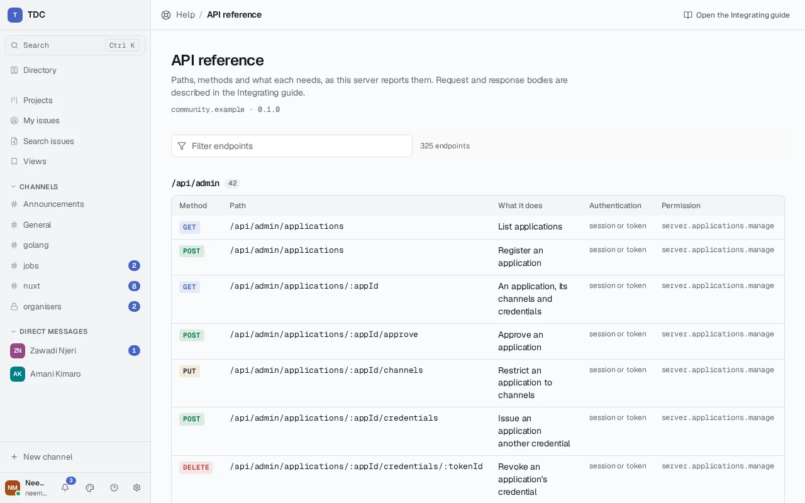
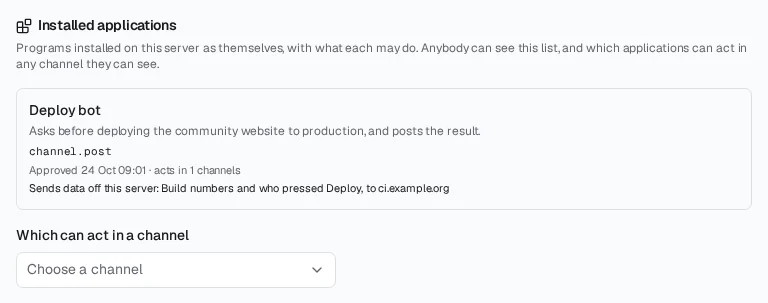

# Integrating with a TDC server

This describes the HTTP API a program can use to read and write a TDC server:
how to authenticate, what the shapes look like, and where the edges are. It is
written for somebody building a bot, a bridge, a script or another client, not
for somebody reading the source.

Every example below runs against a server started with `docker compose up -d`,
reachable on `http://localhost:8080`. Substitute your own address and, if the
server is behind TLS as it should be in anything but a local trial, `https`.

## Shape of the API

Everything lives under `/api`. Requests and responses are JSON, except file
uploads, which are `multipart/form-data`, and file downloads, which are the
file. There is one live connection, a WebSocket at `/api/live`, carrying
everything that happens while a client is connected.



Three endpoints need no credential, because a client needs them before it can
sign in and an uptime check holds no credential:

```sh
curl http://localhost:8080/api/health
curl http://localhost:8080/api/version
curl http://localhost:8080/api/server
```

`/api/health` answers `{"status":"ok","checks":{"database":"ok"}}` with status
200, or the same shape with `"unavailable"` and status 503. It says that the
server is unhealthy and never why: the reason goes to the log, where a caller
with no credential cannot read it.

`/api/version` answers the identity of the build:

```json
{ "version": "0.1.0", "protocolVersion": "tdc/1", "apiVersion": "1" }
```

`commit` and `buildTime` appear too when the binary was built by the release
workflow; a development build omits them. `protocolVersion` is the federation
protocol and `apiVersion` the client API (see [Versions](#versions)); both move
independently of `version`, because the software can be released many times
without either changing.

`/api/server` is what a client reads before it offers anybody a sign-in box —
what the server is called, what it can do, and what it wants clients to do:

```json
{
  "name": "TDC",
  "description": "A Tanzania Developers Community server",
  "canonicalAddress": "localhost:8080",
  "version": "0.1.0",
  "protocolVersions": ["tdc/1"],
  "capabilities": ["attachments", "invitations", "public-directory", "scheduled-messages"],
  "defaultLanguage": "en",
  "obscureSensitiveMedia": true,
  "branding": { "name": "TDC", "initials": "TDC" }
}
```

**Read `capabilities` rather than assuming.** It lists the optional features
this server actually accepts requests for, and it is derived from the same
values the server enforces on — so a name absent from that list is a request
that will be refused, not merely a control a client could hide. A feature that
also needs something configured, such as GIF search needing a provider, appears
only when both hold.

`protocolVersions` lists the federation protocols this server speaks, newest
first, and is empty on a server whose operator has not switched federation on.

One surprise worth knowing: on a server whose visibility is set to private, or
limited to peers you are not among, `/api/server` answers **404**, not 403. A
refusal that distinguished "you may not know" from "there is nothing here" would
answer the question it was refusing.

## Authenticating

There is one credential: an opaque session token. A browser holds it in a
cookie; anything else sends it as a bearer token. They are the same token, and
the server reads whichever arrives.

### Signing in

```sh
curl -X POST http://localhost:8080/api/auth/signin \
  -H 'Content-Type: application/json' \
  -d '{"username":"founder","password":"correct horse battery staple"}'
```

```json
{
  "user": {
    "id": "0d6f…",
    "username": "founder",
    "displayName": "Founder",
    "address": "founder@localhost:8080"
  },
  "token": "…",
  "expiresAt": "2026-10-17T09:15:00Z"
}
```

The response also sets the `tdc_session` cookie, which is what the web client
uses. For an integration, take `token` from the body and send it on every
subsequent request:

```sh
curl http://localhost:8080/api/me \
  -H "Authorization: Bearer $TOKEN"
```

`address` is the federated form, `user@server`, built from the server's
`canonical_address`. It is already in every response that names a person, so
that identifiers stay unambiguous once servers do exchange messages. An operator
who has not set a canonical address gets `localhost` in that position, which is
one of several reasons to set it.

A failed sign-in answers 401 with `{"message":"the username or password is
incorrect"}` — the same message whether or not the account exists.

### API tokens

A program should not be holding somebody's password. Issue it a token instead.
The simplest way is the screen for it — Settings → _API tokens_ in either
client, which names the token, sets its lifetime, lists what it may do and
shows the secret once (see [Using TDC](using-tdc.md#api-tokens)). The same,
from a program signed in as you:

```sh
curl -X POST http://localhost:8080/api/me/tokens \
  -H "Authorization: Bearer $SESSION" \
  -H 'Content-Type: application/json' \
  -d '{"label":"deploy bot","scope":["channel.post","attachment.upload"]}'
```

```json
{
  "id": "…",
  "label": "deploy bot",
  "scope": ["channel.post", "attachment.upload"],
  "created": "2026-09-21T10:00:00Z",
  "token": "tdc_…"
}
```

**`token` is shown once.** It is stored hashed and nobody can recover it, not
even the person who made it — a lost one is replaced rather than found. It
starts `tdc_` so a secret scanner can recognise it as a credential rather than
as an anonymous string.

Use it exactly like a session token, in the same header, on every route:

```sh
curl http://localhost:8080/api/rooms -H "Authorization: Bearer tdc_…"
```

**A token does what its scope names and what its account still holds**, and
never more. The two are intersected on every request rather than frozen when
the token was issued, so taking a role away from an account takes it from that
account's tokens at the same moment. Scope names come from
`GET /api/admin/permissions`; an unknown name is refused rather than ignored,
and one the account does not hold is refused too — a token is a way to delegate
authority, never a way to acquire it.

`expiresAt` is optional. Without it the token does not expire on its own, which
is right for a deployment that runs for years; with it, a token for an
afternoon's script stops mattering by the evening.

`GET /api/me/tokens` lists them without their secrets, including when each was
last used, so a token nobody has touched for a year is easy to spot.
`DELETE /api/me/tokens/{id}` stops one working immediately.

Two things a token deliberately cannot do. It cannot issue another token — a
program able to mint its own successor would make revocation less than final —
and it does not appear in the account's list of signed-in devices, because it is
not one.

**Recovering an account ends every token it held.** A password is changed after
a compromise, and a token minted by whoever had the account is exactly what
would let them back in.

### Signing in as an account instead

A bot may still authenticate as an account somebody made for it, which is what
to do when it needs to act continuously as a distinct identity rather than on
somebody's behalf. Sessions last 30 days by default
(`server.session_lifetime`) and are renewed by use.

### Other ways in

Every way of signing in ends in the same session token. The others are made
for people at a browser rather than for programs, and `/api/server` says which
a server offers (`signInProviders`, `passkeys`, `recovery`):

- **A sign-in provider** (OAuth 2.0 / OpenID Connect, such as GitHub or
  Google, as the operator configured): `GET /api/auth/oauth/:provider/start`
  sends the browser to the provider, which returns it to
  `/api/auth/oauth/callback`; a first sign-in finishes at
  `POST /api/auth/oauth/finish`.
- **A passkey**: `POST /api/auth/passkey/signin/begin` returns WebAuthn options
  for the browser, and `POST /api/auth/passkey/signin/finish` takes the
  browser's answer. Passkeys are added under `/api/me/passkeys`.
- **A second step**, where the account has one: sign-in answers with a ticket
  instead of a token, redeemed at `POST /api/auth/second-factor` with a code,
  or by passkey or emailed code under `/api/auth/second-factor/…`.
- **Recovering a forgotten password**: `POST /api/auth/recover` with the email
  address sends a link to a confirmed address, and always answers the same
  way, so it cannot be used to learn who has an account;
  `POST /api/auth/recover/redeem` sets the new password.

The bodies of each are in [the OpenAPI document](#describing-the-api).

### Signing out

```sh
curl -X POST http://localhost:8080/api/auth/signout \
  -H "Authorization: Bearer $TOKEN"
```

Answers 204 and revokes that one session. A token is not recoverable afterwards.

### First-run setup

A server with no accounts has exactly one way in:

```sh
curl http://localhost:8080/api/setup           # {"setupRequired":true}

curl -X POST http://localhost:8080/api/setup \
  -H 'Content-Type: application/json' \
  -d '{"username":"founder","password":"correct horse battery staple"}'
```

That creates the first administrator and closes the path. Asking again answers
409, and the account cannot be created a second time. There is no default
credential at any point, which is why this endpoint exists at all.

`email` and `displayName` are accepted here too. So is `invitation`, because the
endpoint shares a request shape with registration — but it is ignored, since
there is nobody to have issued one.

### Registering

```sh
curl -X POST http://localhost:8080/api/auth/register \
  -H 'Content-Type: application/json' \
  -d '{"username":"amina","email":"amina@example.org","password":"…","displayName":"Amina"}'
```

Answers 201 with the new account. Under the `invitation` registration policy,
add `"invitation":"<code or token>"`; under `domain`, the email must be in an
admitted domain. A refusal under policy is 403, and a server at its account
limit refuses cleanly before creating anything.

A display name is at most 64 characters and may not carry control or invisible
formatting characters, or spell one of the reserved names; a refusal is 400. A
username somebody else gave up recently is refused as taken (409).

### Changing names

```sh
# The display name: any session or token. Empty means "show my username".
curl -X PUT http://localhost:8080/api/me/display-name \
  -H "Authorization: Bearer $TOKEN" -H 'Content-Type: application/json' \
  -d '{"displayName":"Amina Juma"}'

# Whether the caller may change their username now, and what it will ask.
curl http://localhost:8080/api/me/username -H "Authorization: Bearer $SESSION"

# Whether a name is free for the caller: {"available":false,"reason":"held",...}
curl 'http://localhost:8080/api/me/username/availability?username=amina.j' \
  -H "Authorization: Bearer $SESSION"

# The change itself: a session, never an API token, with the current password.
curl -X PUT http://localhost:8080/api/me/username \
  -H "Authorization: Bearer $SESSION" -H 'Content-Type: application/json' \
  -d '{"username":"amina.j","password":"…"}'
```

`GET /api/me/username` answers `canChange`, and when it is false a `refusal` of
`disabled` (the operator does not allow changes), `federated` (the caller is in
a room another server takes part in, which knows them by address), `waiting`
(changed too recently; `nextChangeAt` says until when) or `token`. It also gives
the operator's `intervalDays` and `holdDays`, `confirm` — `password`, or
`recent-sign-in` for an account with no password, whose session must be under
15 minutes old (`recentSignInUntil`) — and the caller's `formerUsernames`.

Availability answers `reason` `invalid`, `current`, `taken` or `held`. The
change answers 200 with the account, 400 for a name that is malformed or already
the caller's, 403 for a refusal above or a wrong or missing password, 409 for a
name that is taken or held, and 429 past five attempts an hour. A changed
account's `GET /api/me` carries `formerAddresses`, so a client can still treat
messages sent under an old address as the caller's own. Old names keep resolving
to their last owner wherever a username is looked up — profiles, filters,
signing in — until somebody else takes them.

## Versions

The API is served under `/api/v1/…`, and under `/api/…` as well. Every
response from either carries a `TDC-API-Version` header naming the version that
answered.

- **Pin `/api/v1`** in anything you build. When a release changes something a
  client relies on — removes a field, changes what a status means — the change
  ships as `/api/v2`, both are served for at least one release, and the
  release notes say what moved.
- **`/api/…` follows the newest version.** The web and desktop clients use it,
  because they ship with the server and change with it.
- Adding a field, an endpoint or an optional parameter is not a new version.
  Write clients that ignore fields they do not know.
- A version the server does not serve answers 404 with a message naming the
  one it does.

## Describing the API

Two documents describe every endpoint, and both are generated by the server
from its own routing table, so they describe what it serves rather than what
somebody wrote down. Neither needs a credential.

**`GET /api/openapi.json`** is an OpenAPI 3.1 document: every path under
`/api/v1`, its parameters, what a caller must carry and which permission it
needs (as `x-tdc-permission`), and the request and response bodies. The bodies
are the Go types the handlers actually bind and write, found by reading the
handlers, so a schema cannot claim a shape the server does not use. Generate a
client from it:

```sh
curl -o tdc-openapi.json https://your-server/api/openapi.json
npx openapi-typescript tdc-openapi.json -o tdc-api.d.ts
```

Two things it is honest about:

- **Request bodies list no required fields.** The server accepts a body with
  fields missing and treats them as empty; which absences a particular
  endpoint refuses is decided by that endpoint and stated in its error. Send
  what this guide shows.
- **A few operations have no body schema**: the live connection, which is a
  WebSocket described under [The live connection](#the-live-connection), and responses
  streamed as files. They say so instead of inventing one.

**`GET /api/description`** is a smaller list of the same endpoints — method,
path, parameters, authentication and permission — for anyone who wants that
without OpenAPI.

## Errors

Every error is the same shape — one key:

```json
{ "message": "authentication is required" }
```

The status code carries the category and the message carries the detail. A
permission refusal names the permission that would have allowed the request, so
a caller can ask for the right thing rather than guess:

```json
{ "message": "permission channel.create is required" }
```

Nothing else is in the body. A development server with
`server.expose_internal_errors` on adds an `error` key with internal detail, and
that setting exists for local debugging only — it can disclose internals to an
unauthenticated caller, and the server warns about it at startup.

### Rate limits

A refusal for rate is 429 with a `Retry-After` header in seconds. There are no
`X-RateLimit-*` headers; read `Retry-After` and wait.

Signing in is limited per account (8 attempts in 15 minutes, then a 15-minute
lockout) and per source address (30 in 15 minutes, then 5 minutes). The
per-account limit is keyed on a normalised username, so varying the case does
not buy a fresh allowance. A successful sign-in resets it. Registration is
limited to 5 per hour per address.

Filing a report is limited too, and is the one case that answers 429 without a
`Retry-After` header.

## Rooms

A room is a channel, a thread's parent, a direct conversation or a disposable
chat — one type with a `kind`.

```sh
curl http://localhost:8080/api/rooms -H "Authorization: Bearer $TOKEN"
```

```json
[
  {
    "id": "5a1c…",
    "slug": "general",
    "name": "General",
    "topic": "Anything",
    "kind": "channel",
    "visibility": "public",
    "address": "general@localhost:8080",
    "archived": false,
    "member": true
  }
]
```

`retentionSeconds` and `retentionFromChannel` appear when a retention period
applies, the latter saying whether it came from the channel rather than the
server-wide default.

Creating one takes the `channel.create` permission:

```sh
curl -X POST http://localhost:8080/api/rooms \
  -H "Authorization: Bearer $TOKEN" \
  -H 'Content-Type: application/json' \
  -d '{"slug":"general","name":"General","topic":"A channel to look at"}'
```

Answers 201 with the room. `visibility` may be `public` or `private`; `kind` may
be `channel` or `disposable`, and a disposable room must also give a positive
`messageTtlSeconds` or it is refused with a message saying so.

A private room a caller cannot see answers 404 rather than 403, throughout. A
non-member cannot distinguish "forbidden" from "does not exist", which is the
point.

### Looking after a channel

Each of these needs its permission in the channel the path names — granted
there, or for the whole server — and the caller must be a member:

| Route                                   | Permission              | Does                                          |
| --------------------------------------- | ----------------------- | --------------------------------------------- |
| `PATCH /api/rooms/:id`                  | `channel.rename`        | `{"name"?, "topic"?}`; absent leaves it as is |
| `PUT /api/rooms/:id/visibility`         | `channel.rename`        | `{"visibility": "public" \| "private"}`       |
| `POST /api/rooms/:id/archive`           | `channel.archive`       | Archive: history kept, posting refused        |
| `DELETE /api/rooms/:id/archive`         | `channel.archive`       | Restore                                       |
| `DELETE /api/rooms/:id/members/:userId` | `channel.member.remove` | Take somebody out; not a ban                  |
| `GET /api/rooms/:id/administration`     | —                       | Which of the above the caller may do here     |

Each answers 200 with the room as it now is, except removal, which answers 204.
Making a channel **public** additionally needs `channel.rename` for the whole
server, since it opens the channel's entire history to everybody; a grant for
the one channel is refused with 403. Asking for what is already so succeeds and
records nothing.

Each change becomes an event in the channel — `room.renamed`,
`room.visibility_changed`, `room.archived`, `room.restored`, `member.removed` —
delivered live like any other, and an audit entry. The person removed is sent
their `member.removed` event on their own connections, since they are no
longer among the channel's members by the time it is delivered.

A direct conversation, a project's stream, an issue's discussion and a channel
another server owns answer **409** to all of these, as does renaming or
changing the visibility of an archived channel, and changing the visibility of
a channel shared with other servers. A name is at most 80 characters and a
topic 500; longer answers 400.

`PATCH /api/rooms/:id/messages/:eventId` edits somebody else's message for a
caller holding `message.edit.any` in that channel. The edit is the caller's
event, its content carries `"byModerator": true`, and a deleted message cannot
be edited.

### Reading a timeline

```sh
curl "http://localhost:8080/api/rooms/$ROOM/timeline" \
  -H "Authorization: Bearer $TOKEN"
```

```json
[
  {
    "id": "b14e…",
    "type": "message.sent",
    "sender": "founder@localhost:8080",
    "sequence": 1,
    "content": { "body": "Hello" },
    "sentAt": "2026-09-17T09:02:11Z",
    "redacted": false
  }
]
```

**The timeline takes no parameters and is not paginated.** It returns the 100
most recent events in the room, oldest first, with thread replies excluded.
There is no `limit`, `before`, `after` or cursor. An integration that needs more
history than that has no endpoint for it today, and an integration that needs to
keep up with a busy room should hold the live connection rather than poll — the
live connection replays what was missed, which is the mechanism that exists for
this.

`content` is passed through as the raw event content, so its shape depends on
the event type. `sequence` is per-room and monotonic, and is the number to
remember for replay.

**A body is Markdown source.** `content.body` is exactly what its author typed,
formatting marks included — `**deploy** is done`, a fenced code block, a list.
The clients render it; nothing on the server converts it, and nothing is lost
by reading it as text. An integration that shows messages somewhere that cannot
render Markdown should strip the marks itself, as the server does for
notifications, push and search: keep the words, the contents of code and the
addresses of links, and drop the rest.

### Sending a message

```sh
curl -X POST "http://localhost:8080/api/rooms/$ROOM/messages" \
  -H "Authorization: Bearer $TOKEN" \
  -H 'Content-Type: application/json' \
  -d '{"body":"Hello from a script","clientToken":"3f9a2c7e-1"}'
```

Answers **201** with the created message in the same shape the timeline returns.

**What to send.** The body is rendered as Markdown, exactly as a person's
message is, so a bot can and should format: a fenced code block for a log
excerpt or a command (with a language after the fence for colours), `**bold**`
for the one word that matters, a list for several items, `[text](https://…)`
for a link with a readable name. Raw HTML is shown as text, never rendered;
images in Markdown become links (attach the file instead); headings are drawn
as a bold line; tables are shown as typed. A body that is plain text renders as
plain text, so an integration written before formatting existed looks the same.
Notifications, push and search see the same message with its marks removed.

`clientToken` is the idempotency key, and an integration should always send one.
Generate it before the first attempt and reuse it on every retry: a repeat with
the same token returns the original message rather than posting a second one.
Without it, a request that succeeded on the server and failed on the way back
becomes a duplicate message every time the caller retries.

`attachmentIds` carries files uploaded beforehand — see below.

Editing and deleting are `PATCH` and `DELETE` on
`/api/rooms/:id/messages/:eventId`, and both also answer **201** with the
resulting message rather than 200 or 204. Deleting leaves a placeholder rather
than removing the event: a deleted message leaves evidence that something was
there.

### Replying in a thread

```sh
curl -X POST "http://localhost:8080/api/rooms/$ROOM/threads/$MESSAGE/replies" \
  -H "Authorization: Bearer $TOKEN" \
  -H 'Content-Type: application/json' \
  -d '{"body":"Deployed.","clientToken":"3f9a2c7e-2"}'
```

**A reply takes exactly what a message takes** — `body`, `clientToken`,
`attachmentIds` and `actions` — and is refused for the same reasons, through
the same code: a ban or posting restriction, the content filter, files that are
not yours to attach, buttons that do not check out. It answers **201** with the
reply, whose `threadRoot` names the thread. Replying to a reply joins the same
thread rather than nesting.

A reply never appears in `/timeline`. `GET /api/rooms/:id/threads/:eventId`
returns `{root, replies, readSequence, following}`, where `replies` is every
event in the thread oldest first — replies, and the edits, deletions and
controls updates of them, which carry `threadRoot` too and are folded the way
a timeline is. Asked with a reply's id, it answers with the thread that reply
is in. `GET /api/rooms/:id/threads` gives `{replyCount, lastReplyAt, unread}`
per thread, where `unread` counts only in threads the caller follows. On the
live connection an event with `threadRoot` belongs to that thread.

Starting a thread or replying in one follows it; `PUT` and `DELETE` on
`/api/rooms/:id/threads/:eventId/follow` follow or stop following explicitly,
which later replies do not override. A reply notifies the thread's followers
and the people it mentions, nobody else. `POST
/api/rooms/:id/threads/:eventId/read` with `{"sequence": n}` records how far
the caller has read; it never moves backwards. Reactions on a thread are
`GET /api/rooms/:id/reactions?thread=:eventId`. Typing in a thread is
`POST /api/rooms/:id/typing` with `{"threadRoot": ":eventId"}`, and the typing
list names the thread for anybody writing in one.

A channel's unread count leaves replies out; each thread keeps its own.

### Offering a choice

A message may carry buttons:

```sh
curl -X POST "http://localhost:8080/api/rooms/$ROOM/messages" \
  -H "Authorization: Bearer $TOKEN" \
  -H 'Content-Type: application/json' \
  -d '{
    "body": "Deploy to production?",
    "clientToken": "3f9a2c7e-2",
    "actions": [
      {"name": "deploy", "label": "Deploy", "once": true},
      {"name": "hold",   "label": "Not yet"},
      {"name": "log",    "label": "See the build", "capability": "open",
       "url": "https://ci.example.test/builds/41"}
    ]
  }'
```

`name` is what a press reports back, so your program can tell which button it
was without matching on a label somebody may translate. `label` is what a
reader sees. At most five per message.

**There is a boundary worth understanding.** Almost every action does one
thing: a press becomes an event to whoever posted the message, and your program
decides what it means. Your program is the only thing that knows, so it is the
only thing that decides.

The exception is a short, fixed set of things a **client** does by itself,
named by `capability`. There is one today:

| Capability | What it does                       |
| ---------- | ---------------------------------- |
| `open`     | Opens `url`, which must be http(s) |

**A capability this server does not declare is refused when you post the
message**, with a 400 naming what was refused — not when somebody presses the
button. A message that reached the channel and then failed on being touched has
already been read, and somebody has already decided the button was worth
trusting. `javascript:`, `data:` and `file:` links are refused for the same
reason.

`once` makes an action pressable one time in total, by anybody, and `expires`
gives it a deadline. Both are enforced by the server so your program does not
have to defend against replay itself.

A message carrying no `actions` is exactly the message it was before this
existed — the key is absent rather than empty, and nothing extra to parse.

### Hearing that somebody pressed

A press becomes an event in the room, which is how it reaches you: over the
live connection you already hold, through the same delivery every other event
uses.

A program that cannot hold a connection open — one that runs only when called —
can be installed as an [application](webhooks-and-apps.md#applications) with an
invocation address instead, and each press on its messages is delivered there,
signed and retried as a webhook's delivery is. The
[worked example](#the-same-program-with-no-connection-held) does it both ways.

```json
{
  "type": "action.pressed",
  "sender": "juma@chat.example.test",
  "content": { "action": "deploy", "pressed": "$abc123…" }
}
```

`action` is the `name` you gave the button. `pressed` is the message it was on.
`sender` is who pressed it — established by the server from the authenticated
request, so it is not something a client can claim.

**Exactly once.** The same person pressing the same button twice is refused
with **409**: a repeat is a retry or a mistake, and a program receiving two
events for one decision cannot tell that from somebody changing their mind. An
action marked `once` is stricter — one press in total, by anybody — so a
question offered to a room is answered once. A press after `expires` is **410**,
and a press naming a button the message does not offer is **404**.

You never have to defend against replay yourself. That is a database rule here,
not something the application remembers.

To press one as a client:

```sh
curl -X POST \
  "http://localhost:8080/api/rooms/$ROOM/messages/$EVENT/actions/deploy" \
  -H "Authorization: Bearer $TOKEN"
```

Answers **201** with the `action.pressed` event. Pressing needs membership of
the channel, not merely the ability to read it — answering a question in a
channel is taking part in it.

### Menus and fields

Buttons answer yes-or-no questions. A **menu** offers a list to choose one
from, and a **field** asks for a short line of text. Both sit in `actions`
beside buttons, marked by `kind`:

<!-- demo: post-menu -->

```sh
curl -X POST "http://localhost:8080/api/rooms/$ROOM/messages" \
  -H "Authorization: Bearer $TOKEN" \
  -H 'Content-Type: application/json' \
  -d '{
    "body": "Build 41 is ready. Where should it go?",
    "clientToken": "3f9a2c7e-3",
    "actions": [
      {"name": "environment", "label": "Environment", "kind": "select",
       "options": [{"value": "staging", "label": "Staging"},
                   {"value": "production", "label": "Production"}]},
      {"name": "note", "label": "Release note", "kind": "input",
       "placeholder": "What changed?", "maxLength": 120}
    ]
  }'
```

| Field         | Applies to | Meaning                                                             |
| ------------- | ---------- | ------------------------------------------------------------------- |
| `kind`        | all        | Absent for a button; `select` for a menu; `input` for a field       |
| `options`     | `select`   | One to 25 choices, each `value` (reported back) and `label` (shown) |
| `placeholder` | `input`    | A hint while the field is empty, at most 80 characters              |
| `maxLength`   | `input`    | The most that may be typed, at most 200 — also the default          |
| `requires`    | all        | A permission the person answering must hold in this channel         |

The same rule as buttons applies: **a malformed control is refused when you
post it**, with a 400 naming what was wrong, and the message is not posted. A
menu with no options or more than 25, two options sharing a value, a field with
no `name` to report its value under, a `capability` on anything but a button, or
a `kind` this server does not know are all refused.

A press of a menu or a field carries a `value`, and the server checks it against
what you offered before you ever see it: a choice that is not one of your
`options`, or text longer than your `maxLength`, is refused with **400**. You
receive only what your control allowed.

```json
{
  "type": "action.pressed",
  "sender": "juma@chat.example.test",
  "content": { "action": "environment", "pressed": "$abc123…", "value": "staging", "version": 0 }
}
```

`requires` is checked against the **person answering**, never against you: a
control restricted to `moderation.review` refuses anybody who does not hold it
in that channel with **403**, and the press never reaches you at all.

A client that meets a `kind` it does not understand leaves that control out and
shows the rest of the message — it never draws an unknown control as a button.

### Answering a press

A program told that somebody pressed has three ways to answer. Posting an
ordinary message is the first and needs nothing new. The other two follow.

**Replace the message's text and controls**, so everybody sees that the
question has been answered:

<!-- demo: update-controls -->

```sh
curl -X PUT "http://localhost:8080/api/rooms/$ROOM/messages/$EVENT/controls" \
  -H "Authorization: Bearer $TOKEN" \
  -H 'Content-Type: application/json' \
  -d '{
    "version": 0,
    "body": "Build 41 is going to staging, at Juma'"'"'s word.",
    "actions": [{"name": "rollback", "label": "Roll back"}]
  }'
```

Only the message's author may. The answer is **200** with the new
`message.updated` event and the `version` now current. Every reader's client
receives that event over the live connection and redraws the message in place.

`version` is the version you are replacing — zero for a message as posted, then
one more for each update. **The update is applied only if that is still the
current version**; otherwise it is refused with **409**. That is a database
rule, not a check this server makes before writing: two answers to the same
press, racing, produce one update and one 409, however they interleave. When
you get a 409, read the message again and decide afresh.

Every press carries the `version` of the controls it answered, and a client
sends the version it was showing. **A press through a view that has since been
replaced is refused with 409** rather than counted against the new question —
the person answered what they were shown. A press naming no version is judged
against whatever is current, and refused if the control no longer exists.

**Reply to the person who pressed, and nobody else**:

<!-- demo: private-reply -->

```sh
curl -X POST "http://localhost:8080/api/rooms/$ROOM/presses/$PRESS/reply" \
  -H "Authorization: Bearer $TOKEN" \
  -H 'Content-Type: application/json' \
  -d '{"body": "Only you can see this: staging is locked until 17:00."}'
```

`$PRESS` is the `id` of the `action.pressed` event, not a person. You can only
answer somebody who pressed one of **your** messages, only within **15 minutes**
of the press, and only while they are still in the channel — there is no way to
use this to reach somebody who did not ask.

The reply never enters the room's log. It is sent over the live connection to
the presser's open connections as a frame of its own:

```json
{
  "type": "private",
  "roomId": "5a1c…",
  "payload": {
    "id": "…",
    "press": "$def456…",
    "message": "$abc123…",
    "sender": "deploybot@chat.example.test",
    "body": "…",
    "createdAt": 1758099731000
  }
}
```

The answer is **201** with `{"delivered": 1}` — how many of their connections
received it. **Nothing is kept.** Somebody not connected when you reply does not
see it later, so post an ordinary message for anything that must not be missed.
On a server running several nodes it reaches their connections on every node,
and the count includes them — an answer may take up to a second longer while
the other nodes say they have it.

### Remembering an exchange

A program asking a follow-up question needs to know what was said at the last
step. Keep it here rather than in a database of your own — it is bound to the
conversation and the person, and it goes when either does:

<!-- demo: context -->

```sh
# Remember where this exchange got to.
curl -X PUT "http://localhost:8080/api/rooms/$ROOM/context/$PERSON" \
  -H "Authorization: Bearer $TOKEN" \
  -H 'Content-Type: application/json' \
  -d '{"state": {"build": 41, "step": "chose-environment"}}'

# Read it back at the next step.
curl "http://localhost:8080/api/rooms/$ROOM/context/$PERSON" \
  -H "Authorization: Bearer $TOKEN"
```

`$PERSON` is the presser's account identifier. The state is any JSON up to 16
KiB. `DELETE` on the same path ends the exchange.

**What you store is readable by you and nobody else.** There is no parameter
naming the program: whoever calls is the program, so another program, the
person it is about, and an administrator using these endpoints all find nothing
(**404**). It is discarded when your account is removed, when the conversation
is, or when you `DELETE` it. Both you and the person must be in the room.

### Throttling

Presses are limited per person (`integrations.presses_per_user_per_minute`,
default 30) and per program, counting every press of that program's controls
by everybody together (`integrations.presses_per_integration_per_minute`,
default 600). Past either, a press is refused with **429** and `Retry-After`.

### Attachments

A file is uploaded to the room first, and the returned identifier is then
attached to a message. That order is deliberate — a refusal costs only the
upload, and a message that fails to send does not take the file with it.

```sh
curl -X POST "http://localhost:8080/api/rooms/$ROOM/attachments" \
  -H "Authorization: Bearer $TOKEN" \
  -F file=@diagram.png
```

Then send a message with `{"body":"…","attachmentIds":["<id>"]}`.

Ask what the server will accept before uploading:

```sh
curl http://localhost:8080/api/attachments/limits -H "Authorization: Bearer $TOKEN"
```

which gives `maxFileSize`, `maxMessageSize`, `maxPerMessage`, `allowedTypes` and
`blockedTypes`. The server enforces all of them regardless of what a client
checked, and a refusal names the limit that was broken. The declared content
type is not believed: the type is detected from the file's own bytes, and that
detected type is what governs.

Downloading is `GET /api/attachments/:id`, authenticated and authorised —
knowing where a file is stored grants nothing on its own.

## The live connection

One WebSocket at `/api/live` carries messages, presence, typing and read state
while a client is connected.

It authenticates exactly like every other route: the `tdc_session` cookie, or an
`Authorization: Bearer` header. There is no token query parameter. A browser
cannot set headers on a WebSocket handshake and so relies on the cookie; a
non-browser client can send the header, which is what the desktop client does.

The connection's origin is checked against `server.allowed_origins`, falling
back to the server's own canonical address when that list is empty.

Immediately after the upgrade the server sends:

```json
{ "type": "ready" }
```

Then subscribe to the rooms you care about, naming the last sequence you hold
for each:

```json
{
  "action": "subscribe",
  "rooms": ["5a1c…"],
  "since": { "5a1c…": 41 }
}
```

The server answers `{"type":"subscribed","roomId":"5a1c…"}` and replays whatever
was missed. Subscriptions change on a live connection — there is no need to
reconnect to add or drop a room.

Frames from the server carry a `type`:

- `ready` — the connection is established.
- `subscribed` — with `roomId`.
- `event` — with `room` (the `room@server` address), `roomId`, `sequence` and
  `payload`.
- `resync` — with `roomId`. The gap was too large to replay, so fetch the
  timeline afresh.
- `pong` — the answer to `{"action":"ping"}`.
- `error` — with `payload` `{"message":"…"}`.

An `event` payload looks like:

```json
{
  "id": "b14e…",
  "type": "message.sent",
  "sender": "founder@localhost:8080",
  "content": { "body": "Hello" },
  "createdAt": 1758099731000,
  "redacted": false
}
```

`type` is the event's own type — the same string the timeline gives. The ones a
program usually cares about are `message.sent`, `message.edited`,
`message.deleted` and `action.pressed`.

**Note the time encoding differs from the REST API.** Here `createdAt` is epoch
milliseconds as a number; the REST timeline gives `sentAt` as an RFC 3339
string. Same instant, two encodings, and a client reading both needs to handle
each.

The other actions a client may send are `unsubscribe` (same shape as
`subscribe`), `ping`, and `viewing` with a single `room` — the conversation
currently on screen, which is how the server knows not to raise a notification
for something the person is already looking at. An empty `room` means none.

Keepalives are WebSocket protocol pings sent by the server every 45 seconds by
default (`server.keepalive`), not JSON frames. An idle connection therefore
carries no application traffic at all, which is what makes it cheap on a phone's
metered data. The JSON `ping`/`pong` pair is separate and optional.

Two bounds worth designing around: a client message is limited to 16 KiB, and a
client that cannot keep up with its send queue is disconnected rather than
buffered indefinitely. Reconnect with randomised backoff — a fleet that all
dropped together and reconnected in lockstep would arrive as one spike.

Fanout is scoped by authorisation on every frame, and that is evaluated live. A
member removed from a channel stops receiving its events immediately, without
the connection being re-established.

## Signed deliveries

Some things arrive at **your** endpoint rather than over a connection you
opened: the events an outgoing webhook subscribes to, and presses on a message
your program posted. Your endpoint has no session with this server, so each
delivery carries what you need to prove, from the request alone, that this
server sent it, that nothing in it changed on the way, and that it is not an old
delivery played back.

Every delivery is a `POST` with a JSON body and these headers:

| Header               | What it is                                                          |
| -------------------- | ------------------------------------------------------------------- |
| `TDC-Delivery`       | The delivery's identifier — the same across retries of one delivery |
| `TDC-Event`          | What kind of delivery it is, e.g. `message.sent` or `delivery.test` |
| `Content-Digest`     | `sha-256=:<base64>:`, the SHA-256 of the body (RFC 9530)            |
| `Signature-Input`    | `tdc=("content-digest" "tdc-delivery");created=…;keyid="…";alg=…`   |
| `Signature`          | `tdc=:<base64>:`, an Ed25519 signature (RFC 9421 shape)             |
| `TDC-Signature-HMAC` | `t=<unix seconds>,v1=<hex>`, present when you were given a secret   |

There are **two** signatures, for two kinds of receiver. Check whichever suits
you; both are always valid together.

**The Ed25519 signature proves the delivery came from this server** with nothing
shared in advance. It is made with the key the server signs its event log with,
and the keys are published, without any credential, at:

```sh
curl http://localhost:8080/.well-known/tdc-delivery-keys
```

```json
{
  "algorithm": "ed25519",
  "replayWindowSeconds": 300,
  "keys": [{ "id": "…", "publicKey": "<base64url, 32 bytes>" }]
}
```

Retired keys stay in that list, marked `"retired": true`, because they still
verify what they signed. Cache the document; fetch it again when a delivery
names a `keyid` you do not have, which is what a rotation looks like.

The signature is over exactly these bytes, lines joined by `\n` with none after
the last:

```text
"content-digest": sha-256=:…:
"tdc-delivery": 0199f1f2-…
"@signature-params": ("content-digest" "tdc-delivery");created=1758099731;keyid="…";alg="ed25519"
```

The last line repeats `Signature-Input` after its `tdc=`. Not the method, path
or host: a receiver behind a proxy often sees all three rewritten, and a
signature that failed there would be one nobody could use. The delivery's
identifier is covered instead, so a signature cannot be moved onto a different
delivery.

**The HMAC is the check most webhook receivers already know.** It is
HMAC-SHA256, keyed with the secret you set, over `<t>.<body>` — the timestamp
from the header, a full stop, and the raw body.

**Both cover a timestamp, and that is what bounds a replay.** Refuse any
delivery whose signed time — `created`, or the HMAC's `t` — is more than **five
minutes** from your own clock, in either direction. Both are Unix seconds, so
there is no timezone to get wrong. A retry is signed afresh when it is sent, so
a delivery retried an hour later still arrives inside its own window. To refuse
a replay _inside_ the window as well, remember the `TDC-Delivery` identifiers
you have handled for five minutes; you want that anyway, because retries mean
you may receive one delivery more than once.

### Verifying a delivery

In TypeScript, for Bun or Node, with nothing but the standard library. Hand it
the request's headers, the body exactly as received — verify before parsing,
since re-serialised JSON is different bytes — and the published keys:

<!-- demo: verify-delivery -->

```ts
import { createHash, createHmac, createPublicKey, timingSafeEqual, verify } from "node:crypto";

export const REPLAY_WINDOW_SECONDS = 300;

type PublishedKey = { id: string; publicKey: string };

function withinWindow(created: number, now: number) {
  if (!Number.isInteger(created) || Math.abs(now / 1000 - created) > REPLAY_WINDOW_SECONDS) {
    throw new Error("the delivery was signed outside the replay window");
  }
}

/** Throws unless the delivery was signed by the server publishing `keys`. */
export function verifyDelivery(
  headers: Headers,
  body: string,
  keys: PublishedKey[],
  now = Date.now(),
): void {
  const input = headers.get("signature-input") ?? "";
  const signature = headers.get("signature") ?? "";
  const digest = headers.get("content-digest") ?? "";
  const delivery = headers.get("tdc-delivery") ?? "";

  const params = input.replace(/^tdc=/, "");
  if (params === input || !/\("content-digest" "tdc-delivery"\)/.test(params)) {
    throw new Error("the signature does not cover what it must");
  }
  const created = Number(/;created=(\d+)/.exec(params)?.[1]);
  const keyId = /;keyid="([^"]+)"/.exec(params)?.[1];
  withinWindow(created, now);

  const sum = createHash("sha256").update(body).digest("base64");
  if (digest !== `sha-256=:${sum}:`) throw new Error("the body does not match its digest");

  const key = keys.find((candidate) => candidate.id === keyId);
  if (!key) throw new Error(`unknown key ${keyId}: fetch the published keys again`);

  const base =
    `"content-digest": ${digest}\n` +
    `"tdc-delivery": ${delivery}\n` +
    `"@signature-params": ${params}`;
  const publicKey = createPublicKey({
    key: { kty: "OKP", crv: "Ed25519", x: key.publicKey },
    format: "jwk",
  });
  const bytes = Buffer.from(signature.replace(/^tdc=:/, "").replace(/:$/, ""), "base64");
  if (!verify(null, Buffer.from(base), publicKey, bytes)) {
    throw new Error("the signature does not verify");
  }
}

/** Throws unless the delivery carries a valid HMAC for `secret`. */
export function verifyHMAC(headers: Headers, body: string, secret: string, now = Date.now()): void {
  const header = headers.get("tdc-signature-hmac") ?? "";
  const created = Number(/(?:^|,)t=(\d+)/.exec(header)?.[1]);
  const claimed = /(?:^|,)v1=([0-9a-f]+)/.exec(header)?.[1] ?? "";
  withinWindow(created, now);

  const expected = createHmac("sha256", secret).update(`${created}.${body}`).digest("hex");
  if (
    claimed.length !== expected.length ||
    !timingSafeEqual(Buffer.from(claimed), Buffer.from(expected))
  ) {
    throw new Error("the HMAC does not match");
  }
}
```

And a receiver using it, which answers 2xx only once a delivery has checked
out — anything else is retried by the server, which is what you want for a
delivery you could not prove:

<!-- demo: delivery-receiver -->

```ts
import { verifyDelivery } from "./verify-delivery";

const SERVER = process.env.TDC_SERVER ?? "http://localhost:8080";
let keys = (await (await fetch(`${SERVER}/.well-known/tdc-delivery-keys`)).json()).keys;

Bun.serve({
  port: 9000,
  async fetch(request) {
    const body = await request.text();
    try {
      verifyDelivery(request.headers, body, keys);
    } catch (error) {
      // A key rotated since the list was fetched: refetch once, then retry.
      keys = (await (await fetch(`${SERVER}/.well-known/tdc-delivery-keys`)).json()).keys;
      try {
        verifyDelivery(request.headers, body, keys);
      } catch {
        return new Response(String(error), { status: 401 });
      }
    }
    const delivery = JSON.parse(body);
    console.log(request.headers.get("tdc-event"), delivery.id);
    return new Response(null, { status: 204 });
  },
});
```

### Outgoing webhooks

A webhook sends a channel's, a project's or the whole server's events —
messages, joins, calls, issues, milestones, new accounts — to your endpoint as
they happen, signed as
above, retried with backoff when your endpoint fails, and turned off — with its
owner told — when it keeps failing. Subscribing, the payload and its versions,
retries, limits, the delivery history and the full event catalogue are all in
[Webhooks and applications](webhooks-and-apps.md#outgoing-webhooks).

### Incoming webhooks

The other direction: an address another system posts into one channel through,
with no account or token — a build server, an alerting tool. Its messages are
marked as the webhook's, it can post nowhere else, and revoking it is final on
the next call. Making one, posting, formatting and limits are in
[Webhooks and applications](webhooks-and-apps.md#incoming-webhooks).

### Applications

A program installed on the server as itself, with an account and permissions of
its own rather than somebody's borrowed: registered, approved by somebody shown
exactly what it will hold, restricted to the channels they choose, and visible
to everybody on the server. Its credential is a bearer token used exactly as
those above are. Registering, approval, what it may call, rotation and removal
are in [Webhooks and applications](webhooks-and-apps.md#applications).



### Sending yourself a test delivery

Before anything depends on your receiver, ask the server to send it one:

<!-- demo: test-delivery -->

```sh
curl -X POST http://localhost:8080/api/integrations/test-delivery \
  -H "Authorization: Bearer $TOKEN" \
  -H 'Content-Type: application/json' \
  -d '{"url": "https://hooks.example.test/tdc", "secret": "the secret you will use"}'
```

```json
{ "id": "0199f1f2-…", "delivered": true, "status": 204 }
```

It is signed exactly as every other delivery, with `TDC-Event: delivery.test`,
and it goes through everything a real one does: the same destination check, the
same guard at connection time, the same timeout. `delivered` is true only for a
2xx answer; otherwise `status` or `error` says what happened, and `response`
carries the start of what your receiver said. Ten a minute per account.

**An endpoint on a private network is refused** — loopback, `10.0.0.0/8`,
`192.168.0.0/16`, link-local, and the rest of the reserved ranges — with
**403**, both when you name it and again when a delivery connects, so a name
that resolves somewhere else a moment later gains nothing. Redirects are never
followed: a 3xx is your receiver's answer, recorded as a failure. An operator
whose receivers genuinely live beside the server turns on
`integrations.allow_private_addresses`; see the hosting guide.

## Calls

Where the operator has switched calls on (`capabilities` includes `calls`), any
channel or direct conversation can hold one voice or video call. Media goes
directly between the participants over WebRTC; the server records who is in
the call and relays their negotiation, and never carries the media itself.

| Request                                                                                         | What it does                                                                                                                                                                                                                                             |
| ----------------------------------------------------------------------------------------------- | -------------------------------------------------------------------------------------------------------------------------------------------------------------------------------------------------------------------------------------------------------- |
| `GET /api/calls/ice`                                                                            | STUN and TURN servers to connect through, with short-lived TURN credentials                                                                                                                                                                              |
| `GET /api/rooms/:id/call`                                                                       | The call in progress in a conversation, and who is in it                                                                                                                                                                                                 |
| `POST /api/rooms/:id/call`                                                                      | Join it, starting one if there is none — `{"audio": true, "video": false}`                                                                                                                                                                               |
| `PATCH /api/rooms/:id/call`                                                                     | Say what you are sending, and whether you are holding the call — `{"audio", "video", "held"}`                                                                                                                                                            |
| `DELETE /api/rooms/:id/call`                                                                    | Leave                                                                                                                                                                                                                                                    |
| `POST /api/rooms/:id/call/ring`                                                                 | Ring people into it — `{"users": [ids]}`; empty rings everybody else in a direct conversation                                                                                                                                                            |
| `POST /api/rooms/:id/call/decline`                                                              | Decline a ring, optionally with `{"message": "…"}` for the caller                                                                                                                                                                                        |
| `PUT`/`DELETE /api/rooms/:id/call/hand`, `DELETE …/hand/:userId`                                | Raise or lower your hand (`handRaisedAt` on the participant, oldest first); lowering somebody else's needs to be the presenter or hold `moderation.restrict`                                                                                             |
| `POST /api/rooms/:id/call/reactions`                                                            | `{"kind": "clap"}` — one of `clap`, `laugh`, `heart`, `thumbs_up`, `surprise`, `celebrate` — passed to the call's participants as `call.reaction` and kept nowhere; 20 per person every 10 seconds                                                       |
| `PUT`/`DELETE /api/rooms/:id/call/stage`                                                        | Start or stop presenting your screen; a second presenter is refused with 409 while the first is on the stage. `DELETE …/stage/presenter` takes whoever presents off it (needs `moderation.restrict`)                                                     |
| `POST /api/rooms/:id/call/invite`                                                               | Merge: invite the people of another call you are in, `{"users": [ids]}`                                                                                                                                                                                  |
| `GET`/`POST`/`DELETE /api/rooms/:id/call/links[/:linkId]`                                       | List, make (`{label, passcode, lobby, expiresInHours, maxUses}`) and withdraw links to the call; needs `call.link`. The secret is in the answer to making one, and only there                                                                            |
| `GET /api/call-links/:secret`                                                                   | What a link leads to — the conversation's name, who is in the call, whether it asks for a passcode or has a lobby. No credential needed                                                                                                                  |
| `POST /api/call-links/:secret/guest`                                                            | Join without an account — `{"name", "passcode"}` — where the link and the server allow guests. Answers a session `token` for that call alone (also set as the cookie) and the same `use` as joining. The session reaches only that call and ends with it |
| `POST /api/call-links/:secret/join`                                                             | Use a link, with `{"passcode"}` where it has one: answers the call to join, or `waiting: true` in its lobby                                                                                                                                              |
| `GET /api/calls/:callId/lobby`, `POST …/lobby/:userId/admit` or `…/turn-away`, `DELETE …/lobby` | Who is waiting; let them in or turn them away (people in the call who belong to its conversation only); stop waiting                                                                                                                                     |
| `GET`/`POST`/`PATCH`/`DELETE /api/calls/:callId`                                                | The same, by the call's own identifier — how somebody merged in, who is not in the conversation, reaches it                                                                                                                                              |

Starting needs `call.start` and joining `call.join`. Ringing answers who was
rung and only a count of who was not: whether somebody accepts calls from you is
theirs, and the reason is never disclosed. Rings are limited per caller.

**On the live connection**, a call sends these frames:

- `call.state` — the call as it now stands, whenever somebody joins, leaves or
  changes what they send, with `presenter` naming whoever is on the stage.
- `call.ring` — somebody is calling you: the call, the conversation, who is
  calling, and `conference: true` when it is an invitation into a merged call,
  which names nothing of the conversation.
- `call.ring_ended` — stop ringing: answered on another device, declined, or
  given up after 45 seconds (which leaves a `missed_call` notification).
- `call.declined` — somebody you rang declined, with their message if any.
- `call.signal` — another participant's WebRTC negotiation for you.
- `call.reaction` — a passing reaction somebody in the call sent.
- `call.lobby` — who is waiting to be let into a call you are in.
- `call.admitted` / `call.turned_away` — you, waiting in a lobby, were let in
  or not.

A protected link's passcode is refused from one address after ten tries in
fifteen minutes, and the link itself refuses every passcode — the right one
too — after twenty wrong ones in fifteen minutes. Every wrong passcode is in the
audit log as `call.link.passcode_failed`.

Negotiation is sent on the same connection:

```json
{ "action": "signal", "call": "<call id>", "to": "<user id>", "signal": { "description": { … } } }
```

`signal` carries either a session `description` or an ICE `candidate`, and is
checked on every frame: both people must be in that call now and allowed to
take part, or it is dropped.

## Search

Two endpoints, both taking the search text as `q`:

```sh
curl "http://localhost:8080/api/search?q=deployment" \
  -H "Authorization: Bearer $TOKEN"

curl "http://localhost:8080/api/search/everything?q=amina" \
  -H "Authorization: Bearer $TOKEN"
```

`/api/search` searches messages. `/api/search/everything` searches messages,
conversations and people together in one request, each kind capped separately
and kept small, because it is built to run on every keystroke of a search box.

They are `GET` requests deliberately, so that a search is shareable and
bookmarkable — the term is the caller's own words about their own conversations.

Authorisation is enforced on every result. Search never returns a message from a
channel the caller cannot read, or a channel they could not otherwise discover.
An empty `q` matches nothing rather than everything.

Nothing you can put in `q` produces a syntax error. The text is treated as words
to find rather than as a query language, so a caller passing through whatever a
user typed does not need to sanitise it.

## Cross-origin requests

A browser-based integration served from another origin needs that origin in
`server.allowed_origins`, which the operator sets. When the list is empty the
CORS middleware is not mounted at all, and no CORS headers appear on any
response — which is correct for the normal deployment, where the web app is
served from the same origin as the API.

Origins are matched exactly. There are no wildcards and no reflection of
arbitrary origins.

There is no CSRF token. What protects a cookie session is `SameSite=Lax` on the
cookie together with that origin allowlist. An integration using a bearer token
is not exposed to the question at all, and a bearer token is the right choice
for anything that is not a browser.

## Federated rooms

**Nothing about federation changes how your program authenticates.** You hold
an API token on one server, you call that server, and it deals with the others.
Server-to-server signing is between servers; your token never touches it.

What changes is what some rooms are. A room whose `homeServer` is set in the
room response lives on another server:

```sh
curl -H "Authorization: Bearer $TDC_TOKEN" \
  http://localhost:8080/api/rooms/$ROOM
```

```json
{
  "id": "…",
  "slug": "townsquare",
  "address": "townsquare@a.example.org",
  "homeServer": "a.example.org",
  "member": true
}
```

An ordinary room omits `homeServer` entirely, so a program written before
federation existed behaves exactly as it did.

### Reading is the same

The timeline, search, and the live connection all work unchanged on a
replicated room. Your server holds a full copy, so reading costs no round trip
to the home server and does not stop working when it is unreachable.

Messages carry a `sender` in `name@server` form, and for a federated room some
of those servers will not be yours. Treat the whole address as the identity —
two people called `amina` on different servers are different people, and
matching on the local part alone will eventually confuse them.

### Posting takes a different endpoint

```sh
# An ordinary room
curl -X POST -H "Authorization: Bearer $TDC_TOKEN" \
  -H 'Content-Type: application/json' \
  -d '{"body":"hello"}' \
  http://localhost:8080/api/rooms/$ROOM/messages

# A room another server owns
curl -X POST -H "Authorization: Bearer $TDC_TOKEN" \
  -H 'Content-Type: application/json' \
  -d '{"body":"hello"}' \
  http://localhost:8080/api/rooms/$ROOM/remote/messages
```

Branch on `homeServer` being present. The remote endpoint answers with the
event the home server created, including the `sequence` it assigned:

```json
{ "id": "$abc…", "sequence": 42, "sender": "yourbot@your.server" }
```

Note what it does **not** do: it stores nothing locally on the way out. Your
message appears in the room when the home server replicates it back, which is
moments later and is the same copy everybody else sees. A program that posts
and then immediately reads its own message from the timeline should retry
rather than conclude the post failed.

Joining follows the same shape: `/api/rooms/{id}/remote/join` rather than
`/api/rooms/{id}/join`.

### What can fail that could not before

| Status | What happened                                                                                                               |
| ------ | --------------------------------------------------------------------------------------------------------------------------- |
| `409`  | The home server refused — not a member, room archived, or its own rules said no. The message is its answer, passed through. |
| `409`  | The home server could not be reached. Retry; it is an outage, not a refusal.                                                |
| `404`  | The room is not federated, or your server no longer participates in it.                                                     |

A `409` whose body mentions reaching the peer is worth retrying with backoff. A
`409` naming a rule is not: retrying will produce the same answer.

**Attachments are not forwarded yet.** They are held by the server that holds
the room, and yours has nowhere to put them that the other could read. Posting
text into a federated room works; posting a file does not.

### Finding federated rooms

```sh
curl -H "Authorization: Bearer $TDC_TOKEN" \
  http://localhost:8080/api/federation/servers

curl -H "Authorization: Bearer $TDC_TOKEN" \
  http://localhost:8080/api/federation/servers/a.example.org/rooms
```

The first lists servers yours is connected to; the second lists what one of
them publishes to yours. Both need only your ordinary token. An empty list from
the second means "nothing for you", which deliberately covers both "that server
publishes nothing" and "that server has not listed us" — the two are not
distinguishable, by design.

## Projects and issues

Projects are named by their key and issues by their identifier — `WEB-12` —
rather than by internal ids, in paths as in conversation. Both are matched
without regard to case. [Projects and issues](projects.md) explains what the
objects are and who may do what; this is how to reach them.

A private project, and every issue in it, answers a non-member exactly as a
project that does not exist does: 404, with the same body. A refusal to act on
something the caller can see is 403 and names the permission.

```sh
# Start a project. Answers 201 with the project, its states, and what the
# caller may do in it ("can").
curl -X POST http://localhost:8080/api/projects \
  -H "Authorization: Bearer $TOKEN" -H 'Content-Type: application/json' \
  -d '{"key":"WEB","name":"Community website","visibility":"public"}'

# File an issue. It starts in the first state unless stateId says otherwise.
curl -X POST http://localhost:8080/api/projects/WEB/issues \
  -H "Authorization: Bearer $TOKEN" -H 'Content-Type: application/json' \
  -d '{"title":"Search ignores diacritics","description":"…"}'

# Move it. expectedStateId is the state you saw it in; give it, and a move made
# against an issue somebody else has just moved answers 409 with the issue as
# it now is, instead of overwriting their move.
curl -X POST http://localhost:8080/api/issues/WEB-1/state \
  -H "Authorization: Bearer $TOKEN" -H 'Content-Type: application/json' \
  -d '{"stateId":"…","expectedStateId":"…"}'
```

| Endpoint                                                                                          | What it does                                                                                                                                                    |
| ------------------------------------------------------------------------------------------------- | --------------------------------------------------------------------------------------------------------------------------------------------------------------- |
| `GET /api/projects`                                                                               | Projects the caller can see, with their role in each                                                                                                            |
| `POST /api/projects`                                                                              | Start a project (`project.create`)                                                                                                                              |
| `GET /api/projects/:key`                                                                          | A project, its states in board order, and `can`                                                                                                                 |
| `PATCH /api/projects/:key`                                                                        | Change `name`, `description` or `visibility`                                                                                                                    |
| `GET /api/projects/:key/members`                                                                  | Its members and their roles                                                                                                                                     |
| `PUT /api/projects/:key/members/:username`                                                        | Add somebody, or change their `role` (`admin` or `member`)                                                                                                      |
| `DELETE /api/projects/:key/members/:username`                                                     | Remove somebody; anybody may remove themselves                                                                                                                  |
| `POST /api/projects/:key/states`                                                                  | Add a state: `name`, `isCompletion`                                                                                                                             |
| `PATCH /api/projects/:key/states/:id`                                                             | Rename a state or change whether it means done                                                                                                                  |
| `PUT /api/projects/:key/states`                                                                   | Reorder: `order` names every state's id exactly once                                                                                                            |
| `DELETE /api/projects/:key/states/:id`                                                            | Remove a state; `?moveTo=:id` is required while issues are in it                                                                                                |
| `GET /api/projects/:key/issues`                                                                   | `state`, `label`, `priority` (ids), `assignee` (a username) narrow together; `sort=priority` orders by the project's scale; `limit` (≤200), `before` (a number) |
| `POST /api/projects/:key/issues`                                                                  | File an issue                                                                                                                                                   |
| `GET /api/issues/:ref`                                                                            | One issue, with its project, `can`, and where it came from                                                                                                      |
| `PATCH /api/issues/:ref`                                                                          | Change `title` or `description`                                                                                                                                 |
| `DELETE /api/issues/:ref`                                                                         | Delete it (`issue.delete`); its history is kept                                                                                                                 |
| `POST /api/issues/:ref/state`                                                                     | Move it                                                                                                                                                         |
| `GET /api/issues/:ref/history`                                                                    | Every recorded change, oldest first                                                                                                                             |
| `GET /api/rooms/:id/issues`                                                                       | Issues made from a room's messages, as the caller may see them                                                                                                  |
| `PUT` / `DELETE /api/issues/:ref/assignees/:username`                                             | Assign somebody who can see the issue, or take them off                                                                                                         |
| `PUT` / `DELETE /api/issues/:ref/labels/:id`                                                      | Add or remove one of the project's labels                                                                                                                       |
| `PUT /api/issues/:ref/priority`                                                                   | `priorityId`, or null to clear it                                                                                                                               |
| `POST /api/issues/:ref/relations`                                                                 | `kind` (what this issue is to the other: `parent`, `child`, `blocks`, `blocked_by`) and `issue` (its identifier); a loop answers 409 naming it                  |
| `DELETE /api/issues/:ref/relations/:kind/:other`                                                  | Remove one                                                                                                                                                      |
| `GET`, `POST /api/projects/:key/labels`; `PATCH`, `DELETE …/labels/:id`                           | The project's labels: `name`, `colour` (`#rrggbb`)                                                                                                              |
| `GET`, `POST`, `PUT /api/projects/:key/priorities`; `PATCH`, `DELETE …/priorities/:id`            | The priority scale; `PUT` reorders it, most urgent first                                                                                                        |
| `GET /api/me/issues`                                                                              | Everything assigned to the caller, in every project they can see                                                                                                |
| `GET /api/projects/:key/board`                                                                    | Every state as a column: `stateId`, `name`, `isCompletion`, `total`, the first page of `cards`, and `next` to continue; `limit` up to 50                        |
| `GET /api/projects/:key/board/:state?after=`                                                      | The next page of one column, from the `next` its last page gave                                                                                                 |
| `GET`, `POST /api/projects/:key/views`                                                            | A project's saved views; save one: `name`, `layout`, `filter`, `shared`                                                                                         |
| `GET`, `POST /api/views`                                                                          | Saved views across projects; save one                                                                                                                           |
| `GET`, `PATCH`, `DELETE /api/views/:id`                                                           | A saved view; only its owner changes or deletes it                                                                                                              |
| `GET /api/views/:id/results`                                                                      | Open a view as the caller: `issues` for a list, `board` for a board                                                                                             |
| `POST /api/projects/:key/issues/bulk`                                                             | One change to many issues: `issues`, `change` (`kind`, `value`); `results` per issue                                                                            |
| `PUT /api/projects/:key/planning`                                                                 | `timeZone` (IANA) and `cyclePolicy` (`carry-forward` or `remain`)                                                                                               |
| `GET`, `POST /api/projects/:key/cycles`; `GET`, `PATCH`, `DELETE …/cycles/:cycle`                 | Cycles: `name`, `startsOn`, `endsOn` as days; `GET` one gives its `issues`                                                                                      |
| `GET`, `POST /api/projects/:key/milestones`; `GET`, `PATCH`, `DELETE …/milestones/:milestone`     | Milestones: `name`, `description`, `targetDate`; `GET` one gives `issues` and `cycles`                                                                          |
| `PUT /api/issues/:ref/cycle`                                                                      | `cycleId`, or null to take it out (`issue.plan`)                                                                                                                |
| `PUT /api/issues/:ref/milestone`                                                                  | `milestoneId`, or null (`issue.plan`)                                                                                                                           |
| `GET /api/projects/:key/progress`, `…/cycles/:cycle/progress`, `…/milestones/:milestone/progress` | `total`, `completed`, and a `trend` of `{day, total, completed}` replayed from the history; `from`, `to`                                                        |

An issue made from a message names it on creation, as two identifiers — the
message is referred to, never copied:

```sh
curl -X POST http://localhost:8080/api/projects/WEB/issues \
  -H "Authorization: Bearer $TOKEN" -H 'Content-Type: application/json' \
  -d '{"title":"…","originChannel":"'$ROOM'","originEvent":"'$MESSAGE'"}'
```

The caller must be able to read the message; one they cannot answers 404,
exactly as one that does not exist. `GET /api/issues/:ref` then carries
`origin`: `{"disclosed": false}` and nothing else for a reader who cannot see
the room, or `disclosed`, `roomId`, `roomName`, `eventId` and `message`
(`sender`, `sentAt`, and `body` as it reads now, or `removed`) for one who can.
`GET /api/rooms/:id/issues` lists the issues made from a room's messages that the
caller may see, as `eventId`, `key`, `title`, `state` and `completed`.

An issue's discussion is a room whose id is the issue's `id`. Read, post, edit
and react through the ordinary room endpoints — `POST /api/rooms/:id/join` to
take part, then `POST /api/rooms/:id/messages` — with the issue's visibility as
the room's. Its `kind` is `issue-discussion`, and it never appears in
`GET /api/rooms`.

A history entry is an event from the project's stream, as recorded: `type`
(`issue.created`, `issue.state_changed`, `issue.title_changed`, …), `actor`
(user@server), `at`, `sequence`, and `content`. A change to a field carries
`field`, `previous` and `new`; a move also carries `previousName` and
`newName`, the names the states had at the time. Times are RFC 3339 instants.

## Directory agreements

An engagement's proposals, agreement and revisions are read and answered over
the routes [the directory guide](directory.md#over-the-api) lists; only the
engagement's two parties get anything but `404`. Revising an agreement in force
is three calls:

```sh
# Propose a revision: why, and the amended terms. Answers 201 with the
# revision and its first version. 409 while another revision is open, or once
# the work is confirmed complete; 400 when the terms change nothing.
curl -X POST https://your-server/api/directory/engagements/$ID/revisions \
  -H "Authorization: Bearer $TOKEN" -H "Content-Type: application/json" \
  -d '{"reason":"SMS reminders were added","scope":"Booking app with SMS",
       "timeline":"Eight weeks from agreement","currency":"TZS",
       "lineItems":[{"description":"App","amountMinor":30000000},
                    {"description":"SMS","amountMinor":20000000}]}'

# Answer its latest version, as for any proposal: accept, decline, or
# request_changes with a part and comment. A counter-version is an ordinary
# POST .../proposals while the revision is open.
curl -X POST https://your-server/api/directory/engagements/$ID/proposals/$VERSION/responses \
  -H "Authorization: Bearer $TOKEN" -H "Content-Type: application/json" -d '{"kind":"accept"}'

# Withdraw it, if you opened it.
curl -X POST https://your-server/api/directory/engagements/$ID/revisions/1/withdraw \
  -H "Authorization: Bearer $TOKEN"
```

`GET .../proposals` then has `agreement` (the one in force, with `revision`),
`agreements` (every one recorded) and `revisions` (each with its `outcome`).
The revised agreement is in force only once both parties have accepted the
same version; until then `agreement` is unchanged.

## Administration

The endpoints under `/api/admin` each name the permission that governs them, and
each is enforced on the server. Of most use to an integration:

| Endpoint                                              | Permission                        | What it is                                                                                                                                                                                |
| ----------------------------------------------------- | --------------------------------- | ----------------------------------------------------------------------------------------------------------------------------------------------------------------------------------------- |
| `GET /api/admin/settings`                             | `server.configure`                | Runtime policy and its values                                                                                                                                                             |
| `PUT /api/admin/settings/:key`                        | `server.configure`                | Change one                                                                                                                                                                                |
| `GET /api/admin/features`                             | `server.configure`                | Feature toggles                                                                                                                                                                           |
| `PUT /api/admin/features/:feature`                    | `server.configure`                | Turn one on or off                                                                                                                                                                        |
| `GET /api/admin/usage`                                | `server.configure`                | Usage against limits                                                                                                                                                                      |
| `GET /api/admin/configuration`                        | `server.configure`                | Startup configuration, secrets redacted                                                                                                                                                   |
| `GET /api/admin/audit`                                | `server.audit.read`               | A page of the audit log                                                                                                                                                                   |
| `GET /api/admin/audit/export`                         | `server.audit.read`               | The whole log, newline-delimited JSON                                                                                                                                                     |
| `GET /api/admin/users`                                | `user.read.all` or `user.suspend` | Every account on this server, paged with `limit` and `offset`                                                                                                                             |
| `POST /api/admin/invitations`                         | `user.invite`                     | Issue an invitation to the server                                                                                                                                                         |
| `GET /api/admin/permissions`                          | `role.manage` or `role.assign`    | Every permission, with what it allows and where it may be granted                                                                                                                         |
| `GET /api/admin/roles`                                | `role.manage` or `role.assign`    | Every role, with `memberCount` and every entry (`permission`, `granted`, `scope` of `server`, `channel` or `project`, and `scopeId`/`scopeName` for a scoped one)                         |
| `PATCH /api/admin/roles/:id`                          | `role.manage`                     | Rename or describe a role; a built-in role keeps its name (409)                                                                                                                           |
| `PUT /api/admin/roles/:id/permissions`                | `role.manage`                     | Allow (`granted: true`) or deny (`false`) a permission, server-wide or with `channel`                                                                                                     |
| `DELETE /api/admin/roles/:id/permissions/:permission` | `role.manage`                     | Clear an entry so the role says nothing; `?channel=` for one channel's, `?confirmed=true` where it asks                                                                                   |
| `GET /api/admin/roles/:id/members`                    | `role.manage` or `role.assign`    | Who holds a role: `members` (at most 500) and `truncated`                                                                                                                                 |
| `POST /api/admin/roles/:id/members`                   | `role.assign`                     | Give somebody the role: `{ "user": id }`                                                                                                                                                  |
| `DELETE /api/admin/roles/:id/members/:user`           | `role.assign`                     | Take it away; `?confirmed=true` where it asks                                                                                                                                             |
| `GET /api/admin/users/:id/permissions`                | `role.manage` or `role.assign`    | What somebody may do, server-wide or with `?channel=`: each permission's `allowed`, its `basis` (`administrator`, `server`, `scope` or `none`) and the role entries (`sources`) behind it |

Reading the audit log takes its own permission, separate from the ones that let
somebody change things — so that being able to act is not the same as being able
to read who acted.

Direct conversations are not readable through any of these. An administrator
querying ordinary endpoints cannot read other people's direct messages, and that
is enforced rather than merely undocumented.

### Backups, restores, reload and restart

Three permissions, held by administrators and nobody else unless granted:
`server.backup`, `server.restore` and `server.restart`. What they do and the
archive format are described in [hosting](hosting.md#backup); this is the API.

| Endpoint                                           | Permission                          | What it is                                                                                                       |
| -------------------------------------------------- | ----------------------------------- | ---------------------------------------------------------------------------------------------------------------- |
| `GET /api/admin/backups`                           | `server.backup` or `server.restore` | Archives, the parts a backup can hold (`needs`, `needsEveryChannel`, `notPartial`), the running job, maintenance |
| `POST /api/admin/backups`                          | `server.backup`                     | `{ "parts": [...], "rooms": [...], "passphrase": "…" }`; answers 202 with the operation                          |
| `GET /api/admin/backups/channels`                  | `server.backup` or `server.restore` | Every channel, for choosing                                                                                      |
| `GET /api/admin/backups/:id/download`              | `server.backup`                     | The encrypted archive; honours `Range`, or redirects to the object store                                         |
| `DELETE /api/admin/backups/:id`                    | `server.backup`                     | Delete an archive                                                                                                |
| `POST /api/admin/backups/uploads`                  | `server.backup`                     | Begin uploading an archive from elsewhere                                                                        |
| `PUT /api/admin/backups/uploads/:id/pieces/:piece` | `server.backup`                     | `{ "data": "<base64>" }`, at most 8 MB, numbered from 0, in order; the archive's `pieces` says what to send next |
| `POST /api/admin/backups/uploads/:id/finish`       | `server.backup`                     | Join the pieces                                                                                                  |
| `POST /api/admin/backups/:id/restore`              | `server.restore`                    | `{ "mode": "replace" or "merge", "parts", "rooms", "passphrase", "dryRun" }`; 202 with the operation             |
| `GET /api/admin/operations` and `/:id`             | any of the three                    | Backups, restores, reloads and restarts, with `progress` while running and `result` once done                    |
| `POST /api/admin/operations/:id/cancel`            | `server.backup` or `server.restore` | Stop a backup or restore; nothing is left half-applied                                                           |
| `GET` and `DELETE /api/admin/maintenance`          | any of the three; `server.restore`  | Whether the server is in maintenance; leave it                                                                   |
| `GET /api/admin/nodes`                             | `server.restart`                    | The nodes, people connected to each, calls in progress, and how this node would restart                          |
| `POST /api/admin/nodes/:node/reload`               | `server.restart`                    | Reload a node (`this` for the one answering); 422 with every problem if the configuration is invalid             |
| `POST /api/admin/nodes/:node/restart`              | `server.restart`                    | Restart a node; 422 with the reason when the check of the next process fails or restarting would only stop it    |

Backups and restores are jobs: poll the operation until its `status` is no longer
`pending` or `running`. One runs at a time across every node; asking for another
answers 409 naming the one running. A replace restore signs everybody out, so a
program following one sees 401 when it ends. A restart's operation is completed
by the process that replaces the old one; poll it, through any node, until it
says `succeeded`.

During maintenance every other `/api` request answers 503 with `Retry-After`,
and `/api/health` still answers 200 with `"maintenance": true`.

## A worked example

A program that asks a channel a question and acts on the answer. It is short
enough to read in one go and does the three things every integration does:
authenticate, say something, and listen for what happens next.

**Before you start**, issue it a token and find the channel:

```sh
# Signed in as yourself, in a browser or with curl.
curl -X POST http://localhost:8080/api/me/tokens \
  -H "Authorization: Bearer $SESSION" \
  -H 'Content-Type: application/json' \
  -d '{"label":"deploy bot","scope":["channel.post","channel.read"]}'

# The channel it should talk in.
curl http://localhost:8080/api/rooms -H "Authorization: Bearer $SESSION"
```

Keep the `token` from the first response — it is shown once. Then:

```ts
#!/usr/bin/env bun
const SERVER = process.env.TDC_SERVER ?? "http://localhost:8080";
const TOKEN = process.env.TDC_TOKEN!;
const CHANNEL = process.env.TDC_CHANNEL!;

const authorised = { Authorization: `Bearer ${TOKEN}`, "Content-Type": "application/json" };

async function api(path: string, init?: RequestInit) {
  const response = await fetch(`${SERVER}${path}`, { ...init, headers: authorised });
  if (!response.ok) {
    throw new Error(
      `${init?.method ?? "GET"} ${path}: ${response.status} ${await response.text()}`,
    );
  }
  return response.status === 204 ? undefined : response.json();
}

// Ask the question.
const asked = await api(`/api/rooms/${CHANNEL}/messages`, {
  method: "POST",
  body: JSON.stringify({
    body: "Deploy build 41 to production?",
    clientToken: crypto.randomUUID(),
    actions: [
      { name: "deploy", label: "Deploy", once: true },
      { name: "hold", label: "Not yet" },
    ],
  }),
});

// Listen for the answer.
const socket = new WebSocket(`${SERVER.replace(/^http/, "ws")}/api/live`, {
  headers: { Authorization: `Bearer ${TOKEN}` },
} as never);

socket.addEventListener("message", async (frame) => {
  const message = JSON.parse(String(frame.data));

  // Subscribe once the connection is ready.
  if (message.type === "ready") {
    socket.send(JSON.stringify({ action: "subscribe", rooms: [CHANNEL] }));
    return;
  }
  if (message.type !== "event") return;

  const event = message.payload;
  if (event.type !== "action.pressed") return;
  // Presses on somebody else's message arrive here too.
  if (event.content.pressed !== asked.id) return;

  const who = event.sender.split("@")[0];
  await api(`/api/rooms/${CHANNEL}/messages`, {
    method: "POST",
    body: JSON.stringify({
      body:
        event.content.action === "deploy"
          ? `Deploying build 41, at ${who}'s word.`
          : `Holding, at ${who}'s word.`,
      clientToken: crypto.randomUUID(),
    }),
  });

  socket.close();
});
```

```sh
TDC_TOKEN=tdc_… TDC_CHANNEL=22089cc6-… bun run deploybot.ts
```

The message appears with two buttons. Somebody presses one, and the bot posts
its reply naming who decided.

**Four things in there are not incidental.**

`clientToken` on every post, a fresh one per message. It is what makes a retry
safe.

Subscribing on `ready` rather than on `open`. The socket is open before the
server has said anything; `ready` is the server saying it is listening.

Checking `event.content.pressed` against the message you sent. A subscription
carries every event in the channel, including presses on messages other
programs posted.

Percent-encoding an event identifier if you build a path with one. They begin
with `$`, and `encodeURIComponent` is what a correct client uses — this
example never does, because it only ever reads identifiers out of events.

### The same program, with no connection held

A program that runs only when something calls it cannot sit on a live
connection waiting for a press. Install it as an
[application](webhooks-and-apps.md#applications) instead, and give it an
address: the server sends each press on its messages there.

**Before you start**, somebody who manages applications installs it —
registered asking for `channel.post`, approved in the channel — and keeps the
credential approval shows once. Then they set where its presses go, keeping
the `secret` that answers:

```sh
curl -X PUT "http://localhost:8080/api/admin/applications/$APP/invocation" \
  -H "Authorization: Bearer $SESSION" \
  -H 'Content-Type: application/json' \
  -d '{"url": "https://deploybot.example.org/presses"}'
```

An address on a private network, `localhost` included, is refused unless the
operator has set `integrations.allow_private_addresses`, which is for trying
this out and nothing else.

The program asks the same question, then answers each invocation — after
proving it came from the server, with the
[verification functions](#verifying-a-delivery) above saved beside it as
`verify-delivery.ts`:

<!-- demo: invoked-bot -->

```ts
#!/usr/bin/env bun
import { verifyDelivery, verifyHMAC } from "./verify-delivery";

const SERVER = process.env.TDC_SERVER ?? "http://localhost:8080";
const TOKEN = process.env.TDC_TOKEN!;
const CHANNEL = process.env.TDC_CHANNEL!;
const SECRET = process.env.TDC_INVOCATION_SECRET!;

const authorised = { Authorization: `Bearer ${TOKEN}`, "Content-Type": "application/json" };

async function api(path: string, init?: RequestInit) {
  const response = await fetch(`${SERVER}${path}`, { ...init, headers: authorised });
  if (!response.ok) {
    throw new Error(
      `${init?.method ?? "GET"} ${path}: ${response.status} ${await response.text()}`,
    );
  }
  return response.status === 204 ? undefined : response.json();
}

const publishedKeys = async () =>
  (await (await fetch(`${SERVER}/.well-known/tdc-delivery-keys`)).json()).keys;
let keys = await publishedKeys();

// Ask the question, as the application.
const asked = await api(`/api/rooms/${CHANNEL}/messages`, {
  method: "POST",
  body: JSON.stringify({
    body: "Deploy build 41 to production?",
    clientToken: crypto.randomUUID(),
    actions: [
      { name: "deploy", label: "Deploy", once: true },
      { name: "hold", label: "Not yet" },
    ],
  }),
});

// Be told the answer.
const server = Bun.serve({
  port: Number(process.env.PORT ?? 9000),
  async fetch(request) {
    const body = await request.text();
    try {
      try {
        verifyDelivery(request.headers, body, keys);
      } catch {
        keys = await publishedKeys(); // a key rotated since: fetch once more
        verifyDelivery(request.headers, body, keys);
      }
      verifyHMAC(request.headers, body, SECRET);
    } catch (error) {
      // Anything but 2xx is retried, which is right for what could not be proved.
      return new Response(String(error), { status: 401 });
    }

    const { event } = JSON.parse(body);
    if (event.type === "action.pressed" && event.content.pressed === asked.id) {
      const who = event.sender.split("@")[0];
      await api(`/api/rooms/${CHANNEL}/messages`, {
        method: "POST",
        body: JSON.stringify({
          body:
            event.content.action === "deploy"
              ? `Deploying build 41, at ${who}'s word.`
              : `Holding, at ${who}'s word.`,
          clientToken: crypto.randomUUID(),
        }),
      });
      setTimeout(() => server.stop(), 100);
    }
    return new Response(null, { status: 204 });
  },
});
```

```sh
TDC_TOKEN=tdc_… TDC_CHANNEL=22089cc6-… TDC_INVOCATION_SECRET=whsec_… bun run deploybot.ts
```

Its question is marked as a bot's in every client, and its answer names who
decided — as before, with nothing held open in between.

**Three differences from the connected version are deliberate.**

Answer 2xx only once a delivery has checked out. An address anybody can reach
will be sent things the server did not send; the server retries what it is not
told succeeded, so a refusal costs nothing real.

Answer quickly. Each attempt is given a few seconds
(`integrations.delivery_timeout_seconds`); slow work belongs after the
response, not before it.

Expect a press twice, now and then. A delivery the server could not confirm is
sent again with the same `TDC-Delivery` identifier, so a program that acts on
a press keeps the identifiers it has seen.

## Writing an integration that behaves

**Send a `clientToken` on every message, and reuse it across retries.** It is
the only thing standing between a network hiccup and a duplicated message.

**Hold the live connection rather than polling the timeline.** The timeline is
capped at 100 events with no pagination, so polling both misses things on a busy
room and wastes requests on a quiet one. The connection replays the gap.

**Read `capabilities` from `/api/server` and adapt.** A control for a feature the
server has switched off is a control that always fails.

**Honour `Retry-After`.** It is the only backoff signal the server gives.

**Expect 404 where you might expect 403.** Private rooms and undiscoverable
servers refuse that way on purpose, and a client that treats 404 as "gone
forever" will do the wrong thing for somebody who has merely not been invited
yet.

**Treat `content` as opaque unless you know the event type.** It is passed
through from the event, and new types can appear.
