# Projects and issues

A project is where work agreed in a conversation is tracked: what was decided,
who is doing it, and whether it is done. It lives on the same server as the
conversations that produce the work, so a message can become an issue without
anybody retyping it, and an issue can be discussed without leaving it.

This guide is for the people using projects and for anybody integrating with
them. [Hosting](hosting.md#projects) has the few things an operator needs to
know.

## From a conversation to done

The whole of it, once, in the order you would meet it. Every step names what
is on the screen; the sections after this one say more about each.

1. **Start a project.** Choose **Projects** in the sidebar, then **New
   project**. Give it a **Name** — "Community website" — and a **Key**, the
   short code its issues will be named by: `WEB`. Choose **Create**. You are
   its administrator, and it starts with three states: _To do_, _In progress_
   and _Done_.
2. **Turn a message into an issue.** In any conversation, open a message's menu
   — right-click it, or long-press on a phone — and choose **Create an issue
   from this**. Pick the **Project**, check the **Title** (it starts as the
   message's first line), and choose **New issue**. You land on the issue,
   `WEB-1`. Under **Where this came from** is the message it was made from; back
   in the conversation, the message now reads **Tracked as WEB-1**.
3. **Talk about it.** The issue's page has a **Discussion** beside it. Whoever
   filed the issue is already in it; anybody else chooses **Join** first. Write
   as in any channel — mention somebody with `@` and they are told.
4. **Give it somewhere to land.** Open the project's **Milestones** tab, choose
   **New milestone**, name it — "Launch" — and, if you like, a **Day to aim
   for**; then **Make milestone**. On the issue's page, set **Milestone** to it.
5. **Move it across the board.** Open the **Board** tab. Drag the card to
   another column — or, from the keyboard, Tab to the card's move button, press
   Enter, choose a column with the arrow keys, and press Enter again. Take it to
   **Done**.
6. **See it counted.** The milestone's page, and the project's **Progress** tab,
   now say **1 of 1 done**. Nothing kept that number: it was counted from the
   issue when you looked.

Anybody can follow an issue's whole life from its **History**, which records
every change and who made it, and which nobody — administrators included — can
edit.

## Projects

A project has a **name**, which can change, and a **key**, which cannot. The key
is two to ten letters or digits starting with a letter — `WEB`, `API`, `MOBILE2`
— and every issue in the project is named by it and a number: `WEB-12`. That
identifier is what people write in commit messages and say in meetings, so it
never changes: not when the issue is renamed, not when it moves between states,
not when the project itself is renamed. A key is typed in any case and stored
upper-cased, and no two projects can have keys that differ only in case.

A project is **public** or **private**. A public project and its issues are
visible to everybody on the server. A private one exists only for its members:
to anybody else it is not refused but absent — it does not appear in any list or
search, and asking for it by key answers exactly as asking for a project that
was never made. Because keys are unique across the server, trying to start a
project with a key a private project already uses is refused as taken; that is
the one thing a key reveals.

Whoever starts a project is its first **administrator**. Administrators decide
who is in it, rename it, change who can see it, and configure its states.
**Members** work in it: they file, move, assign, label and relate issues.

### Starting one

**Projects** in the sidebar lists every project you can see. **New project**
asks for a name and suggests a key from it — edit the key to choose your own —
and whether it is public or private. Starting a project needs the
`project.create` permission, which the role every account holds grants by
default.

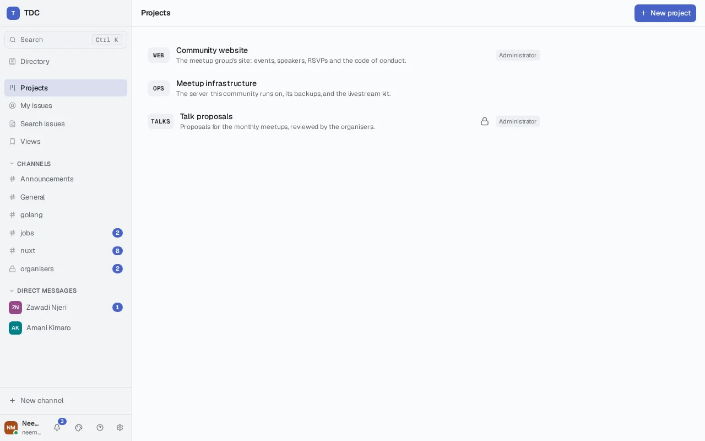

## States

An issue is always in exactly one **state**. A project's states are its
workflow, and they are the columns of its board, left to right. A new project
starts with three — _To do_, _In progress_, _Done_ — and its administrators
change them under **Settings**: rename one, add one, move one earlier or later,
and mark which ones **mean done**. Progress counts an issue as finished when it
is in a state marked done, whatever that state is called.

Removing a state that issues are still in asks where they should go, and
refuses to guess. Each issue is then moved there as an ordinary move, recorded
in its own history, before the state is removed — so no issue is ever left in a
state that no longer exists. A project always keeps at least one state.

## Issues

**New issue** on a project's issue list asks for a title and, optionally, a
description. The issue starts in the project's first state and takes the next
number: numbers are never reused, so `WEB-12` can only ever mean one issue.

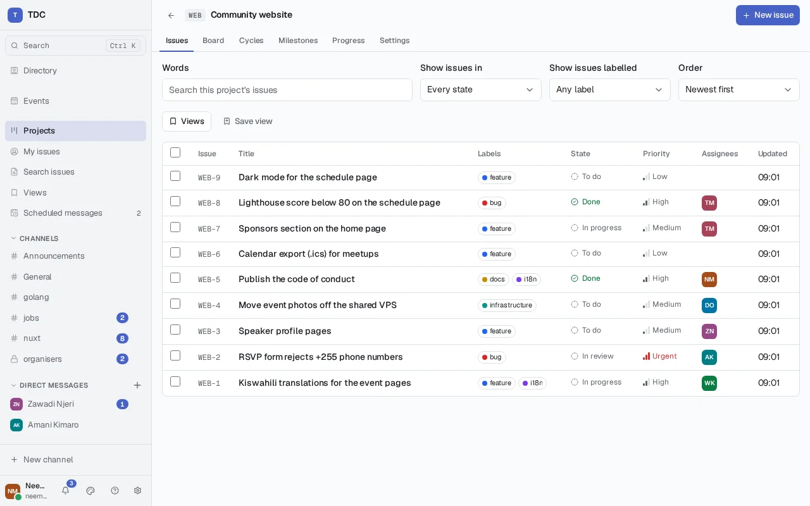

On the issue's own page, `/issues/WEB-12`:

- **State** moves it. If somebody else moved it between your loading the page
  and choosing, your move is refused rather than silently overwriting theirs,
  and the page shows where it actually is.
- The pencil beside the title edits the title and description. Whoever filed an
  issue may always edit it, as may anybody who may file issues in the project.
- **Delete** hides it from lists and boards. Its history is kept and its number
  is not given to another issue.

### History

Every change to an issue — filed, moved, renamed, described, deleted, and in
later sections assigned, labelled, related and scheduled — is recorded with who
made it, when, and what it was before. The record is the server's signed event
log: the same append-only, tamper-evident log that holds every message. It is
not a separate audit table that could disagree with it, and nothing can edit or
remove an entry — there is no endpoint that writes to a history, and the log
behind it cannot be reached through the room endpoints either.

The history shows the names things had at the time. An issue moved into _Doing_
that was later renamed _In progress_ still reads "moved to Doing", because that
is what happened.

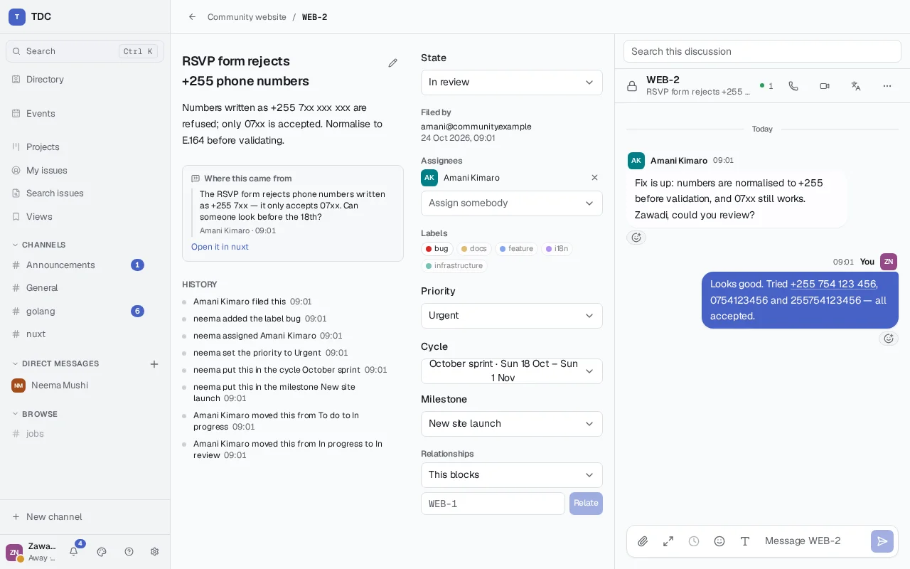

### The project's own history

What happens to the project itself is recorded the same way, and shown on its
**History** tab, newest first: starting it, renaming it or changing who can see
it, its calendar, who is in it and with what role, every state, label and
priority level added, changed or removed, and every cycle and milestone planned,
changed, ended or removed. What happens to one issue stays on that issue's page.

Together the two are everything the project holds. The issues, states, labels,
priorities, cycles, milestones, members, assignments and relationships can all
be worked out again from the recorded events alone, in order — and the server's
tests do exactly that for a project taken through every kind of change, then
compare the board, lists and progress figures with the original's.

A project started before this was true — before labels, priority levels and a
milestone's description were recorded — is given one entry when the server
first starts on a version that records them: _The server recorded everything the
project held, so its history is complete from here._ Nothing earlier is lost;
that entry is the point from which the record alone describes the project.

## Tracking: who, what kind, how urgent, and what depends on what

The panel beside an issue sets everything else about it. Each change is made
the moment it is chosen and recorded in the issue's history.

- **Assignees.** One or more people responsible for it, chosen from the
  project's members. Being assigned tells you — according to your own
  notification settings — and puts you in the issue's discussion, following it.
  Nobody can be assigned an issue they cannot see, so a private project's issues
  can only be assigned to its members. **My issues** in the sidebar lists
  everything assigned to you across every project you can still see.
- **Labels.** The project's own vocabulary — `bug`, `docs`, `needs-design` —
  each with a colour from a short palette. The colour is a dot beside the name,
  never the only thing saying which label it is. A project's labels are managed
  under **Settings**; removing one takes it off every issue that had it, each
  removal recorded.
- **Priority.** A level from the project's own scale, most urgent first. A new
  project starts with _Urgent_, _High_, _Medium_ and _Low_; its administrators
  can rename, add, remove and reorder levels. **Most urgent first** on the issue
  list sorts by that order, whatever the levels are called, with issues that
  have no priority last.
- **Relationships.** An issue can be the **parent** of others — a piece of work
  made up of smaller pieces — and it shows how many of its children are done,
  from their states as they are now. An issue has at most one parent. And an
  issue can **block** another. Neither kind may form a loop: making an issue its
  own ancestor, or a chain of blocks that comes back round, is refused, and the
  refusal names the issues the loop would run through. Relationships are
  between issues of the same project, and each side records the change in its
  own history.

## The board

**Board** on a project shows its issues as columns, one per state, left to
right in the order the project's settings give them — the columns _are_ the
states, so adding or reordering a state changes the board. Each column shows
how many issues it holds and the first twenty of them, most urgent first;
**Show more** at the bottom of a column fetches the next twenty.

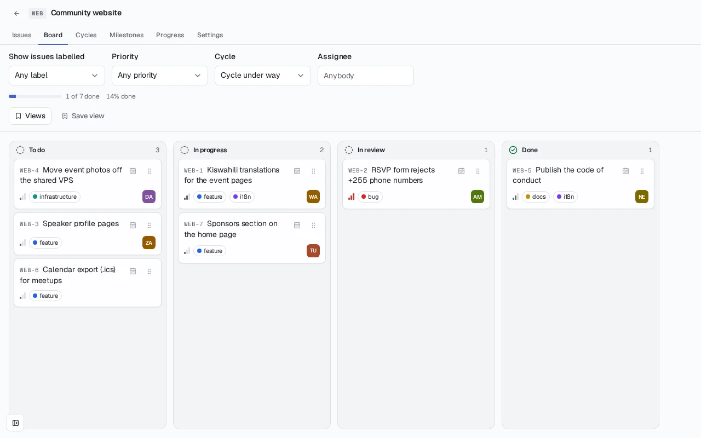

Above the columns, a board can be narrowed to one label, one priority, or one
person's issues; every column then holds only what matches, and its count says
how many do. The API takes the same as `label`, `priority` (names) and
`assignee` (a username) on `GET /api/projects/:key/board` and on each column's
next page.

To move a card, drag it to another column. From the keyboard, Tab to the card's
grip button and press Enter or Space to pick it up; the left and right arrow
keys choose a column, Enter puts it down there, and Escape leaves it where it
was. A screen reader is told each step. Both ways send exactly the same request
— the same one choosing a state on the issue's page sends — so there is nothing
one of them can do that the other cannot.

If somebody else moved the same card a moment before you, your move is refused
rather than overwriting theirs, and the board reloads to show where the card
actually is. The server settles two simultaneous moves on one of them, and tells
the other person what happened.

### What a board costs to load

A board is drawn on phones on metered data, so its first load is held to a
budget: **48 KB of JSON before compression, whatever the project holds**. Every
column sends one page of cards — a project of nine hundred issues sends the same
cards as one of ninety — and a card carries only what it shows: its identifier,
title, priority, label names and colours, and assignees' usernames. Never the
description, the history or the discussion. A test files six times as many
issues into a full project and fails if the board grows, or if it weighs more
than the budget; it runs with the rest of the server's tests, so a change that
breaks either fails the build. The budget lives in `projects.BoardBudgetBytes`,
and raising it should be a decision made on purpose, in a commit that says why.

The browser checks measure the same thing where it is felt. On a project of
three hundred issues, `apps/web/tests/projects-payload.spec.ts` opens the board
and an issue's page the way somebody already in the application does — by a
link — and fails if the board's data is over its 48 KB, or if either screen,
code and data together, fetches more than its own budget. The board and an
issue's page are audited for accessibility the way the conversation is, with
cards, filters, figures, a card picked up and another being planned, and an
issue with every field filled.

## Finding issues

**Search issues** in the sidebar searches every issue in every project you can
see, and what was said in their discussions. Words and filters combine — every
one you give must hold:

- **Words** match an issue's title, and less strongly its description. The
  search ignores word endings the way a search engine does, so "crashes" finds
  "crash"; and nothing typed into it, however odd, makes it fail.
- **State** and **label** are names, not choices from one project's lists,
  because the search spans projects: _Done_ means done wherever it is, and
  `bug` is `bug` in every project that has one. Case does not matter.
- **Assigned to** is a username. **Finished or not** uses each project's own
  idea of which states mean done.

Results come most recently changed first, with the matched words marked, and
below them anything said in a discussion that matched. A search is part of the
page's address, so it can be shared as a link — and each person opening it sees
what they may see, not what its author saw.

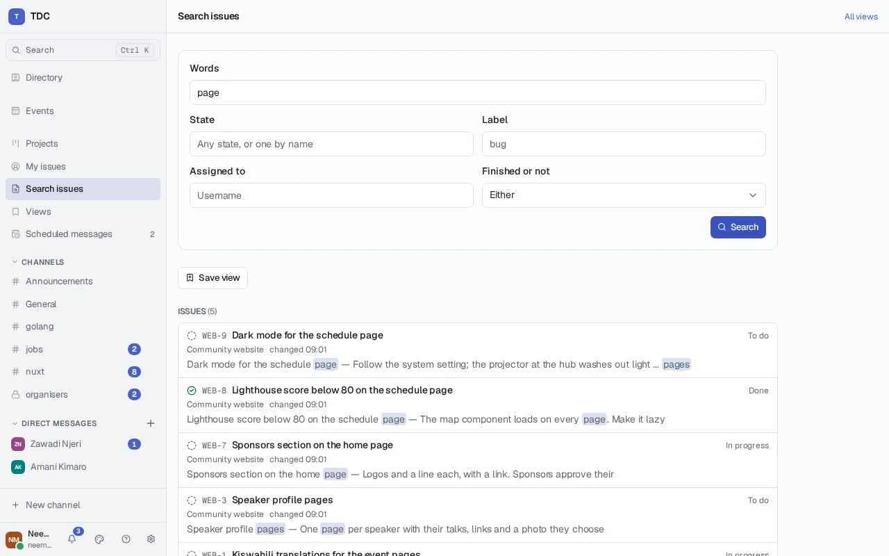

A project's own issue list has the same search above it, limited to that
project, and an issue's discussion has a search of its own beside it, which
anybody who can see the issue may use without ever having taken part.

**Private projects are never searched on behalf of anybody outside them** — not
by words, not by filters, not by naming the project, and not through their
discussions. The search does not find their issues and then hide them; it never
reads them.

The API: `GET /api/issues/search` takes `q`, `project` (a key), `state`,
`label`, `priority` (names), `assignee` (a username), `completed` (`true` or
`false`), `prefix=true` for search-as-you-type over titles, and `limit` (at most
50), and answers `{"issues": [...], "discussions": [...]}`. Each issue carries
`key`, `title`, `projectKey`, `projectName`, `state`, `completed`, `updatedAt`
and, when there were words, `highlighted` — the title and description with the
matches in `<mark>`. `GET /api/issues/:ref/discussion/search?q=` searches one
issue's discussion.

## Saved views

A view is a way of looking at issues, kept under a name: a project's list
with its filters, a project's board narrowed to a label, a priority or a
person, or a search across every project. **Views** on a project's list or
board shows the views of that project and **Save view** keeps what is on the
screen; a search across projects is saved from the search page, and **Views**
in the sidebar lists those.

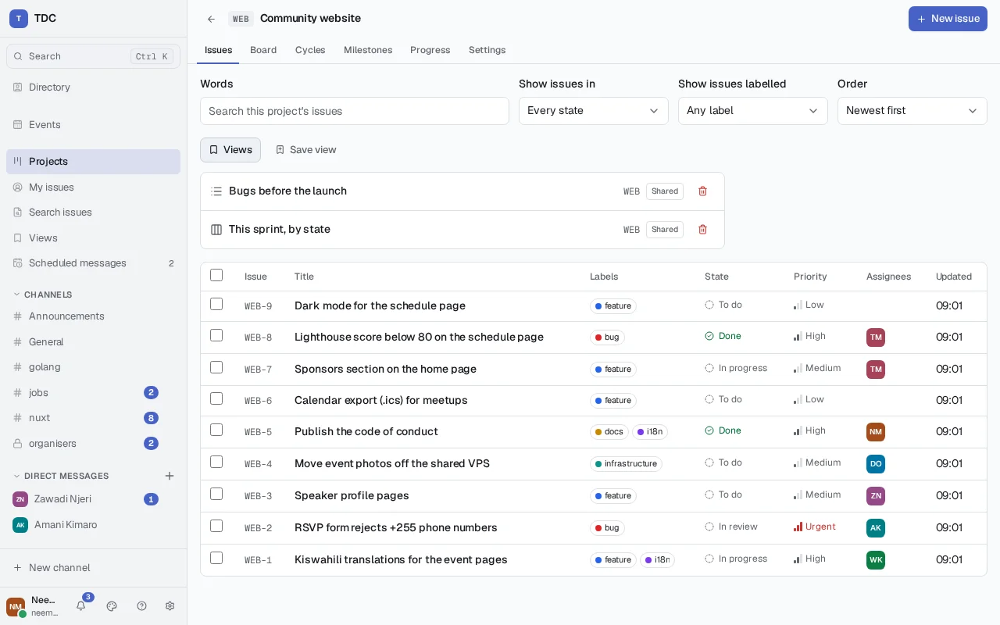

What a view keeps is the question, never the answer — the filters, by name.
Opening it asks again, as whoever opened it. So a view can be shared: tick
**Share with everybody who can see this** and it is listed for them, and each
of them sees what _they_ may see. Somebody outside a private project who opens
a shared search for every `bug` sees the bugs in projects they can see and none
from the private one, even though the same view shows its author more. A view
of a private project does not exist to anybody who cannot see the project.

Only a project's members may share a view of it — so a project's list of shared
views is the team's — but anybody who can see a project may keep views of it for
themselves. Only whoever saved a view may change or delete it.

The API: `GET`, `POST /api/projects/:key/views` for a project's views, and
`GET`, `POST /api/views` for those across projects; each takes `name` (at most
sixty characters), `layout` (`list` or `board`, and a board belongs to one
project), `filter` and `shared`. `filter` holds `q`, `state`, `label`,
`priority` (names), `assignee` (a username) and `sort` (`newest` or
`priority`). `GET`, `PATCH`, `DELETE /api/views/:id` read, change and delete one;
`GET /api/views/:id/results` opens it as the caller and answers
`{"view": …, "issues": [...]}` for a list, the same issues a search returns, or
`{"view": …, "board": …}` for a board. A view the caller may not open answers
404, the same as one that does not exist.

## Changing many issues at once

Tick issues in a project's list and a bar appears above it: choose a change —
add or remove a label, move to a state, set a priority, assign or unassign
somebody — and **Apply to selected**.

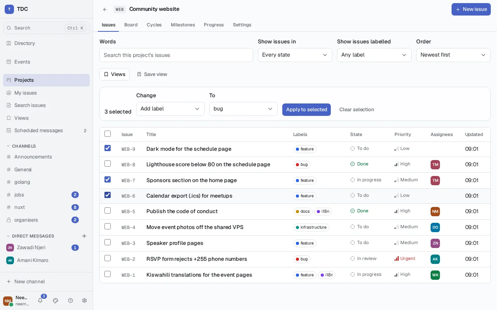

Each issue is decided on its own, exactly as if it had been changed alone: its
own permission check, its own entry in its own history. So a batch can come
back half done, and the answer says so line by line — which issues changed,
which already were as asked, which were **refused** and the permission that
would have allowed it, and which are not in this project. Somebody who is not a
member of a public project, for instance, may label the issues they filed there
and nobody else's: a batch of both labels theirs and names `issue.label` for the
rest. Nothing that was refused leaves any trace in the issue's history.

A change that cannot mean anything — a state or label that is not this
project's, an unknown kind of change, no issues at all — is refused whole before
any issue is touched, rather than as the same refusal for every issue in it.

The API: `POST /api/projects/:key/issues/bulk` with
`{"issues": ["WEB-1", …], "change": {"kind": …, "value": …}}`, at most two
hundred issues. `kind` is `state`, `label`, `unlabel` or `priority` with the
id of the state, label or priority level as `value` (an empty `value` clears a
priority), or `assign` or `unassign` with a username. It answers 200 with
`results`, one per issue in the order given: `issue`, `code` (`changed`,
`unchanged`, `refused`, `not_found` or `failed`), `changed`, and for anything
not changed a `reason` — and for a refusal, `permission`.

## Cycles and milestones

Both are optional. A project that never makes a cycle or a milestone works
exactly as it did: nothing about its issues, its list or its board depends on
them.

### Days, and the calendar they are in

Cycles and milestones are planned in **days** — "Sprint 1 runs from the 5th to
the 18th", "Beta by the 30th" — and a day only means something in a calendar.
Each project has one: a time zone, set under **Settings → Cycles and dates**,
UTC until somebody sets it. A cycle ending on the 18th in a project on
`Africa/Dar_es_Salaam` ends when the 18th is over in Dar es Salaam, wherever the
server is and wherever the person reading it is.

So days are shown as days, exactly as they were chosen — never converted into
the reader's zone, which would show the 17th to somebody in Honolulu — and the
zone is named beside them. Changing the project's zone keeps every cycle and
milestone on the same days, and moves the instants those days begin and end.
The API sends both: `startsOn` and `endsOn` (or a milestone's `targetDate`) as
`YYYY-MM-DD`, and `startsAt`, `endsAt` (or `dueAt`) as the instants those days
begin and are over, with the project's offset — `2026-10-19T00:00:00+03:00`.

### Cycles

**Cycles** on a project lists its cycles, with how much of each is done; **New
cycle** makes one, two weeks from today by default. A project's cycles never
overlap, so the one under way is always one; they need not be back to back.
The board opens on the cycle under way when there is one, and can be narrowed to
any cycle, or to the issues in none.

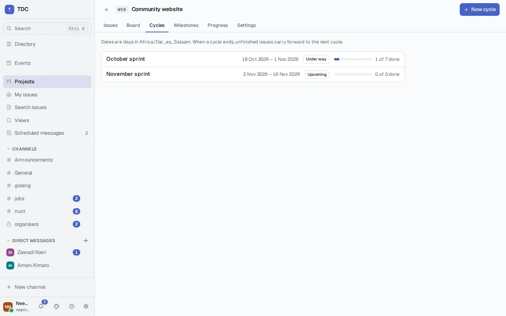

An issue is put into a cycle from its own page, from a card on the board (the
calendar button beside it), or many at once from the list with **Put in cycle**.
Each move is recorded in the issue's history.

**When a cycle ends**, the server deals with it by itself, within a minute of
midnight in the project's calendar, under the project's policy:

- **Carry forward** (the default): every unfinished issue moves to the next
  cycle — the first that starts once this one has ended — or out of any cycle if
  there is none.
- **Remain**: unfinished issues stay in the cycle that ended, which then shows
  the work left in it.

Either way, **nothing is deleted and no issue changes state.** Finished issues
stay in the cycle they were finished in. Every issue that moves has the move in
its own history, recorded as the server's own act ("When Sprint 1 ended, the
server carried this forward to Sprint 2") rather than as anybody's; and the end
itself is recorded in the project's history, naming the policy and every issue
that was unfinished. An ended cycle shows when it ended and under which policy.

A cycle with issues in it cannot be removed — they would leave it with no record
of why — and once its end has been dealt with, its days are fixed.

### Milestones

**Milestones** groups issues across cycles towards something — a release, a
launch — with a day to aim for if you want one. An issue counts towards one
milestone at most, set from its own page or from a board card. A milestone shows
its issues, how many are done, and which cycles they are in: what it spans.

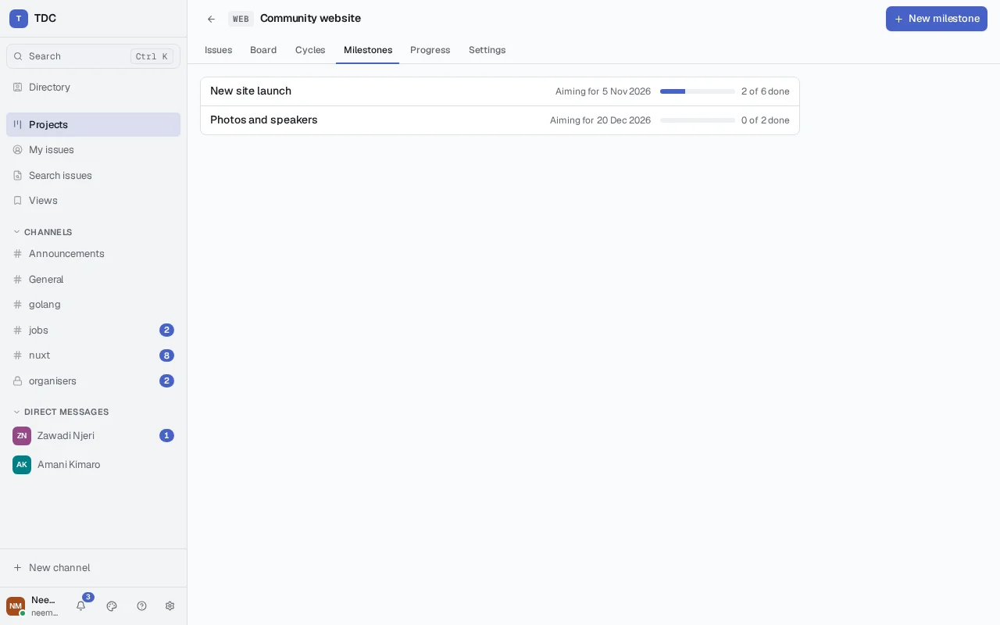

The day is advisory. Once it is over in the project's calendar with work still
unfinished, the milestone shows **Overdue** — and that is all. No issue in it
is moved, closed or changed because of it.

Progress for a cycle or a milestone is counted when it is shown, from the
issues' states as they are, so there is no second number that could drift.

The API: `PUT /api/projects/:key/planning` with `timeZone` (an IANA name) and
`cyclePolicy` (`carry-forward` or `remain`); `GET`, `POST
/api/projects/:key/cycles` (`name`, `startsOn`, `endsOn`) and `GET`, `PATCH`,
`DELETE …/cycles/:cycle`, where `GET` gives the cycle and its `issues`; `GET`,
`POST /api/projects/:key/milestones` (`name`, `description`, `targetDate`) and
`GET`, `PATCH`, `DELETE …/milestones/:milestone`, where `GET` gives the
milestone, its `issues` and the `cycles` it spans. `PUT /api/issues/:ref/cycle`
takes `cycleId`, and `PUT /api/issues/:ref/milestone` takes `milestoneId`;
`null` takes the issue out. A cycle carries `status` (`upcoming`, `active`,
`ended`), `total` and `completed`, and once dealt with `closedAt` and
`closedPolicy`; a milestone carries `overdue`, `total` and `completed`. An issue
names its `cycle` and `milestone` when it has them. The batch endpoint takes
`"kind": "cycle"` with a cycle's id, or an empty value to take issues out, and
the board takes `cycle` — an id, or `none`.

## Progress

**Progress** on a project shows how much of it is done — the whole project
over the last two weeks, each cycle, and each milestone — and the same figures
sit above the board for the cycle or project it shows, and on each cycle's and
milestone's own page.

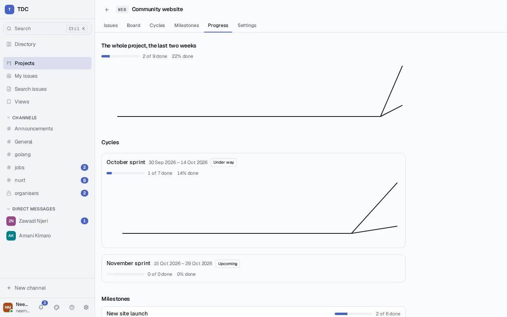

Every figure is **counted when it is shown**, from the issues' states as they
are; nothing keeps a running total that could drift from them. So a card moved
on the board changes the figures above it at once, without the page loading
again. The day-by-day trend beside the figures is worked out a different way:
by replaying the project's recorded history, counting at the end of each day in
the project's calendar. Today's point of the trend and the figures are two
independent answers to one question, and they always agree — the server's tests
and the projects milestone check that they do, against a recount made from
nothing but each issue's own history.

Which states count as done is the project's present answer, for the trend as
for the figures: making a state mean done changes the past days too, which is
what lets the two be compared exactly.

The trend is drawn as a chart, and the figures are always written out beside
it. If the chart cannot be drawn — an old browser, a charting library that has
broken — the same numbers are shown as a table instead, built from the same
rows the chart would have drawn.

The API: `GET /api/projects/:key/progress`, `GET
/api/projects/:key/cycles/:cycle/progress` and `GET
/api/projects/:key/milestones/:milestone/progress` answer `total`, `completed`,
`from`, `to` and `trend`, one `{day, total, completed}` a day, the last being
today as it stands. A project's period is the last two weeks, a cycle's its own
days, a milestone's from the day it was made; `from` and `to` (days) choose
another, of at most a year, and a period never runs past today.

## Who may do what

| Permission                 | What it allows                                   | Held by default by                 |
| -------------------------- | ------------------------------------------------ | ---------------------------------- |
| `project.create`           | Starting a project                               | every account (the _Member_ role)  |
| `project.administer`       | Renaming, changing visibility, managing members  | the project's administrators       |
| `project.configure_states` | Adding, renaming, reordering and removing states | the project's administrators       |
| `issue.create`             | Filing issues, and editing any issue's text      | the project's members              |
| `issue.transition`         | Moving issues between states                     | members, and an issue's own author |
| `issue.assign`             | Assigning people                                 | members                            |
| `issue.label`              | Labels and priority                              | members, and an issue's own author |
| `issue.relate`             | Parent, child and blocking relationships         | members                            |
| `issue.delete`             | Deleting issues                                  | the project's administrators       |
| `project.plan`             | Making and changing cycles and milestones        | members                            |
| `issue.plan`               | Putting issues into cycles and milestones        | members                            |

Each of these except `project.create` can also be granted to a role, either
server-wide or for one project only (`PUT /api/admin/roles/:id/project-permissions`).
An explicit denial wins over everything: a role denied `issue.delete` in one
project cannot delete there even as that project's administrator, the same way
a denial beats server administration. None of the project permissions can be
granted on a channel, and none of the channel permissions on a project.

A refusal says which permission would have allowed the action.

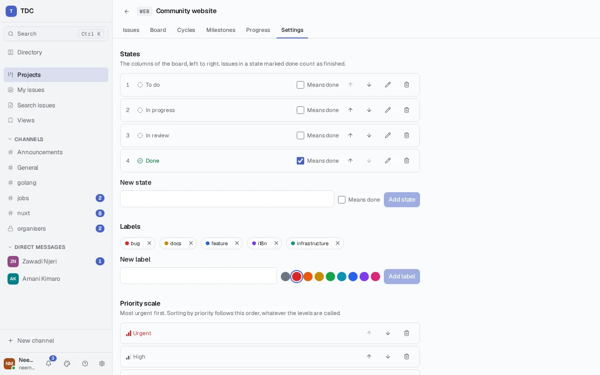

Commenting on an issue has no permission of its own: it is posting in the
issue's discussion, which is governed like posting in any conversation.

## People on other servers

On a server that federates, a project's administrators can let people from
other servers into it. It starts closed. **Settings → Other servers → Open to
other servers** opens it; this is recorded in the project's history and in the
server's audit log.

Once it is open, add somebody from elsewhere under **Members** by their address,
`name@their.server`, with a role, as you would add somebody here by username.
They are marked **Elsewhere**. A server this one has blocked, or does not list
when it federates only with a list, is refused.

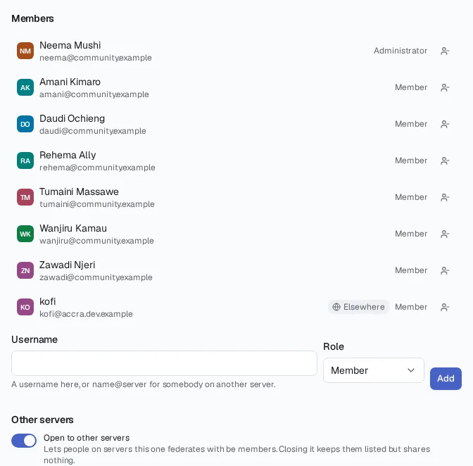

Their permissions here come from their role in the project and nothing else: an
administrator here may do what the table above gives the project's
administrators, and a member what it gives members. Roles their own server gives
them, and grants this server's roles carry, do not apply to them. Only
administrators on this server count towards a project's last administrator.

### On their server

Their server gets the project: its board, its lists, its cycles, milestones and
progress, and every issue's discussion, kept up to date as the project changes
here. Servers hosting one of its members get it, and for a public project also
any server that adds it (below). It
appears there under a key naming this server, `WEB@your.server`, and its issues
as `WEB@your.server-12`, so it can never be mistaken for a project of their own.
Its header says where it lives.

There they work in it as you do here, as far as their role allows: filing,
editing, moving, assigning, labelling, prioritising, relating and planning
issues, and commenting in their discussions. Each change is made here, on the
project's home, in their name — their server asks, this server checks their
role and makes it — and comes back to their server before they see the result,
so both servers always show the same thing. If this server refuses, they are
told why, in its words. Running the project itself — members, states, labels,
cycles and milestones — is done here only. Assigning somebody on another server
tells them through their own server.

When the last of a server's members leaves the project, or the project is closed
to other servers, that server is told to discard its copy, and nothing more is
sent to it. Closing a project keeps its members from elsewhere listed, so
opening it again shares it with them again.

A card being moved on their server is dimmed until the home has made the move.
If somebody here moved it first, the move is refused and the card goes to where
it really is, saying so. Their saved views of the project are their own and stay
on their server.

If this server stops answering, their copy says since when: what they see may be
behind, and nothing can be changed until it answers again. If the project's home
records something their server does not understand yet — a newer kind of change
— their copy stops there and says so, rather than skipping it and quietly
showing something different from the home. It catches up by itself once their
server is updated.

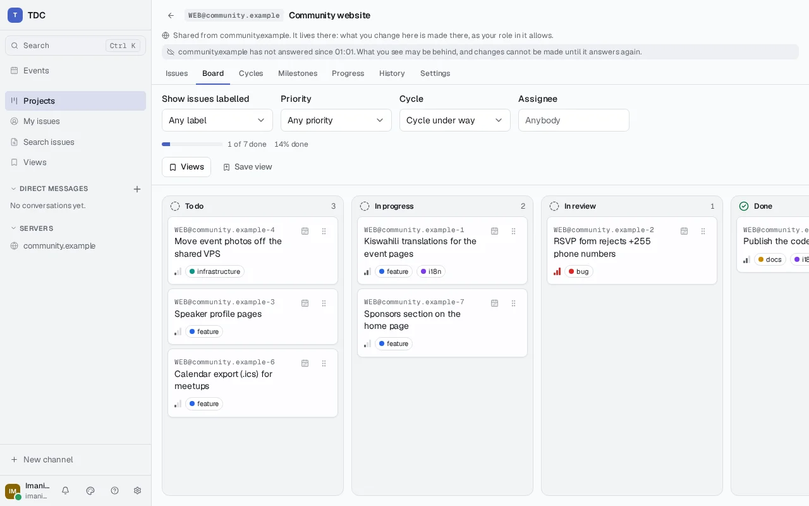

### Adding a public project to another server, and asking to join

A public project opened to other servers can be added to any server this one
federates with, so that people there can read it. On that server, **Projects →
Add from another server** asks for this server's address — `your.server`, or
`https://your.server` written out — lists the public projects opened here, and
**Add** brings one in. Anybody there who may start projects may add one. It
arrives a moment later, marked as living here, and everybody on that server can
read it. Nobody there can change it yet.

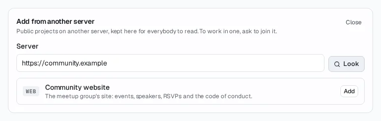

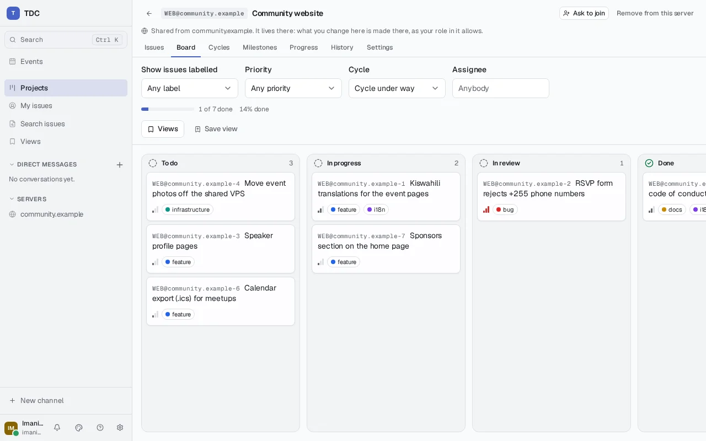

To work in it, somebody there presses **Ask to join** in its header. Here, the
project's administrators see **1 person waiting to join** in its header, and
under **Settings → Waiting to join** they **Let in** — the person becomes a
member, and can work in the project from their own server as above — or
**Decline**. Asking again while a request waits changes nothing.

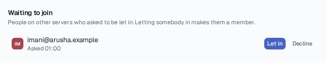

An added project stays on that server while it is public and open to other
servers, until somebody there who may start projects presses **Remove from this
server** in its header — a server where people are members keeps it for them.
Making it private withdraws it from every server that only added it; closing it
to other servers withdraws it from every server.

## Discussing an issue

Every issue has a discussion beside it, and it is a conversation like any
channel: formatting, files, reactions, threads, editing and deleting your own
messages, and mentions all work as they do everywhere else, because it is the
same conversation underneath. Anybody who can see the issue can read the
discussion; **Join** it to take part, the way you would join a public channel.
In a private project only its members can see either.

Taking part is following:

- Whoever filed an issue, and anybody who comments on it, hears about every
  later comment — as if they had set that discussion to **All** themselves. If
  you would rather not, change the setting for that discussion like any other;
  and if you have asked to hear nothing anywhere, commenting does not change
  that.
- Naming somebody — `@amina` — reaches them if they may see the issue,
  according to their own notification settings, exactly as a mention in a
  channel does. They are brought into the discussion so it can. Naming somebody
  outside a private project does nothing at all: they are not told, and not
  told they were named.

Somebody looking at the discussion when a comment arrives is not interrupted
about it, as in a channel.

## Turning a message into an issue

When a conversation agrees that something needs doing, open the message's menu
— right-click, or press and hold on a phone — and choose **Create an issue from
this**. Pick the project; the title and description start as the message's
first line and the rest of it, and are yours to change before filing.

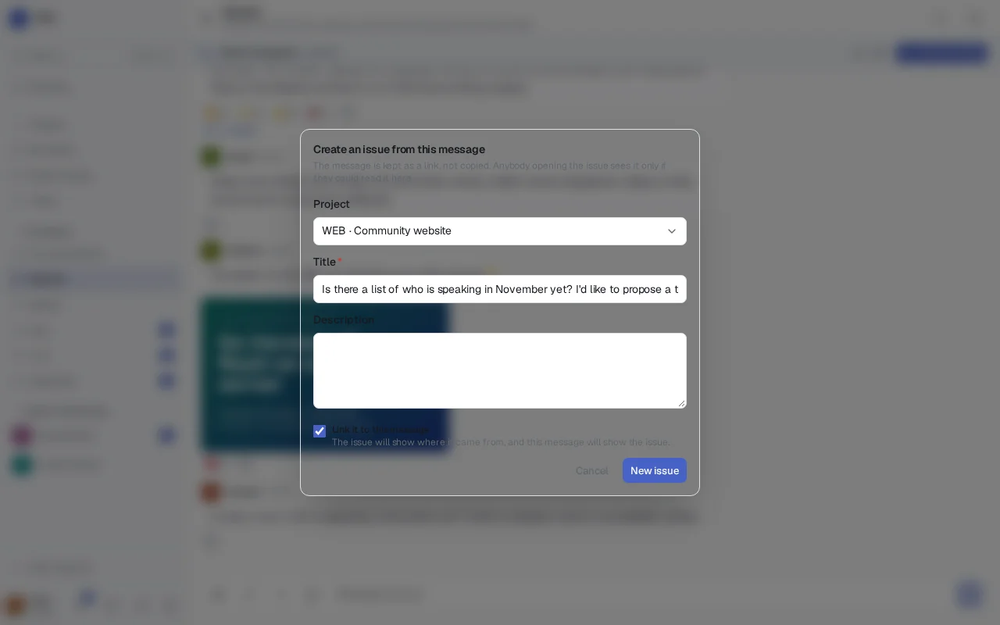

The issue keeps a **link** to the message, not a copy of it. On the issue's
page, **Where this came from** shows the message as it reads in its
conversation now — edited, or removed if it has since been deleted — with a way
back to it, to anybody who can read that conversation. Anybody who cannot sees
only that the issue was made from a message in a conversation they cannot see:
not which conversation, not who wrote it, not what it said, and not whether it
is still there. A private conversation and a message deleted from one look
exactly the same from outside, because telling them apart would itself say
something.

The message, in turn, shows the issue it became — to people who can see that
issue. A message that became an issue in a private project shows nothing to the
conversation's members outside that project, so the conversation does not tell
them the project exists.

You can only link an issue to a message you can read yourself.
