# Using TDC

What the application does, from the point of view of somebody using it rather
than running it. Everything here is in the software today; where a capability
depends on a choice your server's operator made, that is said.

There are two applications and they are the same application. The web client
runs in a browser and installs to a phone or a desktop like any other app; the
desktop client wraps the same interface in a native window and adds the few
things a browser will not do. What you read and type is the same code in both,
so they cannot drift apart.

## Getting an account

How you get one depends on your server's registration policy. It may be open to
anybody, restricted to people holding an invitation, restricted to particular
email domains, or closed entirely, in which case the operator makes accounts.

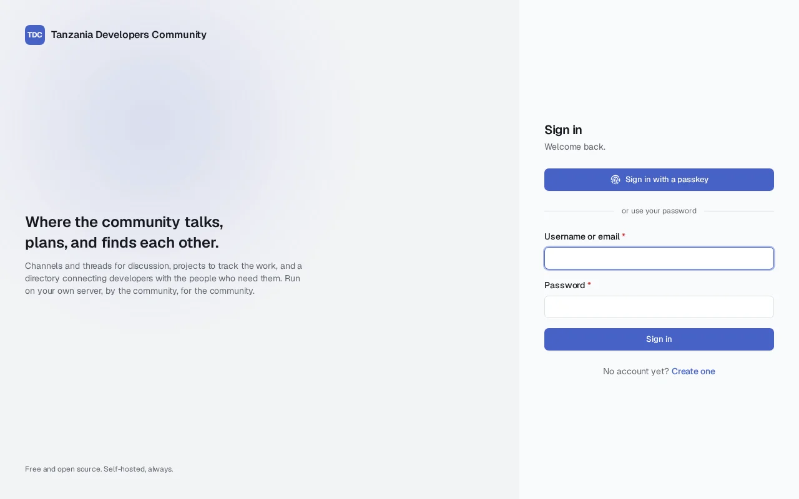

If you were sent an invitation, it is either a link or a short code, and either
one is entered during registration. An invitation may expire, may be usable a
limited number of times, and may be bound to one email address so that
forwarding it to somebody else does not work.

If an invitation does not work, the server will not tell you why. Expired,
already used up, revoked, meant for somebody else and never having existed all
produce the same refusal, because a response that distinguished them would tell
somebody guessing codes when they had guessed right.

**A password reset needs a confirmed email address, and most accounts do not
have one.** Where the server sends mail and your address has been confirmed,
"forgotten your password" sends a link good once and for an hour. Setting a new
password signs every device out and does not sign you in — you sign in with it,
which is what proves you know it.

Confirming is yours to do, from your settings: give an address, a link arrives,
and using it proves the address is yours. Until you do, an account that has lost
its password needs an administrator — so it is worth doing before you need it.
Choose a password you will keep as well, and keep it somewhere.

Changing the address later keeps the old one working until the new one is
proved, so a typo costs nothing.

Beyond a password, there are three other ways in, depending on what the server
offers:

- **A passkey** — your fingerprint, face or device PIN, with the key itself
  staying on your device. Sign in with nothing typed at all. Offered wherever the
  server has a settled address; add one from your settings.
- **Another service** — GitHub, GitLab, a self-hosted Forgejo or Keycloak,
  whichever the operator has configured. The buttons appear on the sign-in form
  when there are any.
- **Two-step sign-in** — something as well as your password. A passkey counts:
  if you have one, signing in with your password asks for it as the second step
  and there is nothing else to set up. Otherwise it is a code from an
  authenticator app, which comes with ten recovery codes, shown once, for the
  day you cannot reach your phone. Where the server sends mail and your address
  is confirmed, a code can also be sent there — a fallback for a phone in
  another room, and the weakest of the options, since it is worth what your
  mailbox is worth. An operator may require two-step sign-in of administrators
  or of everybody.

Recovery codes are not a password reset: they get you past the second step, not
past a forgotten password.

### Your sessions

Every device you sign in on is a session, and you can see all of them: when each
was created, when it was last used, and which one you are looking at. Any of
them can be revoked, which signs that device out immediately.

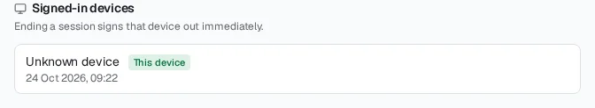

Ending a session asks first and says what will happen, because signing a device
out is not something to do by accident.

Changing your password invalidates every other session. That is the behaviour
you want if you are changing it because you think somebody else has it.

### Your name

You have two names, and both are changed from **Your name** in your settings.

Your **display name** is what people call you. It is shown everywhere you are
named to somebody else: beside your messages, in member lists and search, on a
call and when you ring somebody, in their notifications and in the banners on
their phone or desktop, and in the conversation's name when you write to them
directly. Where you are picked from a list, your `@username` sits beside it, so
two people with the same display name can still be told apart. A mention you
are sent is drawn as your display name, with the `@username` it was typed as
shown on hover. Change it whenever you like; it saves at once, and others see it
the next time a list or a profile is loaded. Leave it empty and your username
is shown instead. Somebody on another server is shown by the first half of
their address, which is all this server knows them by. Any
script is fine, emoji included. What is refused is only what can deceive: an
invisible or right-to-left character hidden inside a name, a control character,
or a name that is one of the server's reserved words — "Admin", "System",
"Moderator" — however it is spelt. The limit is 64 characters.

Your **username** is the first half of your address, `you@server`. It is not
what people read as your name; it is what identifies you: in links, in
`@mentions` (type either your username or your display name after `@` and the
list offers you), and to other servers. So changing it is allowed, but with
care:

- As you type a new one, the field says whether it is free. A name that is
  taken, reserved, or was given up by somebody else recently is not.
- Changing it asks you to confirm. It shows your new address and what will and
  will not change, and asks for your password. If your account has no password
  — you sign in with a passkey or another service — it asks instead that you
  have signed in within the last 15 minutes; sign out and in again first.
- Your **old name stays yours** for a while (90 days unless your server says
  otherwise): nobody else can register it or take it. Links to your old profile
  keep finding you, and you can still sign in with the old name until somebody
  else takes it.
- **Messages you already sent keep the address they were sent under.** Every
  message is signed with its sender's address, and rewriting it would break the
  signature. They still show your display name, as everything you write does,
  and they are still yours: you can edit and delete them as before.
- Mentions are text. A message that said `@oldname` still says it; a new
  mention needs your new name.
- You can change it again after a wait (30 days unless your server says
  otherwise), so a name cannot be rotated to dodge a block or confuse people
  about who is who.
- **It cannot be changed while you are in a conversation shared with another
  server.** Other servers know you by your address, and the federation protocol
  has no way to tell them it changed — they would keep you as a member under a
  name that no longer exists here. Leave those conversations first; the
  settings page says so when this is what is in the way.

An operator can turn username changes off entirely, in which case the section
says so. Every change, of either name, is in the audit log, and administrators
see the names somebody had before beside their account in the list of people.

Things outside the server that hold your old name keep holding it: a passkey
shows it on your device until you replace it (it still works), and a ringtone
somebody chose for you is set against your old address.

### API tokens

A program acting as you — a script, a bot, a deployment — should not hold your
password. Give it a token instead, under Settings → _API tokens_: a name, how
long it lasts, and what it may do.

**A token is your account with everything you do not tick denied.** The list
starts with nothing ticked, and the form counts what the token will be denied
as you choose. It can never do more than your account, and when your account
loses a permission, its tokens lose it in the same moment.

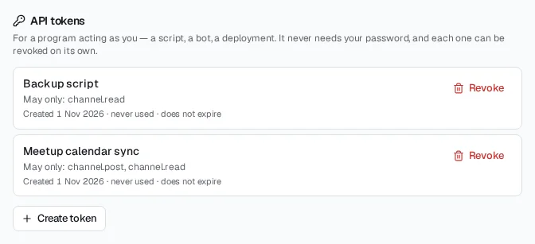

**The token is shown once**, when it is made, with a button to copy it. It is
stored only in a form nobody can turn back into the token, so a lost one is
revoked and replaced rather than recovered. The list shows each token's name,
what it may do, when it was made, when it was last used and when it expires —
a token nobody has used for a year is easy to spot. Revoking one asks first and
stops it working immediately.

A token cannot make another token, and it does not appear among your sessions.
Recovering your account ends every token it held. The details for whoever
writes the program are in [Integrating](integrating.md#api-tokens).

## Conversations

### Channels

A channel is a named conversation. It may be **public**, which anybody on the
server can find and join, or **private**, which only its members can see.

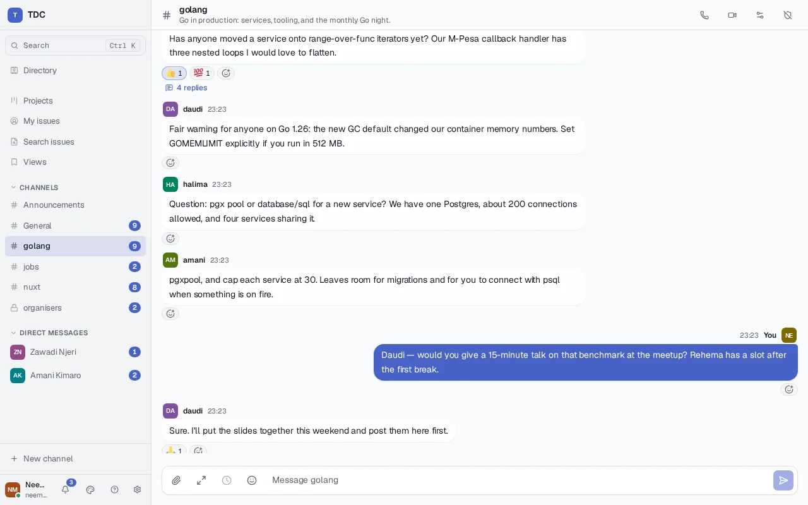

A private channel is genuinely invisible rather than merely locked. Somebody who
is not a member cannot tell the difference between a channel they are not
allowed into and one that does not exist, anywhere in the application or the
API. That is deliberate — a refusal that distinguished the two would confirm
that the channel is there.

Channels can be archived, which keeps all the history readable and refuses new
messages, and restored, which resumes posting. Nothing is lost either way. An
archived channel says so beside its name, for everybody in it.

Whoever looks after a channel finds its settings behind the gear in the
channel's header — its name and topic, whether it is public or private,
archiving and restoring, and who is in it. The gear appears only for somebody
who may change something there, and each part of the settings only for what
they may change. Every change appears in the channel as it happens, for
everybody who has it open. A direct conversation has no such settings: it
belongs to the people in it.

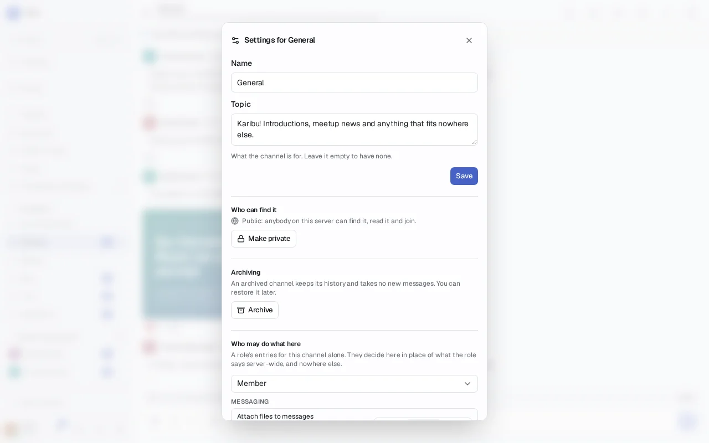

Creating a channel takes a permission. On most servers ordinary members have it;
on some the operator keeps it.

### Direct messages

A direct conversation is between you and one other person, or between you and
several. Start one with the **+** beside _Direct messages_ in the sidebar, or
_New message_ in the search box (`Ctrl K`): type a name, press Enter to add
them, add as many people as you like, and press Enter again — or _Start
conversation_ — to open it. Choosing one person in the search box opens your
conversation with them directly, and `Shift Enter` on a person there starts the
new-message box with them already in it.

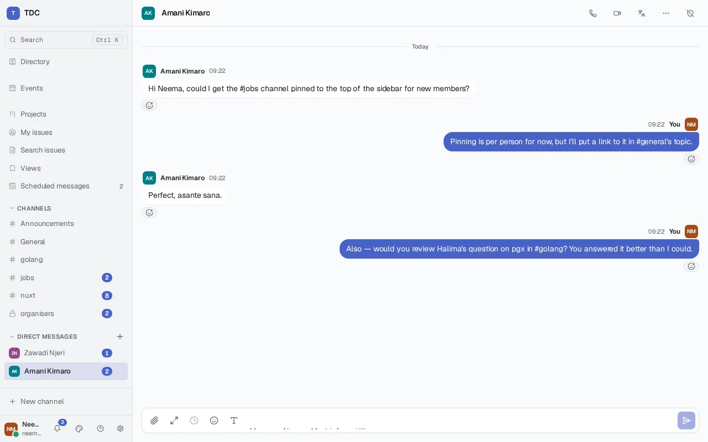

A conversation with several people shows in the sidebar as two overlapping
faces with a count, and is named after everybody in it but you.

**A direct conversation is the people in it.** Opening one with the same people
again returns the conversation you already have rather than starting a second.
For the same reason, _Add people_ in a conversation's menu starts a new
conversation with everybody in the old one and whoever you add — the old one
stays as it was, its history readable by the people who were there, rather than
being shown to somebody who was not. A direct conversation has no name of its
own to change.

**Administrators cannot read them.** Not "should not" — an administrator using
the ordinary endpoints cannot retrieve other people's direct messages, and that
is enforced on the server rather than being a rule somebody might not follow.

You control who may open one with you: **anyone**, **only people who share a
channel with you**, or **nobody**. Narrowing it does not close the conversations
you already have. Somebody refused is not told which setting refused them, and
moderators can still reach you, because a moderation problem you can make
unreachable is not one anybody can deal with.

### Threads

Any message can become a thread. Replies live in a panel beside the
conversation rather than in the main timeline, so a long tangent does not bury
everything else, and the thread inherits the channel's permissions and
visibility — there is no way for a thread to be more open than the channel it is
in.

The conversation shows how many replies each thread has, so you can see what is
worth opening without opening it. Under a thread you follow it also says how
many of those replies are new to you.

**A reply is a message.** The box at the foot of a thread is the same one as
the channel's: attach files by picking them, pasting a screenshot or dropping
them anywhere on the panel; add a GIF or an emoji; format with the toolbar or
the shortcuts; mention somebody by typing `@` and choosing them from the list;
send it later. Each reply has the same menu as a message — react, edit, delete,
copy, forward, pin, report, file an issue from it, give it a lifetime — and
shows its files, its link's preview and any buttons a program put on it. The
up arrow in an empty reply box edits your last reply, as it does in the
channel. On a phone the thread opens over the conversation; Escape or the close
button goes back.

**Following.** You follow a thread when you start it or reply in it, and you
can follow or stop following any thread with the bell in its header. A reply
notifies the people who follow the thread and anybody it mentions — not
everybody in the channel, even those who asked to hear about every message
there. Once you stop following a thread, replying in it again does not make you
follow it again; the bell does.

**Read state.** Opening a thread marks where the replies you have not read
begin, and records them as read on every device. Replies do not count towards
the channel's own unread badge — a busy thread you do not follow should not
make a quiet channel look busy. Somebody typing a reply is shown in the thread,
not under the channel.

A search result, a pinned reply or a notification about a reply opens its
thread, with the reply brought into view.

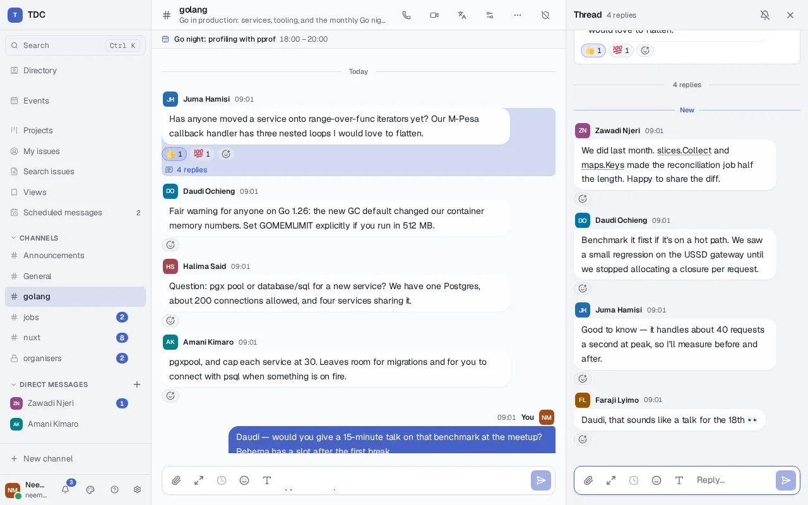

### Disposable chats

A conversation that deletes its own contents after a period the creator sets.
The expiry is enforced by the server, so a client that was offline through the
whole lifetime of a message never receives it — the content is gone, not merely
hidden by whatever happened to be displaying it.

## Messages

Writing, editing and deleting all work as you would expect, with two things
worth knowing.

**An edited message says it was edited.** Not the old text, but a marker that
the message is not what was originally sent.

**A deleted message leaves a placeholder.** The content goes; evidence that
something was there and was removed stays. A conversation where messages can
silently cease to have existed is one nobody can trust, and quoting somebody who
can then make the original disappear is the specific problem this avoids.

### What you can do to a message

- **React** to it with an emoji, from the picker. The picker is searchable, and
  carries a GIF tab as well where your operator has configured a provider —
  sending a GIF works regardless, since it uploads like any other file.
- **Reply in a thread**, which is what turns it into one.
- **Pin** it, if you have the permission. Pinned messages are the channel's,
  listed together, and pinning speaks for the channel rather than for you — so
  it takes a permission where reading what is pinned does not.
- **Forward** it to another conversation.
- **Report** it, if it needs a moderator.
- **Give it an expiry** — see below.

Right-clicking a message opens these, and so does a long press on a touch
screen. Everything in that menu is reachable another way too: a context menu is
a shortcut, never the only route to something.

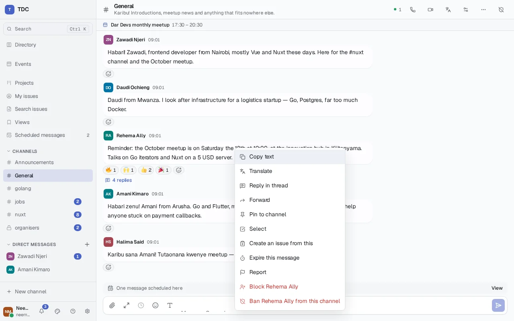

### Writing now and sending later

A message can be written now and sent at a chosen time — the clock in the
composer, which offers a few presets and a picker. At least ten seconds ahead
and at most a year. Whether this is available at all is one of the capabilities
your operator can switch off.

What you have scheduled is listed under _Scheduled messages_, which appears in
the sidebar while anything is waiting, and a conversation with messages waiting
says so above its composer. Each one can be **reworded**, **moved** to another
time, **sent now**, or **cancelled** — cancelling asks first, since the words go
with it. Sending now goes through the same checks it would have met later: if
you may no longer post there, you are told at once rather than finding out
tomorrow.

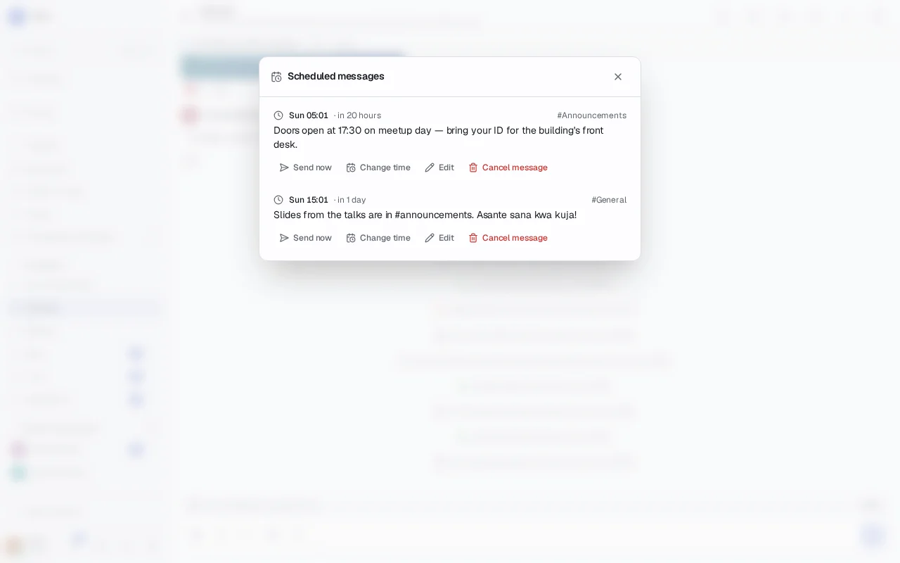

A message the server has begun sending can no longer be changed or cancelled;
for the moment it takes, it is already on its way.

### Keeping a conversation to hand

Any conversation can be pinned to the top of your own sidebar — a private
bookmark rather than an announcement, which nobody else sees. Pin it from the
conversation's menu: the **⋯** beside it in the sidebar (or right-click it, or
long-press it on a touch screen), or the **⋯** in the conversation's header.
Pinned conversations sit together under _Pinned_ in the order you choose, and
_Move up_ and _Move down_ in the same menu rearrange them. The order follows
you to every device.

Pinning a _message_ is the other thing entirely: that one speaks for the
channel, and everybody in it sees it.

### Messages that expire

You can put a lifetime on a single message, in a conversation that otherwise
keeps everything. Three ways to reckon it:

- **A fixed time from sending** — it goes after that period whether or not
  anybody read it.
- **Once everybody has seen it** — it goes as soon as every other participant
  has read it.
- **A period after each person first sees it** — everybody gets the same window
  from their own first reading, and it goes when the last of those runs out.

Only the person who sent a message may set this, or a moderator. And a lifetime
can be **shortened but never extended**. Somebody who sent something meaning it
to disappear in an hour should not find that it now lasts a week.

When an expiring message goes, its attachments go with it.

### Messages that ask you something

A message from a program may carry buttons — "Deploy", "Not yet", that sort of
thing. Pressing one tells the program what you chose; it decides what happens
next, because it is the only thing that knows.

They are ordinary buttons. You can reach them by pressing Tab, press them with
Enter or Space, and a screen reader announces them as buttons and says what
happened after you press. You need to be in the channel to answer — reading one
is not the same as taking part in it.

Some are offered once. A question put to a channel is usually answered once by
anybody, so the second press is refused and says so rather than quietly
counting twice. Some have a deadline, and stay visible but stop working when it
passes — a button that vanished would leave you wondering whether you had
imagined it.

A button that opens a link says so with an icon, and opens it in a new tab. TDC
only lets a message offer `http` and `https` links; anything else is refused
when the message is posted, so a button in a message cannot be a way to run
something on your machine.

#### Menus, fields, and answers only you can see

Some questions are not yes or no. A program may offer a **menu** — pick one of
a list, and your choice is sent as soon as you make it — or a short **field** to
type into, sent with Enter or the arrow beside it. A screen reader announces a
menu as a list of choices and a field by the label written above it.

What you choose or type is checked before the program sees it: a menu only
accepts one of its own choices, and a field only as much text as it asked for.
Some controls are for particular people — approving a deployment, say — and
refuse anybody without the right permission, saying so, without the program
ever hearing that you tried.

A program may answer by changing the message itself, so everybody sees the
question has been settled. If it changes while you are answering, your answer
is refused and you are asked to look again, rather than being counted against
a question you were never shown.

It may also answer **you alone**. That answer appears under the message, marked
"Only you can see this", and nobody else in the channel receives it. It is not
kept: close the conversation and it is gone, and if you were not connected when
it was sent you will not see it later. Anything a program needs you to be sure
to see, it posts as an ordinary message.

### Messages from programs

A message posted by a program rather than a person says so beside its name:
**Webhook** for an outside system posting into the channel — a build server, an
alerting tool — and **Bot** for an application taking part in the
conversation. The marking is the server's, not the program's, so a program
cannot leave it off and pretend to be somebody. You can reply to, react to,
report and (if you moderate) remove these messages exactly as anybody else's.

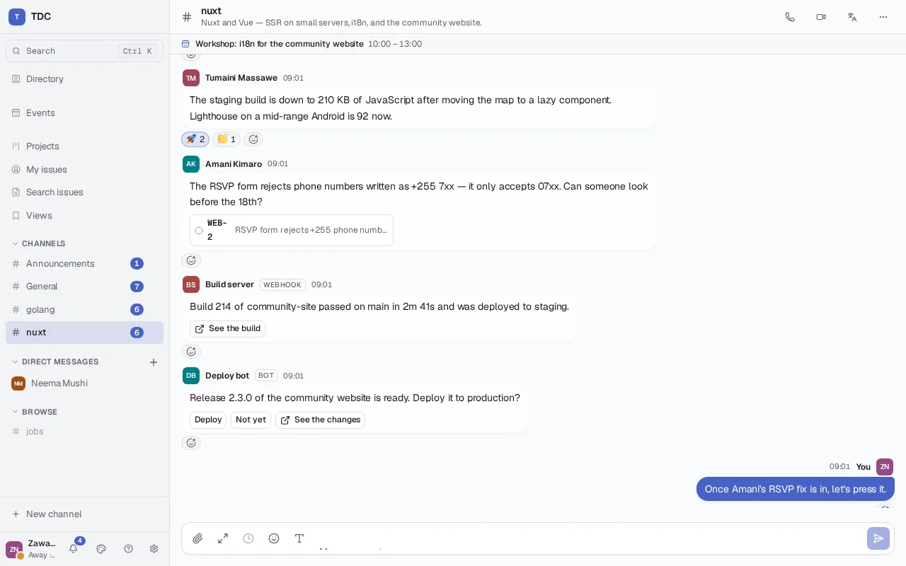

### Formatting

A message is written in Markdown — the same marks GitHub and Discord
use — and shown formatted. What you type is what is stored; the formatting is
how it is drawn.

| Type                     | To get                                 |
| ------------------------ | -------------------------------------- |
| `**bold**` or `__bold__` | **bold**                               |
| `_italic_` or `*italic*` | _italic_                               |
| `~~struck~~`             | ~~struck~~ (two tildes; one is just ~) |
| `` `code` ``             | `code`                                 |
| ` ```go ` … ` ``` `      | a code block, labelled and highlighted |
| `> quoted`               | a quote                                |
| `- item` or `* item`     | a list                                 |
| `1. item`                | a numbered list                        |
| `[text](https://…)`      | a link with your own words             |

A **code block** keeps every space and line exactly as typed, scrolls sideways
rather than wrapping a long line, says which language it is when you name one
after the opening fence, and has a **Copy** button. Colours for the common
languages (Go, JavaScript, TypeScript, Python, Rust, shell, SQL, JSON, YAML, HTML,
CSS and others) load the first time a labelled block is on screen.

Some Markdown is deliberately left as text, because in a conversation it is
typed by accident far more often than on purpose: a heading (`# …`) is drawn as
a bold line rather than a title; tables, horizontal rules (`---`), four-space
indented code and HTML are shown exactly as typed. HTML is never interpreted —
`<b>` reads as the three characters you typed. An image written in Markdown is a
link to the picture rather than the picture, since attaching it is how an image
is sent.

**In the message box**, select some text and press:

| Keys           | Wraps it in                    |
| -------------- | ------------------------------ |
| `Ctrl B`       | bold                           |
| `Ctrl I`       | italic                         |
| `Ctrl Shift X` | strikethrough                  |
| `Ctrl E`       | inline code                    |
| `Ctrl Shift C` | a code block, on its own lines |

Pressing the same keys on text that is already wrapped unwraps it. With nothing
selected, the marks go in as a pair with the cursor between them. The **T**
button beside the emoji button shows a row of the same as buttons, with a short
reference to the syntax; whether that row is showing is remembered in this
browser.

`Enter` sends and `Shift Enter` starts a new line, as always — except inside a
code block you have opened and not yet closed, where `Enter` starts a new line
too, so code can be typed or pasted without sending half of it. Type the closing
` ``` ` and `Enter` sends again.

Wherever a message cannot be shown formatted — a notification, a push to your
phone, a desktop banner, a search result, the pinned list — its words are shown
without the marks: `**deploy** is done` reads _deploy is done_. A mention inside
code (`` `@amina` ``) does not notify anybody; one made bold does.

If you would rather see every message exactly as it was typed, switch off **Show
formatting in messages** in your interface preferences (next to motion and
density). Links are still found either way.

### Links

Links, addresses and phone numbers in a message are detected and made
clickable, as they always have been — except inside code, where a URL is an
example rather than a link. A Markdown link (`[text](address)`) may point only
to a web or mail address; anything else is shown as its text. Every link opens
in a new tab and carries no referrer back.

Nothing you can type into a message becomes markup the application did not
mean to produce: raw HTML is escaped, the Markdown is parsed into a small set of
elements, and a sanitiser removes anything outside that set before it reaches
the page.

Markdown is rendered in full for text files somebody attaches, where a README
arrives looking like a README rather than like its source.

A link posted in a conversation may be shown with a preview of what it points
at. That depends on two things: whether your operator has link previews on at
all, and whether you want them — there is a setting of your own. With either
off, the server makes no outbound request for your links.

### Translation

A message in a language you do not read can be translated where it is. Point
at it and press **Translate** (or choose it from the message's menu); it is
replaced by the translation, marked "Translated from Swahili · Show original",
and **Show original** puts the words back as written. Threads work the same
way.

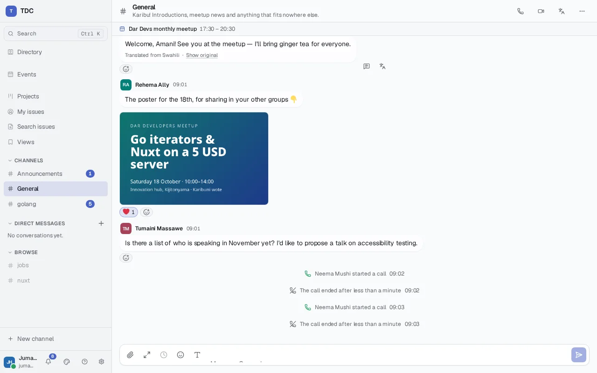

You can also have translation happen without asking:

- **Everything on this server** — in **Settings → More → Translation**.
- **One conversation** — the translate button in the conversation's header
  turns it on or off there, whatever the server-wide choice is.

Your own messages are never translated automatically. A message already in your
language is shown as it is, without a label. Code, mentions, channel names,
links, email addresses and `:emoji:` are never sent for translation and come
back exactly as written; the words around them are translated piece by piece,
which occasionally costs a little fluency around inline code.

**Which language.** The one you read the interface in, unless you choose another
in **Settings → More → Translation**.

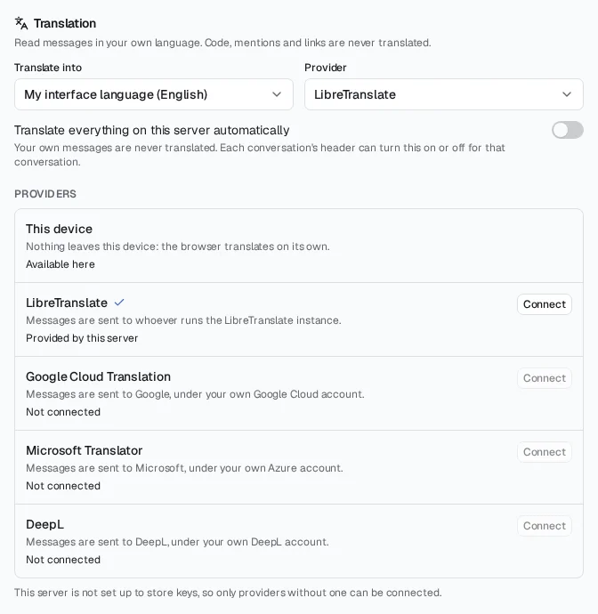

**Where it happens, and who sees your messages.** You choose the provider. By
default it is the first of these that works for you:

| Provider             | Who sees the message text                                                                                                                                                                                                                                                                                              | Cost                                                     |
| -------------------- | ---------------------------------------------------------------------------------------------------------------------------------------------------------------------------------------------------------------------------------------------------------------------------------------------------------------------- | -------------------------------------------------------- |
| **On this device**   | Nobody. The browser translates it itself; nothing about the message leaves your computer. The browser downloads a language model once, from its maker, the first time you translate a language — and asks for a click to do it. Only some browsers have this (recent Chrome on a computer; not Firefox or Safari yet). | Free                                                     |
| **LibreTranslate**   | Whoever runs the instance. If your operator runs one for this server, that is them; if you connect your own address, it is whoever runs that one. Public instances exist but see what you send and limit how much.                                                                                                     | Free, or the instance's terms                            |
| **Google**           | Google, under its Cloud Translation terms.                                                                                                                                                                                                                                                                             | Your own key; Google bills you beyond its free allowance |
| **Microsoft** (Bing) | Microsoft, under its Translator terms.                                                                                                                                                                                                                                                                                 | Your own key and, for most keys, its Azure region        |
| **DeepL**            | DeepL, under its API terms. Free keys end in `:fx`.                                                                                                                                                                                                                                                                    | Your own key                                             |

Choosing anything other than **On this device** sends the text of the messages
you translate — including other people's messages — to that provider, through
this server. It is the same as pasting them into that provider's website, without
leaving the conversation. Your operator may allow only some providers, or turn
translation off.

**Your keys.** A key you connect is stored encrypted on this server, used only to
translate messages you ask for, and **never shown again** — not to you, not to
an administrator. Replace it by connecting again; **Remove** deletes it. A
translation, once made, is kept on the server and shared with anybody else here
who can read the same message and asks for the same language from the same
provider, so the same message is not paid for twice; it is deleted when the
message is edited or removed.

Your preferences belong to your account on this server. The desktop application,
which can hold several servers, keeps a separate set for each.

## Files

Files are uploaded to the conversation and then sent with a message, which is
why a refused upload costs you nothing but the upload and a message that fails
to send does not lose the file.

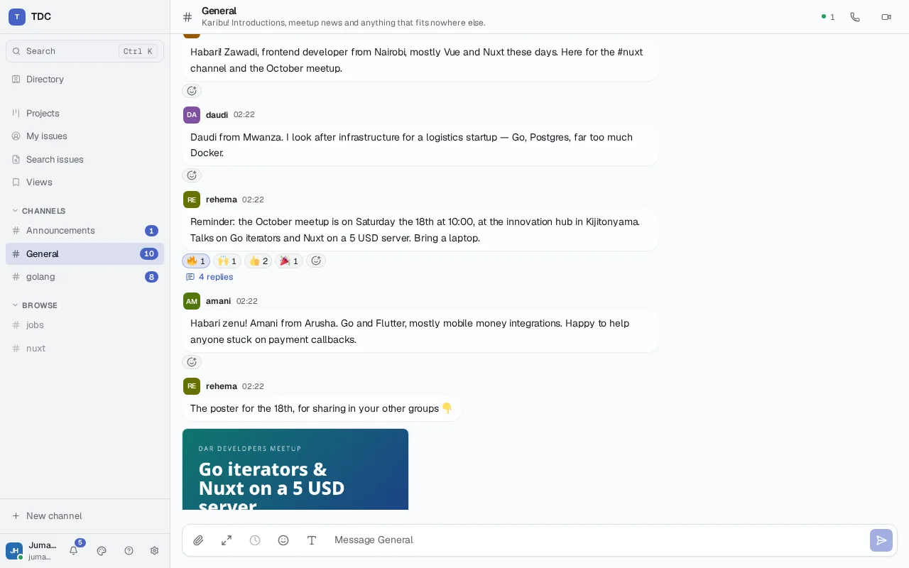

While a file is uploading you see real progress — the actual transfer, not an
animation — and you can cancel it, or retry without choosing the file again. The
conversation stays usable throughout.

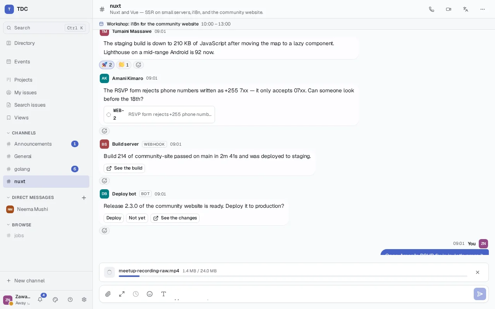

**A message can be just its files.** Pick a photo and press send without
writing anything; it goes as a message on its own, in a channel, a thread, a
direct conversation, a message scheduled for later, or a room on another server.
Notifications for it name the files.

**Large files survive a bad connection.** Every file is sent in pieces (4 MB
each, unless your server's operator chose otherwise). If the connection drops —
a train going into a tunnel, Wi-Fi handing over to mobile data — the upload
waits, asks the server how much arrived, and carries on from there instead of
starting again. Only after a minute and a half without getting anywhere does it
give up and offer to try again. Closing the page stops it; a half-sent file is
removed by the server after a day.

**How large?** The server's limits — by default 100 MB a file and 250 MB a
message, at most ten files — apply however you send. Your operator may also set
a **quota** on what your files take up altogether; where there is one, the
attach menu shows how much you have used, and a file that would go over it is
refused before any of it is sent. Sending the same file twice costs your quota
once.

On the desktop application, saving a file asks where to put it and writes it
straight there, so a file of any size saves without filling the computer's
memory.

The server enforces its own size and type limits regardless of what the client
checked, and a refusal names the limit you exceeded rather than failing vaguely.
A file's type is determined from its contents rather than from its name or what
the uploader claimed, and everything is served in a way that cannot execute in
the application.

**Images are reduced before sending by default**, and you can choose to send the
original instead. The application says which it is sending, and tells you if the
original is too large for the server's limit.

Each file can carry its own caption, so several sent together can each say
something different.

Images, animated images, video, audio and PDFs open in a viewer over the
conversation, with the keyboard to dismiss it and to move between the files on
one message. A type that cannot be displayed still shows its name, size and type
with a download.

### Files from other servers

In a room shared with another server, files work as they do anywhere else: what
you send reaches the people there, and what they send reaches you. A file from
elsewhere is copied to your server the first time anybody here opens it, so the
**first view may take a moment** — as long as copying it takes — and every view
after that is as fast as a file sent here. Your server checks that what it copied
is exactly what the sender's server signed for; if it is not, or if the file is
larger than your server copies from elsewhere (100 MB unless your operator chose
otherwise), you see the file's name and size with an explanation instead.

### Sending a file directly

In a direct conversation with one person, the attach menu has **Send directly…**.
The file then goes straight from your device to theirs, without being stored
on the server — useful for something very large, or something you would rather
did not rest on a server at all. Both of you need to be online and in TDC at the
same time.

**What they see.** A card in the corner of their screen: your name, the file's
name and size, **Accept** and **Decline**, and a note that accepting connects
the two devices, so each can see the other's network address — and so can a
relay, if the two cannot reach each other directly and your server provides
one. The name and size are what your device says; nothing has been checked by
the server, because the server never sees the file. Nothing is sent until they
accept.

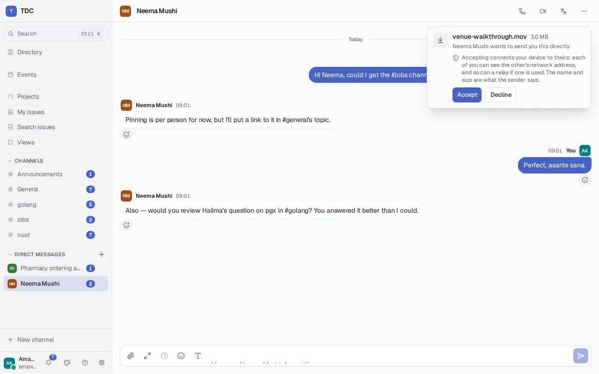

**While it goes,** both of you see progress and speed, and either of you can
stop it. On a browser that can (Chrome, Edge and other Chromium browsers),
accepting asks where to save the file and writes it to disk as it arrives, so
any size works. Elsewhere — Firefox, Safari, the desktop application — the file
is gathered as it arrives and offered as a download at the end, which suits
files up to a few gigabytes.

**When it does not work** — they are offline, they decline, nobody answers in
ten minutes, or your two devices cannot reach each other — you are offered
**Send through the server instead**, which uploads the same file as an ordinary
message without choosing it again. A direct transfer that breaks part way does
not resume; sending through the server does.

A direct transfer leaves nothing in the conversation. If you want a record that
you sent something, say so in a message.

### Sensitive media

Anybody can mark their own upload as sensitive, and a moderator can mark
anybody's. Marked media is covered until the viewer chooses to see it. Whether
covering happens at all is the operator's policy rather than each client's, so
that the same server behaves the same way in every client.

## Knowing what happened

### Presence and status

Whether somebody is around is derived from whether they are connected, so it is
right without anybody maintaining it. There are two states, **online** and
**offline** — a connection that drops without saying goodbye reads as offline
within a couple of minutes rather than leaving somebody apparently present for
ever.

Separately from that, you can set a status: **Available**, **Busy**, **Away** or
**Appear offline**. Busy and Appear offline withhold notifications. These four
are seeded when a server is created and there is no interface for changing the
list, so in practice they are what every server has.

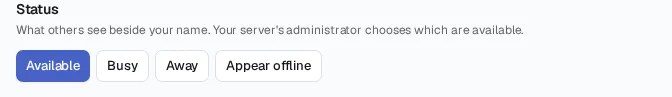

Your status is changed where it is shown: press your name at the foot of the
sidebar. The menu changes it in one press; _Set a note or a time_ opens a
dialog for a few words to go with it ("back at four") and **when it clears
itself** — after 30 minutes, an hour, four hours, at the end of today, at the
end of this week, at a time you pick, or never. The foot of the sidebar then
says how long it has left, and when the time comes it reverts to Available on
the server, whether or not any of your devices is open. Settings shows the same
status and opens the same dialog.

**Appear offline** shows you as offline to everybody while you stay connected:
your status and its note are withheld with it, and you still receive
everything. Choosing any other status makes you visible again. It also holds
notifications, as Busy does — hiding that you are here does not mean you want
to be interrupted.

### Automatic replies

While you are away, the server can answer for you: somebody who writes to you
directly, or names you with `@` in a channel, is told what you would have told
them — "away until Monday, ask Amina meanwhile".

The quickest way is from the status dialog. Choose a status other than
Available and tick **Turn on my automatic reply**, with the words to send. That
reply is tied to the status: it answers while you hold it and stops when you
change back or the status clears itself. The foot of the sidebar says
**Automatic reply on**, with a small speech-bubble mark, for as long as one is
answering.

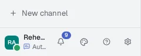

Settings → **Automatic replies** is where they are made in full. Each one has:

- **What it says.** Up to 500 characters, formatted as a message is. You can
  give mentions in channels different words from direct messages.
- **When it answers.** While your status is one or more of those you pick, or
  whatever your status is if you pick none; and from a time, until a time, both,
  or neither. The times are read in the time zone you choose, which starts as
  your device's — 09:00 in Dar es Salaam means 09:00 there wherever the server
  is. Leaving the end empty means until you change it.
- **What it answers.** Direct messages, group conversations, mentions in
  channels — any of them.
- **A preview** of the reply exactly as the person receiving it will see it.

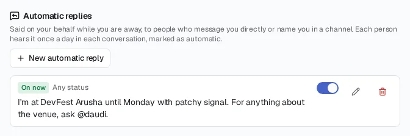

You can keep several, and switch each on and off without losing it. Where more
than one applies, the one made first answers.

**What people see.** The reply is posted as you, with **Automatic reply** beside
your name, so nobody takes it for you typing. A direct message is answered in
the conversation. A mention is answered in the thread of the message that named
you — the person who named you is told, and the channel itself is left alone.

**When it stays quiet.** An automatic reply that fires at everything is worse
than none, so:

- Each person hears it once per conversation per day, however many times they
  write.
- It answers people, never bots, webhooks or another automatic reply, and never
  you yourself.
- Nobody you have blocked, or who has blocked you, is answered; nor is anybody
  your privacy settings would not let start a conversation with you.
- A reply tied to a status stays silent while you **appear offline**, since that
  status is hidden from everybody then. A reply tied to Appear offline itself,
  or to no status, still answers — it says only what you wrote, and nothing
  about it depends on whether you are connected.
- At most twenty conversations an hour are answered for any one person.
- Only conversations on this server: somebody in a channel another server holds
  is not answered.

### What a member list says about you

A channel's members can see who else is in it. Your **name and address are
always shown** — they are how a message is attributed and a conversation is
opened, so a list without them is not a member list.

The three details past that are yours, under Settings → Privacy:

- **Whether you are online.** Turning it off does not disconnect you or change
  what you receive; it stops the server answering the question.
- **Your status**, along with the note that goes with it. One setting for both,
  because a status without its note ("Away", with no "back at four") gives away
  the fact while withholding the part that made it useful.
- **When you were last here.** The most revealing of the three — a last-seen
  time is a record of when you work and when you stop — and separate from
  presence, because "online now" and "last here at 03:12" are different things
  to disclose.

All three are shown by default, and each is a separate choice: hiding when you
were last here does not hide whether you are online now.

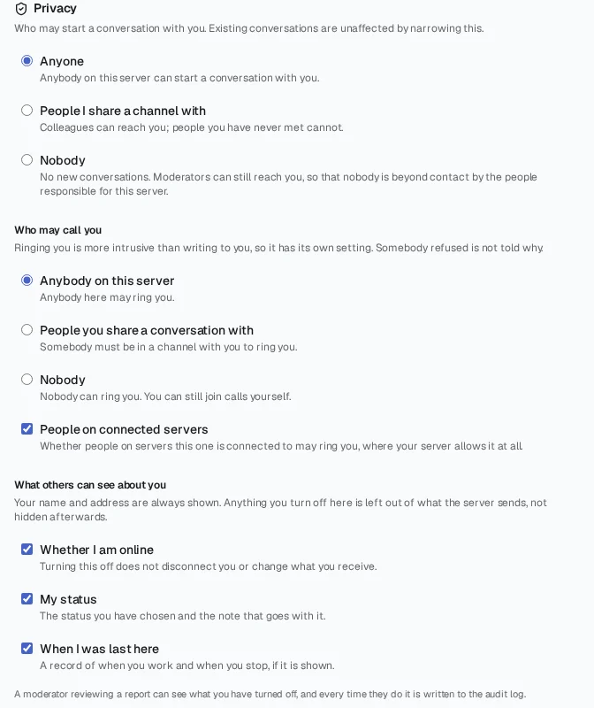

**A detail you turn off is left out of what the server sends**, rather than sent
and hidden by the application. This is the difference that matters: a detail
that reaches the client has been disclosed whatever the client then does with
it, and anybody who can read a network response can read it. That holds
everywhere the server answers these questions: the member list, and the online
count a conversation shows, which leaves you out of it rather than counting you
as offline.

These are standing choices, and not the same as _Appear offline_. Appearing
offline is about this afternoon and lapses when you turn it off; these hold
until you change them.

**A moderator reviewing a report can see what you have turned off**, and every
time one does it is written to the audit log. A report about somebody's status
cannot be judged without reading it, so the answer is not to refuse the access
but to account for it — which is what lets you see that it happened.

### Where you are

You can say where you are, under Settings → **Location**. It is one setting for
the account, shown with your name on your directory profile and in the member
lists you appear in. **Nobody sees it until you choose who may**: it starts as
_Only you_.

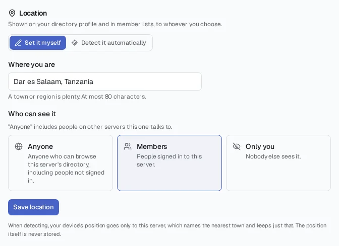

There are two ways to keep it:

- **Set it myself** — type a town or region, up to 80 characters. It stays as
  you wrote it.
- **Detect it automatically** — your browser asks once whether TDC may know
  where you are. If you allow it, your device's position goes to **this server
  only**, which names the nearest town from a list it carries (for example
  _Arusha, Tanzania_) and keeps that name. **The position itself is never
  stored or recorded**, and nothing is sent to any other company or service.
  While you use TDC it is checked again every few hours, and only if you have
  already allowed it — you are never asked twice. If your browser refuses, or
  the app cannot tell where it is (the Linux desktop app usually cannot), it
  says so and you can type it instead. Switching back to typing keeps the last
  detected town as the starting text.

Who may see it is the same three-way choice the directory uses:

| Setting      | Who sees your location                                                           |
| ------------ | -------------------------------------------------------------------------------- |
| **Anyone**   | anybody allowed to see you at all, including people on servers this one talks to |
| **Members**  | people signed in to this server                                                  |
| **Only you** | nobody else                                                                      |

Your directory profile shows the same location, but **never more widely than
what you wrote on the profile**: a location set to _Anyone_ on a profile whose
details are for _Members_ is seen by members only. As with the other details
here, a location somebody may not see is left out of what the server sends, and
a directory search by location does not find you unless they could see it.

### Typing indicators

You see who is composing, and the indicator disappears by itself when it stops
being refreshed rather than sticking around after somebody wandered off
mid-sentence.

You can stop others seeing yours: Settings → Privacy → _Show others when I am
typing_. Turned off, your devices stop announcing that you are writing, and the
server ignores any device that still does — so an old client somewhere cannot
give you away. It is one setting for the account, not one per device.

### Unread state

Unread state is kept on your account rather than in each browser, so it converges
across every device you are signed in on. Reading something on your phone clears
it on your laptop, and a device that was offline catches up when it reconnects.

Convergence happens when the other device next asks rather than being pushed
along the live connection, so the second device catches up within moments rather
than instantaneously.

### Notifications

You are notified about direct messages and mentions of you, about reactions,
replies and forwards of your messages, and about a message being pinned or
somebody joining. A reply notifies the people following its thread — whoever
started it and whoever has replied, unless they stopped following — and anybody
it mentions. Never your own actions.

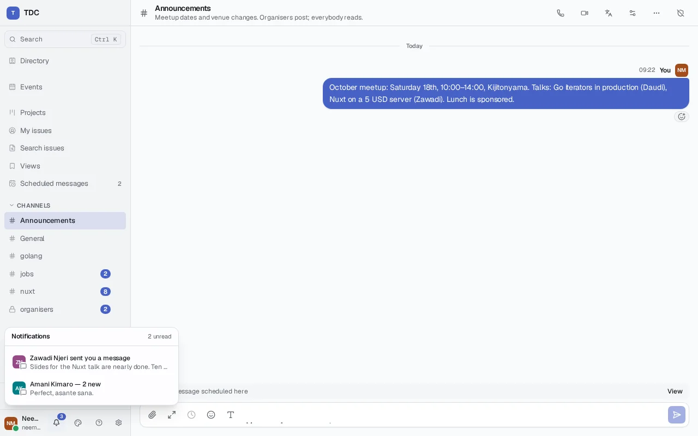

Some things happen without being asked for, because they are what make
notifications bearable:

- Nothing is raised for the conversation you are currently looking at.
- A notification is withdrawn when you read the thing elsewhere.
- A burst of messages arrives as one batched notification rather than one each.
  Your notification list shows one entry per conversation with a count, and
  your devices are told about the first message of a burst and not again until
  you have read the conversation or a minute has passed. Your operator chooses
  that window, and can turn it off.
- A status that suppresses notifications suppresses them.

Notifications also reach you with the browser closed, where your operator has
configured that. **You can choose to hide the content** in those, so a push for
a private conversation says that something arrived without saying what. That
switch is in your settings, and it fails closed — a push it cannot be sure about
conceals the sender rather than guessing.

#### A summary instead of interruptions

If you would rather not be interrupted at all, you can ask for **a summary by
email** instead, daily or weekly, at an hour you choose. It is in your settings
under _Summaries by email_, and it is off until you turn it on.

- **The hour is yours.** "Daily at 08:00" means eight in the morning where you
  are, taken from your device's time zone when you first choose it and shown
  beside the setting. If you move, the setting offers to switch to the zone
  your device is now in.
- **It replaces the interruptions.** While it is on, your devices are not
  notified. Everything still appears in your notification list and still counts
  as unread, which is what the summary is made from.
- **It counts; it never quotes.** A summary lists each conversation with
  something unread — how many notifications, from how many people, and how many
  were addressed to you — with a link to open it. What anybody wrote is not in
  the mail, because mail leaves this server.
- **Only what you can still read.** Each summary is checked when it is sent: a
  channel you have left, been removed from or muted since is left out, counts
  and all. If nothing is left, no mail is sent.
- **It waits for you.** If your status says not to interrupt you when a summary
  is due, it is held and sent once that changes, with nothing lost.
- **It goes only to a confirmed address**, like account recovery. Confirm one
  in your settings first.

The control appears only where it can work. A server whose operator has not
configured mail cannot send a summary, and does not offer one.

#### How much to hear from one conversation

Each conversation's menu — the **⋯** beside it in the sidebar, or in its header
— says how much you want to hear from it:

- **Every new message**, for a channel you follow closely.
- **Mentions and replies to me**, which is what every channel starts at: you
  are told when somebody names you or answers you, and not otherwise.
- **Nothing from here**, which keeps the channel without its interruptions.

A direct conversation does not offer these, because everything in it is
addressed to you; what it offers is muting.

**Mute conversation** silences it entirely, mentions and all — including a
reaction or a reply to something of yours there. A muted conversation is drawn
dimmed in the sidebar with a crossed-out bell and no unread count, and the key
for the next unread conversation passes over it. Its messages are still
unread and still there when you open it; muting stops interruptions, not
reading. It is on or off, not for a set time, and it follows you to every
device.

Replies in a thread reach you only when you follow it or are mentioned, even
with **Every new message** chosen. Any thread can be followed from the bell in
its header, including one you were not part of.

### Search

One box searches messages, channels and people together, rather than making you
choose first and search three times.

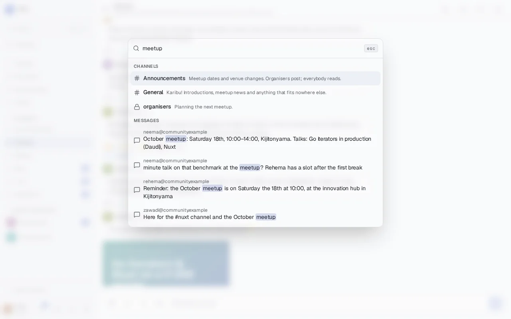

Results are ordered by recency with the matching part highlighted. Typing
partial words works — searching for the beginning of a word finds it.

**Search never returns anything you cannot otherwise read.** Messages from
channels you are not in do not appear, and a channel you could not discover is
not returned.

There is no search syntax to learn, and none to remember. There is no `from:`,
no `in:`, no date filter — type what you are looking for. Whatever you type is
treated as words to find rather than as a query language, so nothing you can
write produces an error.

## Invitations

Inviting somebody to a channel takes a permission, and being a member of that
channel is not enough on its own — an invitation admits somebody to a
conversation, and that is treated as the channel's decision rather than any
member's. The permission is granted at server level, so on most servers this is
something moderators and administrators do.

An invitation is a link, a short code, or both. The code is opt-in, and exists
for reading aloud.

Every invitation can carry an expiry, a limit on how many times it may be used,
and a binding to one person so that forwarding it achieves nothing.

Revoking one takes effect immediately. Somebody already holding the link cannot
be un-sent it, so the only withdrawal that means anything is the server refusing
to honour it.

A channel invitation admits somebody to that channel and nothing else.

Pasting an invitation link somewhere that renders previews shows an invitation
to the server and never names the channel — an invitation posted into a group
chat is previewed for everybody in it, not only the person being invited. It
also previews identically whether it is valid, revoked or invented, so nobody
can test invitations by pasting them.

## The directory

Where the operator has switched it on, **Directory** appears in the sidebar. It
lists people on this server who chose to be found, and the companies they
agreed to be listed by. [The directory](directory.md) describes all of it; the
short version:

- **Nobody is in it unless they put themselves there.** Without a directory
  profile you are not listed, and nothing else about your account changes.
- **Your profile has three visibility settings** — for the profile as a whole,
  for what you wrote, and for your contact details — each _Anyone_, _Members_
  or _Only you_. Contact details start as _Only you_. A section is never more
  visible than the profile it is in.
- **It does not touch your privacy settings.** Having a public profile does not
  make you visible as online, and hiding your presence does not take you out of
  the directory. They are separate decisions.
- **You can delete your profile** at any time without deleting your account,
  and **export it** as a file you can bring back later or elsewhere.
- **Whether you take enquiries is a setting on your profile**, separate from
  who may send you direct messages. An enquiry is one message, which opens a
  private conversation the sender cannot add to until you take it up.
- **Taking up an enquiry makes it an engagement**, with a private conversation
  and a recorded state you both see. Either of you can withdraw before an
  agreement.
- **A proposal is versioned and an agreement needs you both.** Asking for a
  change to one line gets you a new version, with the old one kept as it was;
  the agreement is recorded only when you both accept the same version, and
  cannot be changed afterwards. Either of you can export it. The server keeps
  the record and nothing more: it holds no money and settles no disputes.
- **Finished work needs both of you too.** One says it is complete; it stays
  outstanding until the other confirms.

### From a profile to an agreement

Two people who have never met: Amani, a developer, and Baraka, who needs work
done. Each has an account on the server (**Create one** on the sign-in page)
and the operator has switched the directory on.

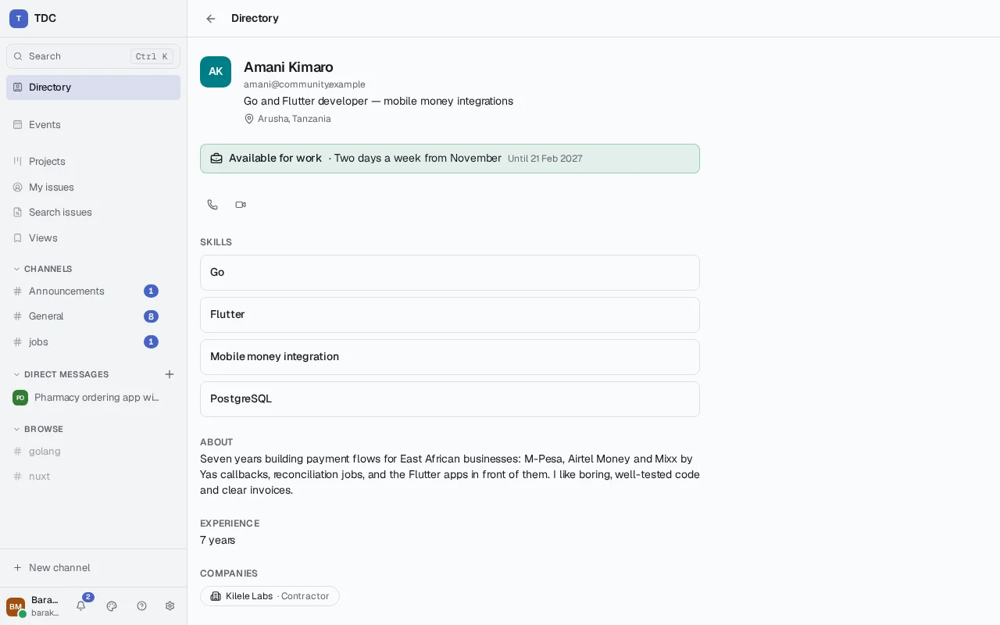

**Amani makes a profile.**

1. Open **Directory** in the sidebar, then **Your profile**. It says _You have
   no directory profile_, and nothing about the account changes until one is
   made.
2. Write a **Headline** — one line on what you do — and a **Location**. Add
   skills by typing in **Find a skill** and choosing one; "golang" finds Go.
3. Choose who sees it. **Who can find you** and **Who sees what you wrote**
   are each _Anyone_, _Members_ or _Only you_. **Who sees your contact
   details** starts at _Only you_, and can stay there: people can still reach
   you through the directory without it.
4. **Take enquiries through my profile** is on for a public profile unless you
   turn it off.
5. **Create profile.** _Your profile is created._ appears, and you are in the
   directory for the people you chose.

**Baraka finds Amani and asks.**

6. Open **Directory**. Search by **Skill**, **Location**, a name or words from
   a headline; tick **Available for work only** to see only people who said
   so. Results show only what each person let you see.
7. Open Amani's profile. Under _Send Amani an enquiry_, give a **Subject** and
   describe **The work** — what, roughly when, and anything Amani needs to
   decide. **Send enquiry.** It is one message: you cannot add to it until
   Amani answers. It appears under **Enquiries** as _Waiting for an answer_.

**Amani takes it up.**

8. Amani is notified like any direct message. Under **Directory →
   Enquiries**, **Take it up** turns the enquiry into an engagement and opens
   its page; **Decline** answers it without one. Both of you now find it under
   **Engagements**, and its **Conversation** tab is a private conversation
   between the two of you.

**Agreeing on the work.**

9. On the engagement's **Proposal** tab, either of you chooses **Write a
   proposal**: **What the work is**, **When**, a **Currency** (TZS unless you
   change it), and each deliverable with its **Price**, typed the way you
   would write it. **Send the proposal.**
10. The other person can **Accept**, **Decline**, or **Ask for a change** to
    one part — the work, the timeline, the currency, or one deliverable — and
    say what they would like instead. The person who sent the proposal is
    notified.
11. Answering a request is **Send a new version**: the form starts from the
    latest version, so you change only what was asked about. Every version
    stays readable under **Earlier versions**, with what changed marked.
12. When one of you accepts, the page says the agreement waits for the other.
    When **both of you accept the same version**, the agreement is recorded,
    with both acceptance times. Nobody can change it after that.
13. Either of you can **Export the agreement** as a file. You both get the
    same file.

**Finishing.**

14. Either of you chooses **Start the work**. When it is done, one of you
    chooses **The work is complete: ask … to confirm**, with a note if you
    like; the other sees it and chooses **Confirm the work is complete**.
    Until they do, it shows as outstanding to both of you. The engagement then shows _Completed_, with every step and
    who took it under **History**.

Either of you can **Withdraw** at any point before an agreement, with a reason
the other sees.

**What an agreement record is, and is not.** It is a record, kept by this
server, of what the two of you agreed and when, which either of you can refer
to or export. **The server and whoever runs it are not a party to it.** They do
not hold or move money, offer escrow or payment, guarantee that either of you
will do what was agreed, or settle disputes about it, and no service that does
any of those is connected. Every agreement, on screen and exported, carries
that statement in the same words. Paying, and resolving a disagreement, are
between the two of you.

- **A company can ask to list you; only you can accept**, from your profile
  page. Leave, and it is gone from both the company's page and your profile at
  once.

## When something is wrong

### Blocking

Blocking somebody is a personal boundary rather than an exercise of authority,
so it needs no permission and **the person blocked is never told**. Moderators
keep their full view, because a moderation problem that can be hidden from
moderators is not one anybody can deal with.

### Reporting

Anybody signed in can file a report, including about something they saw in a
channel they have since left. **The person reported never learns who reported
them.** Reports are rate limited, for the obvious reason.

### What moderators can do

Remove a message, or edit one — an edit by a moderator is shown as theirs, not
the author's, and marked as a moderator's. Suspend an account, which
invalidates its sessions immediately. Restrict somebody from posting,
temporarily or permanently. Ban somebody from one channel, which is confined to
that channel and leaves their other memberships alone.

Look after a channel: rename it or change its topic, archive and restore it,
make it private, and take somebody out of it. Each is its own permission, and
each can be given for one channel alone, so a channel can have keepers who have
no say anywhere else. Making a channel **public** needs that permission for the
whole server, because it opens everything ever said in the channel to everybody
on it — the settings ask before doing it. Taking somebody out of a channel is
not a ban: their client is told at once and stops receiving the channel, and
they can join a public channel again whenever they like; a private one needs an
invitation, as it did the first time.

Everything on that list is recorded in the audit log, with its reason and its
duration where it has one, and everything on it is reversible. Temporary
restrictions expire by themselves rather than needing somebody to remember.

Your operator may also have a word filter configured, which can flag a message
for a human, mask the word, or block the message outright. It is off unless
somebody set it up.

Where the directory is switched on, three more permissions may be handed out,
each to whoever the community trusts with that judgement: moderating profiles,
reviewing proposed skills, and verifying claims. [The directory's moderation
section](directory.md#moderation) is the guide for all three — what each
allows, how to approve, merge or reject a skill, how to verify and revoke a
claim, and the audit entry each leaves.

### Deciding who may do what

Whoever may make roles or hand them out finds **Roles and permissions** under
Administration in your settings. It lists every role with how many people hold
it and what it allows. Open one to rename it, describe it, delete it — the
server keeps `Member` and `Administrator` — or set each permission to
**Allow**, **Deny** or **Unset**. Beside each choice is what it will mean:
whether `Member` already gives it to everybody, that a denial wins over every
other role, or that a role which administers the server already has it. The
people holding a role are listed underneath, with a search to add somebody.

To see what one person may do, search for them on the roles screen, or open
**Roles** beside them in the people list. Every permission is listed with the
role that decided it, across the server or in one channel you pick. Their roles
can be given and taken away from there too.

A channel's own settings show **Who may do what here** to the same people: what
each role is allowed or denied in that channel alone. That is how a channel
gets keepers who have no say anywhere else, and how an announcement channel is
made. Deny posting to `Member` there, and allow it to the role whoever
announces holds.

If a change would take away your own authority, you are asked first. One that
would leave the server with nobody to administer it is refused.

### Messages from other servers

If your server federates, some messages in a room come from people on other
servers. Your moderators can act on them exactly as on local ones: remove them,
filter them, and take reports about them. Nothing about a message being foreign
puts it out of reach.

**What your moderators cannot do is make it go away everywhere.** Removing a
message here removes it here. The server it came from keeps its own copy, and
so does every other server in the room, because no server can compel another to
forget something. A protocol that claimed otherwise would be telling your
moderators their decision travelled when it had not.

This works both ways: a moderator on another server can remove one of your
messages from their copy, and your server keeps it.

## Calls

Where your server offers them, any channel or direct conversation can hold a
voice or video call. Calls are off unless the server's operator turns them on,
so if you see no phone button in a conversation's header, that is why.

### Starting and joining

The phone button in a conversation's header starts a call by voice; you can
turn your camera on once you are in. In a direct conversation that rings the
other person, and **Start a video call** does the same with your camera on.
Everybody in the conversation sees a bar saying a call is going on and who is
in it, with **Join** and **Join with video**. Your browser asks for your
microphone (and camera) the first time; nothing is sent until you allow it, and
nobody is told you have joined until then either. Where your device says the
connection is metered, TDC warns you before you join.

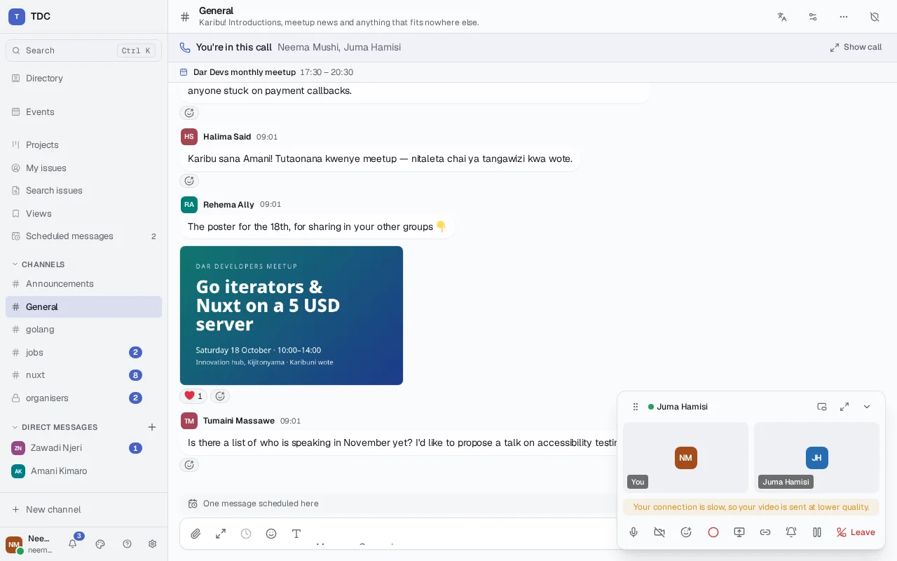

You can switch between voice and video at any time: answer or join by voice or
with video, and turn your camera on or off during the call. Closing the tab or
reloading the page ends your part in the call; moving between pages inside TDC
does not.

### Ringing people, and being rung

**Ringing.** In a call, the bell in the call window (**Ring people**) lists the
conversation's members who are not in the call, each with **Ring**. A ring
reaches every device the person is signed in on, and stops on all of them when
they answer on one. If they decline, you see that for a moment; if nobody
answers within 45 seconds, they get a missed-call notification. Somebody whose
settings do not let you ring them is listed like anybody else and simply not
rung — you are not told why.

**Somebody on another server.** Where your server calls connected servers,
**Ring people** also has a field for an address — `name@server`. Type it and
press **Ring**. Their server decides for them, and answers every ring the same
way whether it rang them or not, so TDC tells you only that they were rung _if
they accept calls from other servers_. If they join, they appear in the call
like anybody else. If your own server cannot ring that address — it is not
connected to theirs, or the address is one of this server's own, whom you ring
from the list — the field says so.

**From a profile.** The phone and camera buttons on somebody's directory
profile, and beside people in a channel's member list, open your direct
conversation with them — or the one you already have — and ring them.

**Being rung.** An incoming call appears as a small window at the edge of the
screen, never over what you are doing; drag it anywhere, or move it from the
keyboard by its grip. It stays while you move between pages, and offers
**Answer**, **Video** (answer with your camera on) and **Decline**. Several
calls at once are listed together, newest first, each with its own buttons.
**Silence** stops the sound without declining. If you are already in a call,
the window says so and offers **Hold & answer** — the current call waits while
you take the new one — or **End & answer**, with a choice of a few words for
the people you are leaving. When the browser is in the background or closed, a
ring arrives as a notification, where you have allowed notifications; the
desktop application shows a banner, even when closed to the tray.

**Declining with a message.** The speech-bubble button beside **Decline**
offers quick replies — "Can't talk right now", "I'll call you back soon" and
others — or a box for your own words. The caller sees them at once in their
call window, and they are posted in your conversation with them, where they
stay.

**Who may call you** is in **Settings → Privacy**: anybody on this server,
only people you share a conversation with, or nobody — you can still join calls
yourself. A separate switch decides whether people on connected servers may
ring you, where your server allows that at all. Whoever is refused is not told
why.

**How it sounds** is in **Settings → Notifications → Ringing**, kept on each device and, in
the desktop application, for each server separately: turn the ringer off,
choose a tone, add your own (an audio file under 400 KB), give particular
people their own tone by address (`name@server`), and, on phones whose browser
supports it, vibrate for incoming calls. The incoming window has a ringer
switch too.

### In a call

The call sits in a small window in the corner, so you can carry on reading,
writing, opening projects — anywhere in the application — without leaving it.
From that window you can:

- **mute** and unmute, and turn your **camera** on and off;
- **expand** it to fill the screen, and make it small again;
- **minimize** it to a bar with just your microphone and **Leave**;
- **move** it: drag it by its grip (the dotted handle) anywhere on the screen,
  or focus the grip and use the arrow keys (Shift moves it further). It stays
  where you put it, on this device;
- **picture in picture**: take the call out of the page into a small window
  that stays above your other windows, so you can work in another app. Where
  your browser can only put a single video there, it is the first person's;
- **hold** it, **ring** people into it, **present**, **raise your hand or
  react**, and — where you may — **record** it or make a **link** to it, each
  described below;
- **Leave**.

**From the keyboard**, while you are in a call and not typing: `Shift M` mutes
and unmutes, `Shift V` turns the camera on and off, `Shift H` raises or lowers
your hand, `Shift S` presents your screen or stops, and `Shift F` makes the call
window large or small again. They are listed under `?` with the rest. With
reduced motion (in **Settings → Appearance**, or your system's own setting),
the call's moving parts — reactions, the ringing pulse, the recording mark —
keep still.

### Presenting, hands and reactions

**Presenting your screen.** The screen button in the call controls shares a
screen, a window or a browser tab — with its sound, where your browser offers
that. Whatever you share takes the stage above everybody's tiles. One person
presents at a time: while somebody is, the button is greyed and says so, and
they stop it themselves (or with the browser's own "Stop sharing"). Somebody who
moderates the conversation can take a presenter off the stage. Sharing needs a
desktop browser; phones generally cannot share their screen.

**Raising a hand and reacting.** The smiley button in the call controls
raises your hand — hands are listed in the order they went up, for everybody to
see, and come down when you lower yours or when whoever is presenting (or a
moderator) takes your question — and sends a passing reaction: clap, laugh,
heart, thumbs up, surprise or celebrate. A reaction floats up over the call with
your name and is gone after a few seconds; nothing is kept. Whoever presents
sees a running count of the reactions their presentation has drawn. With
reduced motion, reactions fade in place instead of floating.

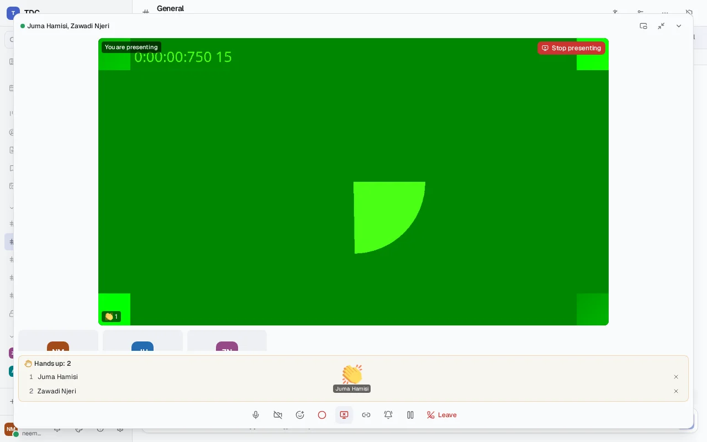

**Letting somebody control your screen.** When you present your whole screen
from the TDC desktop application, the others in the call see **Ask to control**
on your screen. If somebody asks, the call window shows their name with
**Allow** and **Decline**; nothing happens until you choose. Once you allow it,
their pointer movements, clicks, scrolling and typing reach your computer — any
program on the screen you share, not only TDC — and a red strip stays at the top
left of your screen, above every other window, saying who is in control. One
person controls at a time: allowing somebody else takes it from the first. You
take control back at once with **Take back control** in the call window, or by
pressing **Pause** on your keyboard (on a Mac, which has no Pause key,
**Control-Option-Command-Escape**) wherever you are; that key is kept for you,
so the person controlling cannot press it or block it. Control also ends when
you stop sharing, or when either of you leaves the call. The person controlling
clicks on your screen in the call window to start, and the keyboard goes to you
only while your screen has focus there; **Tab** moves them off it, and **Stop
controlling** gives control back.

Somebody asking is told plainly when control cannot be given, and why: you are
presenting from a browser (which cannot move a pointer, so remote control needs
the desktop application), you are sharing a window or a tab rather than a whole
screen, the call is a large one carried through the server (which has no direct
channel between you), or your computer cannot be driven. On Linux that last one
means a Wayland desktop — Wayland does not let one program move the pointer or
type into others, so remote control works only in an X11 session; under
Windows, programs running as administrator cannot be controlled from a program
that is not; and a Mac needs TDC allowed under **System Settings → Privacy &
Security → Accessibility** first.

### Recording a call

Where the server's operator allows recording, somebody holding the
`call.record` permission (which nobody has until an administrator grants it)
sees a red record button in the call controls. Pressing it tells everybody
first: before your device records anything, the server writes in the
conversation and the audit log that you started recording, and everybody in the
call gets a red **Recording** bar naming you, which stays up for as long as the
recording lasts — in every size of the call window, and as a red mark on the
minimized bar. Somebody joining a call that is being recorded is told who is
recording before any of their sound or picture is sent, and can choose **Don't
join** instead.

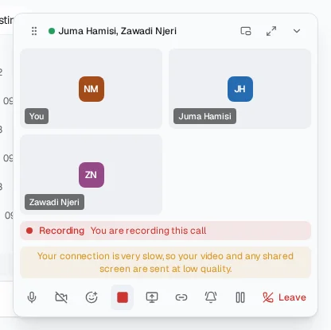

The recording is made on your own device — the stage (the screen being
presented, or everybody's tiles with their names) and everybody's sound mixed
together — so it holds what your device received: if your connection dropped
somebody for a while, they are missing from it. The server records nothing
itself. Press the button again to stop. Leaving the call, holding it, switching
to another call, or losing your connection stops it too, and that is noted in
the conversation and the audit log the same way. When it stops, the file is
uploaded into the conversation as an ordinary attachment, under the server's
usual file limits; if the server will not take it — it is larger than the
server accepts, say — the call window says why and offers **Save it on this
device** instead. The feature is about recording openly: it cannot stop anybody
recording their own screen with other software.

### Links to a call, and guests

Somebody allowed to (the `call.link` permission, which an administrator grants)
can make a link to a conversation's call from the link button in the call
window: with a label, a lobby where people wait until somebody in the call lets
them in, a passcode, an expiry and a limit on how many people it lets in. The
link is shown once — copy it then. Whoever opens it sees the conversation's
name and who is in the call, signs in if they have not, and joins the call —
only the call: the conversation, its messages and members stay closed to them.
Links already made are listed below the form, with a button to withdraw each. A
link to a call that has not started waits for it. People waiting in a lobby are
listed in the call window, with **Let in** and a button to turn each away.

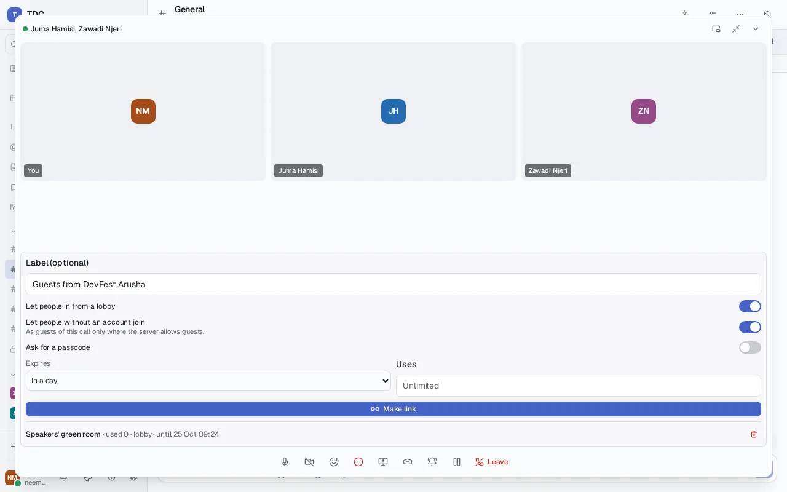

**Guests.** Where the server's operator allows it, a link can also let in
people with no account here — a speaker from elsewhere, a client. Switch on
_Let people without an account join_ when making the link. Whoever opens it is
offered **Sign in to join** and, below, **Join as a guest** with a name to be
shown by. A guest is in the call and nowhere else: they cannot open its
conversation or anything else on the server, everybody in the call sees them
marked _Guest_, and when the last person who belongs to the conversation
leaves, the call ends for the guests too. Guests join from a web browser.

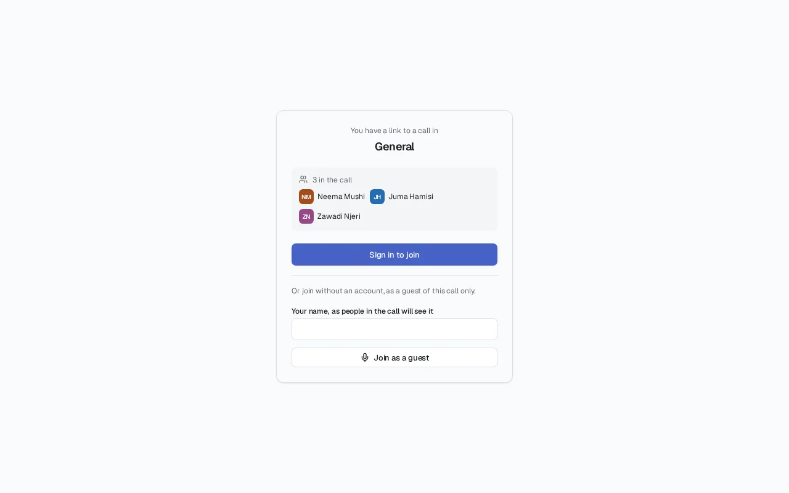

### Several calls at once

You can be in more than one call, talking in one and holding the others, as on
a phone. Your microphone and camera go only to the call you are talking in;
nothing reaches a held call, and its people see that you are holding. Held
calls are listed in the call window with **Switch**, which holds the current
call and takes you back to that one, and a button to leave them. **Hold** in the
call controls holds the call you are in, and **Resume** brings it back. Joining
another conversation's call while in one holds the first rather than ending it.

**Merging calls into a conference.** With one call held and another going,
**Merge** on the held call invites its people into the call you are in. Each of
them is asked first, and joins only by accepting; once they have, the held call
ends. People merged in take part in the call and nothing else: they cannot open
its conversation, read its messages or see who else is in it beyond the call.

### What others can see

- **In the conversation:** that a call is going on and who is in it; then lines
  between the messages for its start (who started it) and its end (how long it
  lasted), and for any recording's start and end, naming who recorded.
- **In the call:** your tile, with your name and whether your microphone and
  camera are on; that you are holding the call; your raised hand, in its place
  in the queue; your reactions, with your name, for a few seconds; whatever you
  present; a red **Recording** bar naming whoever records; and _Guest_ beside
  anybody without an account.
- **Your server's operator:** who called whom, when and for how long. In a
  call of up to four people (or your server's mesh limit), sound and picture go
  directly between you, encrypted between each pair of devices, and do not pass
  through the server. In a larger call carried by the server's forwarding unit,
  they pass through the server and are decrypted there on the way — nothing is
  kept, but the server handles them. Your operator's hosting guide says which
  your server does.

### Your connection

**What a call uses.** In a small call, everybody sends their own sound and
picture to everybody else, so what matters is your own connection:

| In a call with   | Voice only (send / receive) | With video (send / receive)  |
| ---------------- | --------------------------- | ---------------------------- |
| one other person | about 0.4 MB a minute each  | about 5–10 MB a minute each  |
| three others     | about 1.2 MB a minute each  | about 15–30 MB a minute each |

Each extra person adds to what _you_ send, not only to what you receive. On a
phone, or on a connection that charges for data, prefer voice. Past four
people (or your server's mesh limit), a call either moves to the server's
forwarding unit — everybody then sends once, to the server, and the picture
freezes for a second while the call moves — or, where the server does not
forward calls, is full, and the next person is told so. However it is carried,
a call holds at most the server's limit, 25 unless your operator chose
otherwise.

**On a poor connection** a call steps down rather than dropping. When your
connection cannot carry what you send, your video goes to a lower quality,
then lower still (with any screen you share sent at fewer frames a second),
then your camera pauses while your sound and shared screen go on, and only
after that is your sound sent at lower quality — the call itself is never ended
for it. Each step is said in the call window ("Your connection is slow, so your
video is sent at lower quality", and so on), and once the connection has stayed
good for about ten seconds things come back a step at a time, which is said too.

**Networks that block calls.** Some networks — offices, mobile carriers, some
home routers — stop two people reaching each other directly. Your server's
operator can run a relay so those calls still connect; without one, a call
between two such people fails, and TDC says so.

## Events

Meetups, talks, workshops and office hours are **events**. **Events** in the
sidebar lists every event you can see, as an **agenda** of what is coming (or,
under **Past**, what has been), as a **month**, or as a **week**, and can be
narrowed to one channel. A channel also shows its next event in a line under
its header. Each occurrence of a repeating event is its own entry.

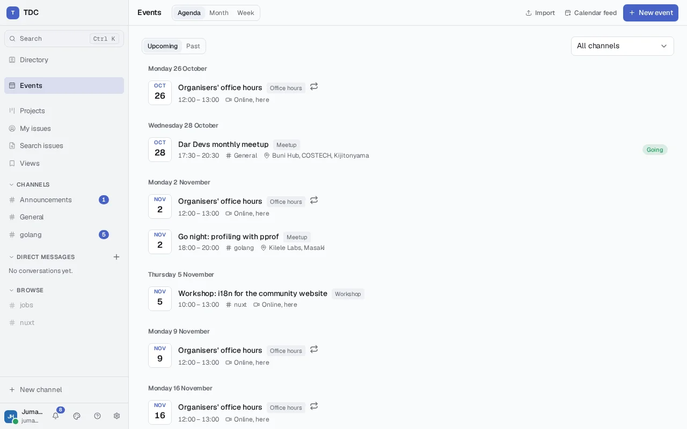

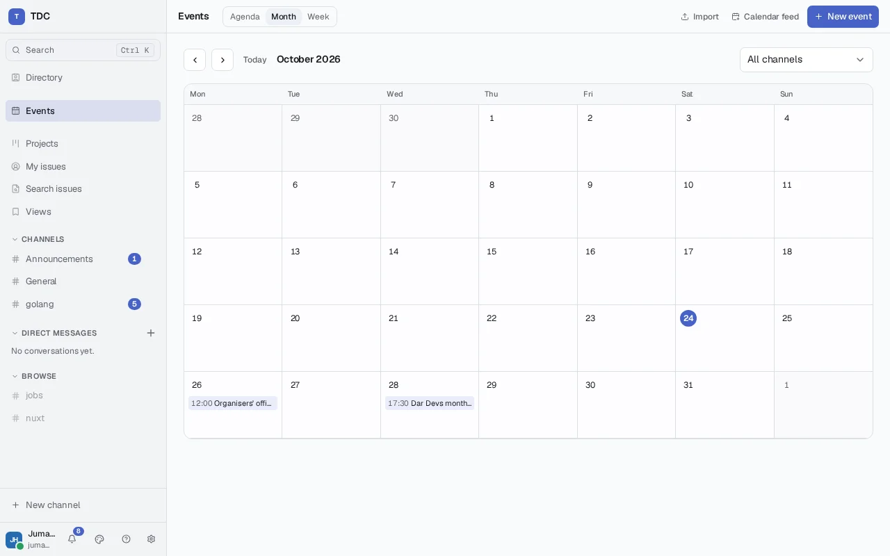

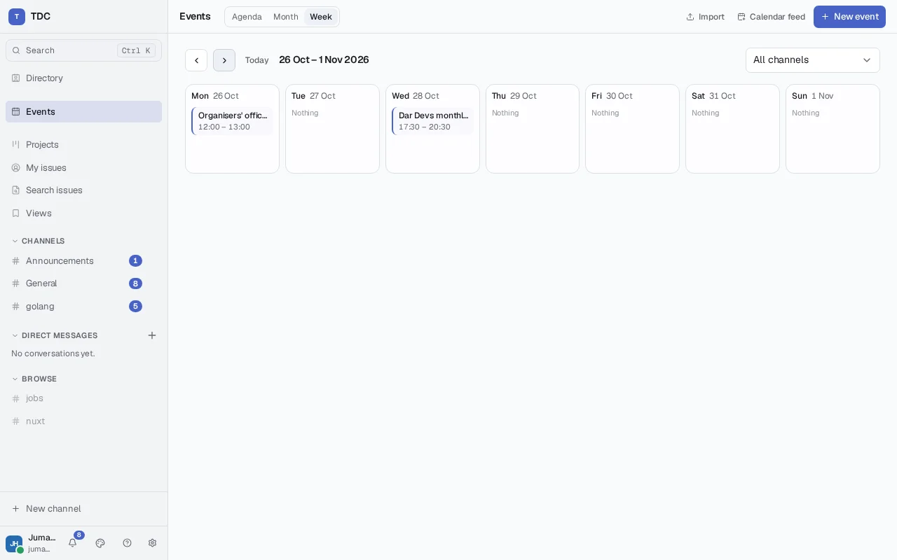

The Events page is there only where your operator offers events, which a new
server does.

### Times, in your zone and theirs

An event is scheduled in a time zone — the organiser's — and stored as an
instant, so it is the same moment for everybody. You see it in **your own
zone**, and whenever that is a different time from the organiser's, their time
beneath it: "15:00 – 17:00 · Thu 18:00 GMT+3 for the organiser". An all-day
event is the same dates for everybody, wherever they are.

### Scheduling one

**New event** opens the form. Most of it is optional:

- **Title, kind and description.** Kinds are meetup, talk, workshop, office
  hours and other. The description is written like a message — bold, lists,
  links, code.
- **When.** A start and an end, or **all day**, in the **time zone** you choose;
  the form opens in yours. Times are read in the zone shown, so choosing London
  and typing 19:00 means 19:00 in London.
- **Repeats.** Daily, weekly (on chosen weekdays) or monthly (on the same date,
  or the same weekday — "the second Tuesday"), every so many days, weeks or
  months, ending never, after a number of times, or on a date. A weekly 19:00
  stays at 19:00 when the clocks change.
- **Where.** A place in words, a link to a meeting somewhere else, or
  **Host it in a call here** (below).
- **Who.** Whether it belongs to a channel or to the whole server, who can see
  it — everybody on the server, the channel's members, or only the people
  invited — how many places it has, and its hosts and speakers.
- **Agenda.** The talks or parts within it, each with a time and speakers —
  people on this server, or named in words when they are not.

A public event cannot belong to a private channel: it would tell everybody the
channel's name. Scheduling takes the `event.create` permission, which every
member has unless the operator has taken it away, and you must be in a channel
to schedule one there.

Whoever made an event and its hosts can change it, invite to it, give it a
**cover image**, and **cancel** it — it stays, marked cancelled with the reason,
and everybody going is told. Deleting it altogether is for whoever made it.
Somebody holding `event.manage.any` can do all of that to anybody's event, and
what they do is in the audit log.

### Answering, and the waiting list

On an event's page, answer **Going**, **Maybe** or **Not going**, and change
your answer whenever you like until it is over. An answer to a repeating event
covers every occurrence.


If an event has a number of places and they are taken, **Going** puts you on the
**waiting list**, and the page says your place in it. When somebody going
changes their answer, the first person waiting gets the place and is told.
Hosts and speakers do not take places.

**Who is coming** lists the people going, maybe going and waiting. If you would
rather not be seen there, turn off **Which events I am going to** under
**Settings → Privacy → What others can see**: you are counted, not named. An
event's organisers always see who is coming — running an event means knowing
that.

### Invitations

Hosts invite **people** and whole **channels** from the event's page. Everybody
invited is told. For an invite-only event, an invitation is what lets somebody
see it, and inviting a channel lets everybody in it see it.

### Reminders

Before each occurrence of an event you are going or maybe going to, hosting or
speaking at, you are reminded — by default a day before and a quarter of an
hour before, though your operator chooses. A reminder is a notification like
any other: in your list, by push where you have turned that on, as a banner from
the desktop application, in your email summary if you chose one, and at the
corner of the page if you have TDC open. You are also told when an event you
are going to changes its time or place, or is cancelled.

**Remind me before it starts**, on the event's page, turns an event's reminders
off for you, and back on. (It mutes the event's own conversation, which is what
reminders belong to.)

### Hosting it in a call

An event **hosted in a call here** has a call on its page. When it is time, a
host presses **Start the call**; everybody going or maybe going then joins from
the same place, by voice or with video. It is an ordinary TDC call, so
everything in [Calls](#calls) applies. Somebody who is not going cannot start
or join it, and only hosts can start it.

To bring in people who have no account here, a host who may make call links
(`call.link`) makes one from the call window once the call has started.

### Putting events in your own calendar

On an event's page, **Add to your calendar** offers:

- **Download .ics file** — opens in any calendar application.
- **Add to Google Calendar** and **Add to Outlook** — open their own forms with
  the event filled in. TDC sends them nothing; your browser goes there because
  you asked.

To have **all** your events appear in your calendar, and keep up to date, use
**your calendar address**: **Settings → More → Your calendar → Make my calendar
address**. It holds the events you are going to, hosting or speaking at, and
your channels' events, and it is **shown once** — copy it then. Anybody holding
it can read your calendar, so treat it like a password: **Make a new address**
replaces it and **Revoke** stops it for everything that uses it.

Adding it:

- **Google Calendar** — on the web, **Other calendars → + → From URL**, paste
  the address, **Add calendar**. Google refreshes subscribed calendars on its
  own schedule, typically every few hours, so a change can take that long to
  appear there.
- **Outlook** — **Calendar → Add calendar → Subscribe from web**, paste the
  address, **Import**.
- **Apple Calendar** — **File → New Calendar Subscription**, paste the address.
  On an iPhone: **Settings → More → Calendar → Accounts → Add Account → Other → Add
  Subscribed Calendar**.
- Anything else that subscribes to a calendar by address (Thunderbird, GNOME
  Calendar…) works the same way. **Open in your calendar application** offers it
  as a `webcal://` link, which most open directly.

What the address holds is decided at every fetch: leave a channel, or answer
**Not going**, and those events leave your calendar at its next refresh.

### Bringing events in

**Import** on the Events page takes an `.ics` file — exported from Google
Calendar, Outlook or anything else. Before anything is saved you see what each
event would become: **new**, an **update** to one you already imported (events
are matched by their identifier, so importing the same file twice creates
nothing twice), or **skipped** because somebody else's event has that identity.
Anything that cannot come across exactly — a repeat events here do not support,
a time zone this server does not know — is said beside it. Choose which to
import, where they belong and who can see them.

**Followed calendars** (for people holding `event.calendars.manage`) keeps a
calendar published elsewhere — a community's Google Calendar, a conference's
feed — appearing here: paste its ICS or `webcal://` address, and the server
fetches it on a schedule, adding, changing and cancelling events as it does.
Those events change only where they come from.

## Projects

When a conversation decides something needs doing, it can be tracked where it
was decided. **Projects** in the sidebar lists the projects you can see; each
holds issues named by the project's key and a number — `WEB-12` — that never
changes. An issue moves through the states its project defines, and everything
that happens to it is kept in a history nobody can edit.

A message becomes an issue from its own menu — **Create an issue from this** —
and the two stay linked: the issue shows where it came from to anybody who can
read that conversation, and the message shows the issue. Each issue has a
discussion beside it that works like any channel.

Work can be time-boxed in **cycles** and gathered across them into
**milestones**, both optional. A cycle's days are the project's own calendar,
and when one ends with work unfinished the server carries that work forward to
the next cycle or leaves it — never deletes it.

[Projects and issues](projects.md) is the whole guide: starting a project,
configuring its states, filing and moving issues, cycles and milestones, and who
may do what.

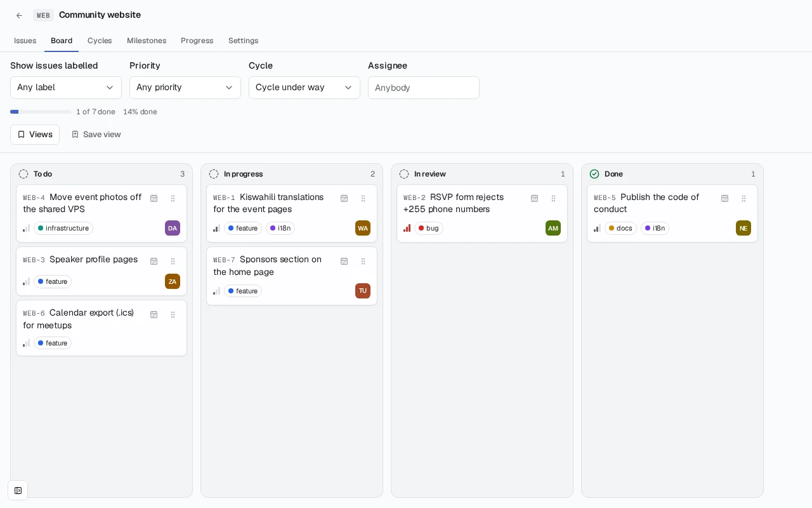

## Making it yours

**Settings** is in tabs, one subject each: **Profile** (your picture, names,
location, status and automatic replies), **Account and security** (email, two-step
sign-in, passkeys, API tokens and signed-in devices), **Appearance**,
**Notifications**, **Privacy** (who may reach you and who you have blocked) and
**More** (translation, your calendar, the tour, integrations and
administration). The tab you are on is in the address, so a link can open one.

### Your picture

**Settings → Profile → Picture** puts a picture beside your name, everywhere
people on your server see you: your messages, member lists, the directory,
calls. Without one, your initials are shown, on a colour of their own.

**Choose a picture** opens a PNG, JPEG, WebP or GIF of up to 20 MB, and frames
it before anything is sent: drag it to move it, zoom with the slider or the
mouse wheel, turn it left or right, flip it, centre it, or start again. The
arrow keys move it and `+` and `−` zoom. What is inside the frame is kept, as a
square of 512 pixels. Only that square leaves your device — never the original
file, and not what a phone photograph carries besides the picture, such as
where it was taken. The server checks it again and refuses anything over 2 MB.

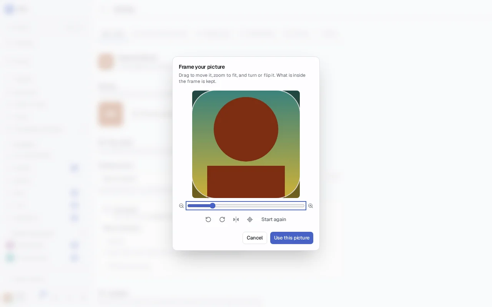

**Remove** goes back to your initials. People on other servers see your
initials for now.

### Appearance

Light or dark, following your system by default. Two colour palettes ship,
offered as **Cool** and **Warm**, and the accent colour is yours to choose
independently of the palette — pick a colour and the application derives a
readable shade for light and for dark rather than accepting or refusing what you
picked. A colour that cannot be made readable is refused.

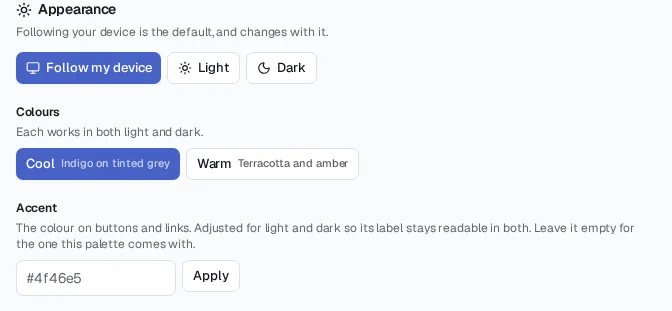

Besides the two palettes there are six **Crystal Neuo materials**, whole looks
from the [Crystal Neuo design system](https://crystal-neuo.anorebel.net), each
with its own colours, corners, borders, shadows and type, in light and dark:

| Material       | What it looks like                                             |
| -------------- | -------------------------------------------------------------- |
| **Refraction** | Frosted glass for the sidebar, menus and dialogs, calm content |
| **Tactile**    | Ink borders and hard shadows; buttons press in like keys       |
| **Signal**     | Soft raised surfaces, headings in a monospaced face            |
| **Folio**      | Flat and shadowless, set in IBM Plex                           |
| **Bloom**      | Round corners, soft glass and warm colour                      |
| **Hybrid**     | Refraction's glass with Tactile's ink buttons                  |

Each is shown in its card as it will look, so you can compare before
choosing. A material replaces the palette; your accent still applies on top.
Refraction, Bloom and Hybrid draw the sidebar, menus and dialogs in frosted
glass: **Frosted glass** turns that off and draws them solid, and glass steps
aside by itself if your system asks for reduced transparency. A material's
styles and fonts are downloaded only once you choose one.

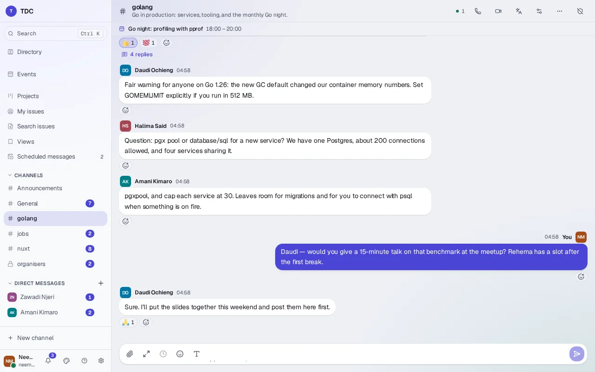

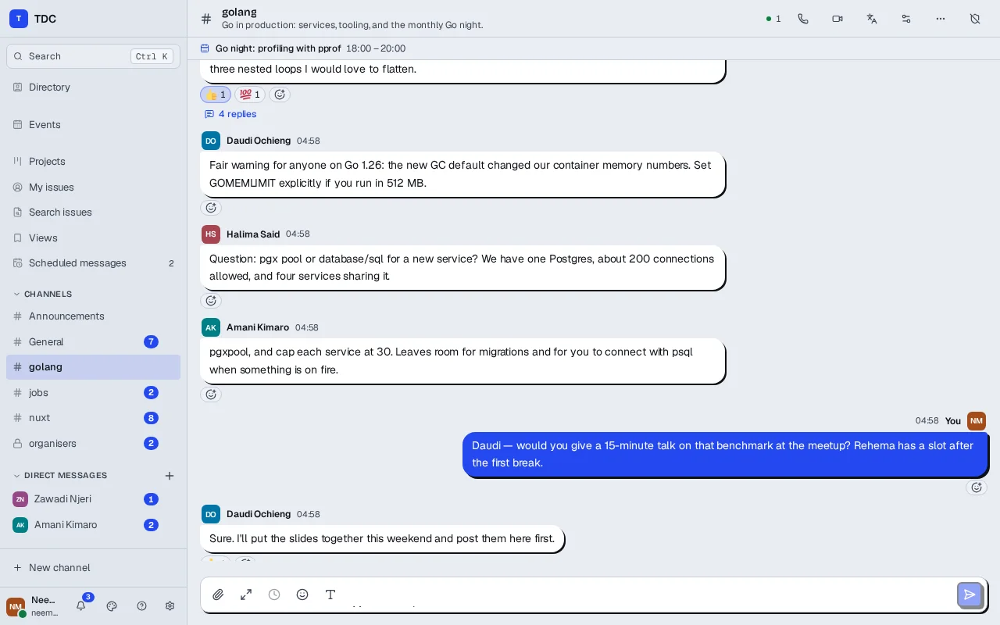

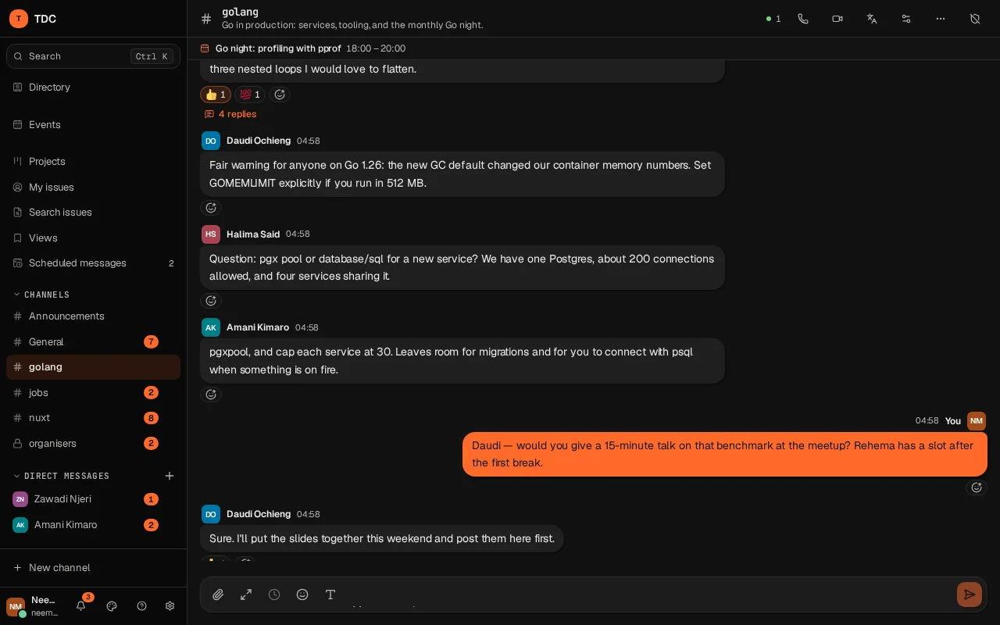

**High contrast** draws white on black with a yellow accent, with no shadows
and nothing see-through, over whichever colours you chose. It is off unless
you turn it on, or set it to follow your device's own contrast setting. Like
motion, it is kept in this browser rather than on your account.

The same choices are a press away from anywhere: the palette button at the
foot of the sidebar offers light or dark and the two palettes, and **More
colours and materials…** opens them all in a dialog. So does "Appearance" in
the command palette (`Ctrl K`).

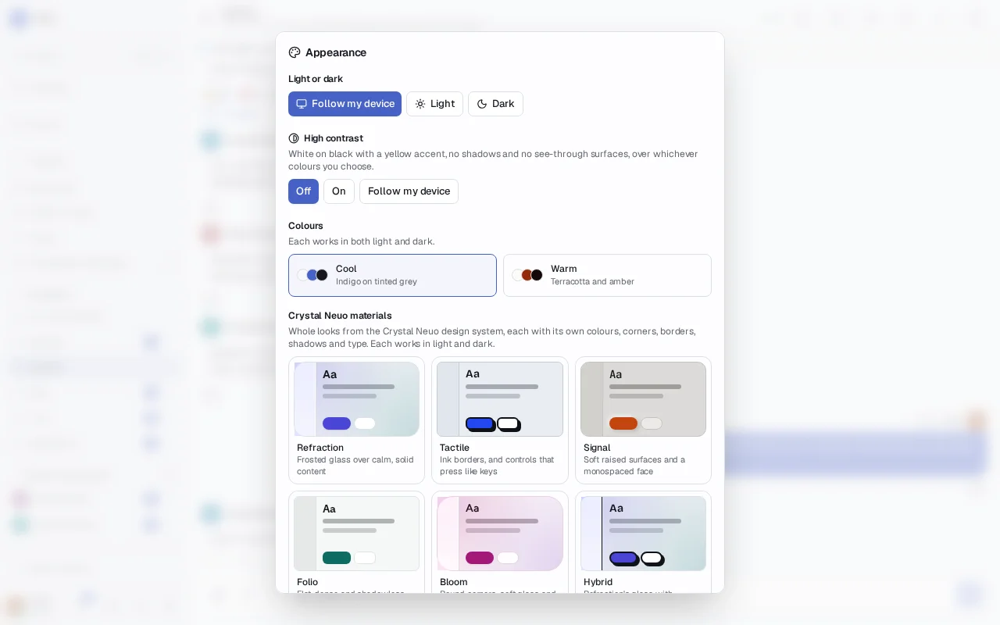

**Your choice is stored on your account**, so it follows you to another browser
or to the desktop client rather than living in one browser's storage. Your
operator sets the server's default, and clearing your own choice returns you to
it.

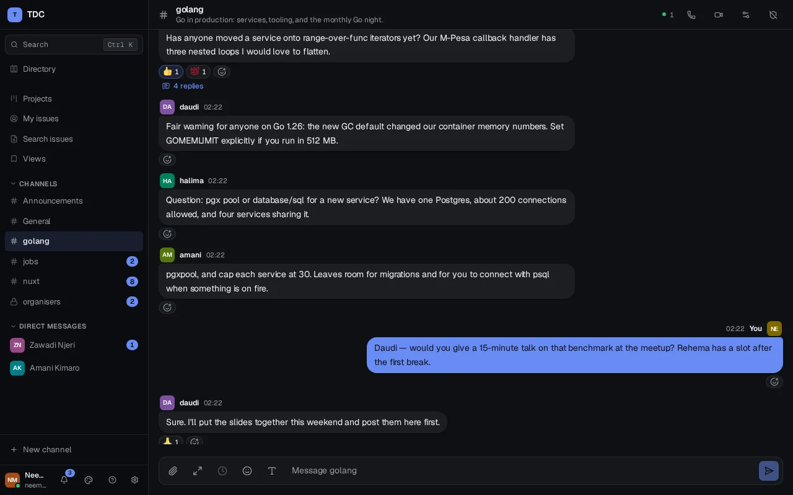

### Language

English and Kiswahili both ship, and your operator sets the server's default.
Switching changes what is on screen: every sentence the interface writes goes
through the translation layer, so a Kiswahili speaker reads a Kiswahili
application rather than an English one with a Kiswahili menu.

What is never translated is what people wrote — messages, channel names, status
text, somebody's display name. Those are shown as they were typed, in whatever
language they were typed in.

### Motion, density and shortcuts

The interface moves a little when something changes: a dialog grows into place,
a new message rises in, a thread panel slides the last few pixels open, a card
glides to its new column on a board, an unread count pops when it appears. Every
one of those is short — nothing takes longer than a quarter of a second — and
nothing waits for it: whatever is appearing can be used from its first frame.

You decide how much of that you want, under **Motion**:

- **Follow my device** — the default. If your operating system is set to reduce
  motion, you get _Reduced_; otherwise _Full_. It keeps following your system
  while TDC is open.
- **Full** — things fade, rise and slide into place.
- **Reduced** — things still fade, so you can see that something changed, but
  nothing slides, grows or bounces, and decorative loops (a shimmering
  placeholder, the dots that say somebody is typing) stay still.
- **Off** — nothing moves at all; every change happens at once.

**Density** makes everything slightly smaller, so more of a conversation fits on
the screen. **Keyboard shortcuts** can be switched off entirely if you keep
setting them off by accident; `Esc` and `Ctrl K` keep working either way.
**Show formatting in messages** is on unless you turn it off; off, every
message is shown as the text that was typed (see [Formatting](#formatting)).

**Show in the interface** puts away what you do not use: the Directory, Events
and Projects links in the sidebar, link previews under messages, who is
typing, and the dots that say who is online. Only you see the difference —
nobody else's view changes, and a page whose link you hid is still reachable
from search.

All of these apply the moment you choose them and are kept **in this browser** (or
this desktop app) rather than on your account — you may want motion on a big
screen and not on your phone. Find them in the command palette (`Ctrl K`, then
"Motion and keyboard preferences"), behind **More preferences** in the shortcut
list, and in settings.

### The keyboard

Press `?` for the full list, grouped by where each shortcut works.

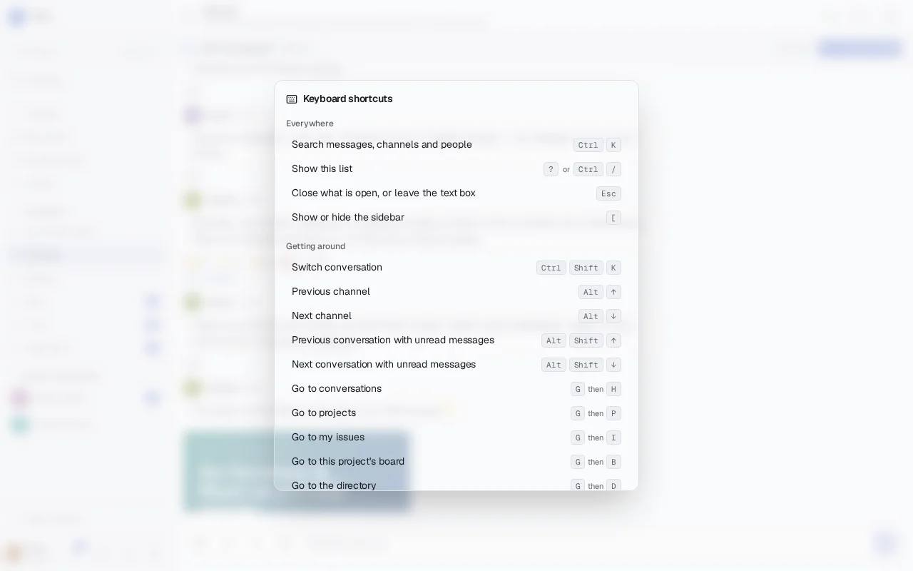

| Keys                           | What it does                                        |
| ------------------------------ | --------------------------------------------------- |
| `Ctrl K`                       | Search messages, channels and people                |
| `?` or `Ctrl /`                | Show the shortcut list                              |
| `Esc`                          | Close what is open, or leave the text box           |
| `[`                            | Show or hide the sidebar                            |
| `Ctrl Shift K`                 | Switch conversation                                 |
| `Alt ↑` / `Alt ↓`              | Previous and next channel                           |
| `Alt Shift ↑` / `Alt Shift ↓`  | Previous and next conversation with unread messages |
| `G` then `H`                   | Go to conversations                                 |
| `G` then `P`                   | Go to projects                                      |
| `G` then `I`                   | Go to my issues                                     |
| `G` then `B`                   | Go to the board of the project you are in           |
| `G` then `D`                   | Go to the directory                                 |
| `G` then `S`                   | Go to settings                                      |
| `C`                            | Write a message                                     |
| `E`, or `↑` in an empty box    | Edit your last message                              |
| `T`                            | Reply in a thread to the last message               |
| `R`                            | React to the last message                           |
| `M`                            | Mark as read and jump to the newest message         |
| `N`                            | File a new issue, in a project                      |
| `Ctrl B`, `Ctrl I`, `Ctrl E`   | Bold, italic, inline code, in the message box       |
| `Ctrl Shift X`, `Ctrl Shift C` | Strikethrough, code block, in the message box       |
| `Shift Enter`                  | New line instead of sending                         |
| `Shift M`                      | Mute or unmute, in a call                           |
| `Shift V`                      | Camera on or off, in a call                         |
| `Shift H`                      | Raise or lower your hand, in a call                 |
| `Shift S`                      | Present your screen, or stop, in a call             |
| `Shift F`                      | Make the call window large, or small again          |

On a board, every card has a move handle. Focus it and press `Enter` or `Space`
to pick the card up, `←` and `→` to choose a column, and `Enter` to put it down
(`Esc` leaves it where it was). `Shift ←` and `Shift →` on the handle move a card
one column straight away.

On a Mac, `Ctrl` here is the command key, `Alt` is option.

The single-key shortcuts do nothing while you are typing — a shortcut that stole
a letter mid-sentence would cost more trust than every shortcut is worth — and
nothing reaches past an open dialog into the screen behind it. Shortcuts
carrying a modifier work anywhere, because nobody types `Ctrl K` into a
sentence. None of them use a key the desktop app's menu already claims, and
the formatting keys (`Ctrl B` and the rest) work only inside the message box,
where they take over from the browser's own meaning for them.

The list under `?` is generated from what the application actually binds, so it
cannot drift from the real behaviour.

### Getting started

A short guided tour introduces the conversation view. It is skippable, and
resumable if you leave it half-way — somebody interrupted at step four has
already read the first three. A tour you have finished or deliberately skipped
is not offered again, and that is remembered on your account, so the
introduction you saw on the web client is not shown to you again on the desktop
one. One tour exists today.

## On a phone

The web application installs to a home screen and behaves as an app: its own
icon, no browser furniture, notifications with the browser closed.

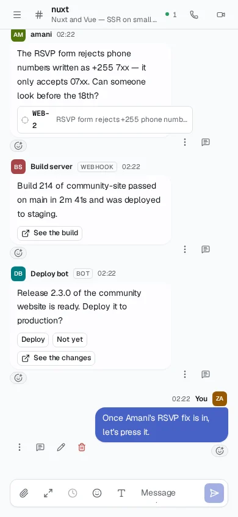

It tolerates being offline. A message you compose with no connection is queued
and sent when one returns — or reported as failed, rather than silently
vanishing — and the queue survives the tab being closed, because a message
written on a train is still a message somebody wrote.

Be clear about what "offline" covers, though. A conversation already open stays
readable when the connection drops, and attachments you have seen are cached.
Reloading while offline does not bring the history back: messages are fetched
from the server rather than kept in the browser, so a cold start with no
connection gets you the application and no conversations.

Swiping does the obvious things: swipe a message to reply, swipe between
channels, pull to refresh. Every one of those is reachable another way, because
a gesture nobody discovers is not a feature.

Nothing is pointer-only. Every action that appears on hover is reachable by
touch, and the whole application works at phone width without sideways
scrolling.

## On the desktop

The desktop client is optional. On a phone or tablet the installed web app is
the one to use; the desktop client exists for what a browser will not do.

**It is installed once and pointed at a server**, because TDC is self-hosted and
the application cannot know which server is yours. You can add more than one —
your community's and your employer's — and each keeps its own session, so
switching is picking a different one rather than signing in again. Removing a
server takes its session with it.

A server reached over plain HTTP must be on your own machine. Everything you
send travels over that connection, and on a network somebody else can see, plain
HTTP hands all of it to anybody on the same wire. Typing a bare hostname gets
`https://`; an address written explicitly as `http://` is never silently
upgraded, because quietly changing what somebody asked for is how people end up
trusting the wrong thing.

**Everything the web client has is here too**: conversations, projects and
issues, the directory where your server offers one, integrations, the
administration pages for those who may use them, and the same settings —
passkeys, two-step sign-in, privacy, signed-in devices. Creating an account,
setting up a new server and recovering a password all work against whichever
server you chose.

What the desktop client adds:

- **Notifications from the operating system**, which respect system quiet modes
  and open the conversation they are about when you activate them. Where your
  system wants permission first, **Settings → Notifications → This computer** is where to give
  it: TDC asks only when you press the button there, because some systems ask
  only once.
- **Window and update settings** alongside the rest, under the same heading:
  how see-through the window is, starting at login, and when to look for a new
  version.
- **Your session in the OS keychain**, so you are not asked for a password every
  launch. Where there is no keychain it says so and asks each time. It never
  falls back to storing anything in plain text.
- **A tray icon** carrying the unread count, with the few things you want
  without opening the window: show or hide it, mute for fifteen minutes, an
  hour, or until tomorrow, jump to a recent conversation, add a server or a
  channel, or quit. Whether closing the window quits or hides it is yours to
  set.
- **Launching at login**, off unless you turn it on, and your window's position
  restored — adjusted if the display it was on has gone.
- **Updates that verify what they downloaded** and discard anything that fails
  the check rather than installing it.
- **Letting somebody in a call control your screen**, when you present your
  whole screen from here; a browser cannot move the pointer, so it cannot offer
  this. See **Letting somebody control your screen** under Calls.

What works differently, because the window is not a browser:

- **Links to anywhere else open in your usual browser** — a link in a message,
  a meeting address, **Add to Google Calendar** or **Outlook**, a guide's link
  out. Signing in through another service happens there too, where the address
  bar shows whose page is asking for your password.
- **Files are fetched and saved by the application**, which holds your session:
  attachments, an event's `.ics` file, backup archives and exports. A file you
  attach is sent the same way, so the tray shows it when it is done rather than
  a progress bar.
- **A recording too large for the server** is saved through the system's own
  save dialog rather than as a browser download.
- **Notifications come from the operating system, not from push.** The web
  client's **Push notifications** setting is not here; calls ringing and event
  reminders raise a system notification as well as appearing in the window,
  even while the window is closed to the tray.
- **Translating on this device** depends on the browser engine, and the one the
  desktop window uses usually does not have it. **Settings → More → Translation** says
  so where it is missing; choose another provider there.

### Which Linux download to take

Two Linux builds are published for each architecture, and almost everybody wants
the ordinary one — `tdc-<version>-linux-amd64`, with no suffix.

The one ending `-gtk3` is for older distributions. The ordinary build uses GTK4
and WebKitGTK 6.0, which reached the base repositories in **Ubuntu 24.04** and
**Debian 13**; where those libraries are absent it does not start, because there
is nothing for it to load. It also needs glibc 2.38 or newer, which rules out
Ubuntu 22.04 (2.35) and Debian 12 (2.36) whatever else is installed.

The `-gtk3` build uses GTK3 and WebKitGTK 4.1 and needs only glibc 2.34, so it
runs on **Ubuntu 22.04**, **Debian 12**, and their derivatives.

Debian 12 can install WebKitGTK 6.0 from backports, but that does not make the
ordinary build run there — its glibc is still too old. Take the `-gtk3` one.

If you are unsure, take the ordinary build. A build that cannot run says so
immediately and does no harm — it fails to start rather than misbehaving.

The two are not interchangeable afterwards. Each updates only to its own kind,
so a machine on the `-gtk3` build is never offered an ordinary build it could
not run. Moving between them means downloading the other one yourself, which you
would only need to do after upgrading the operating system.

macOS and Windows have one build each; there is nothing to choose.

**Calls on Linux** go through GStreamer, which WebKitGTK uses for sound and
video: its WebRTC plugin (in `gst-plugins-bad`) and libnice's plugin must be
installed. The `.deb`, `.rpm` and Arch packages bring them in themselves. With
another kind of download, or where they are missing, the conversation header
shows a crossed-out phone instead of the call buttons, and pressing it says
what to install — `gstreamer1.0-plugins-bad` and `gstreamer1.0-nice` on Debian
and Ubuntu, `gstreamer1-plugins-bad-free` and `libnice-gstreamer1` on Fedora,
`gst-plugins-bad` and `libnice` on Arch. A WebKitGTK built without WebRTC at all
is said the same way; the desktop application switches WebRTC on in the
WebKitGTK it is given, reloading its page once at start to do it. On macOS the
first call asks for the camera and microphone in the system's own dialog; on
Windows, calls need nothing extra.

## Asking before it is too late

Anything irreversible asks first, in both clients, and the question says what
will be lost rather than only whether to continue. Deleting a message, banning
or blocking somebody, removing a server, signing out, ending a session, quitting
with unsent messages.

The confirming button is never the one focus lands on, so a reflexive press of
the space bar cannot destroy anything. Reversible actions do not interrupt you —
a dialog that appears for everything is a dialog nobody reads.

## What is not here yet

So that nothing above is read as implying more than it says:

- **More of calls.** Calls between a few people work, on servers that switch
  them on (see [Calls](#calls)), with ringing, holding, merging into a
  conference, links, guests, presenting a screen, raised hands and reactions.
  Larger calls go through the server's forwarding unit where the server has
  it on, and calls reach people on connected servers where both servers allow
  it, recording on your own device where the server allows it, and remote
  control from the desktop application. Not yet: raising a hand, presenting,
  reacting or recording for people who joined from another server.
