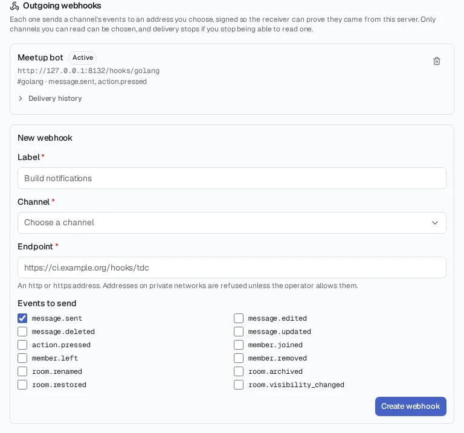
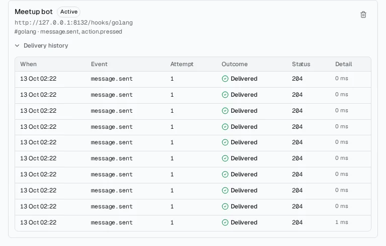
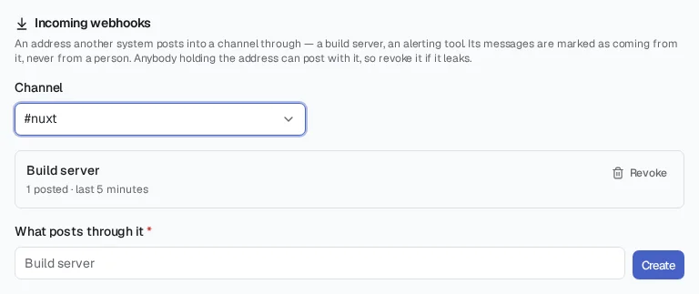
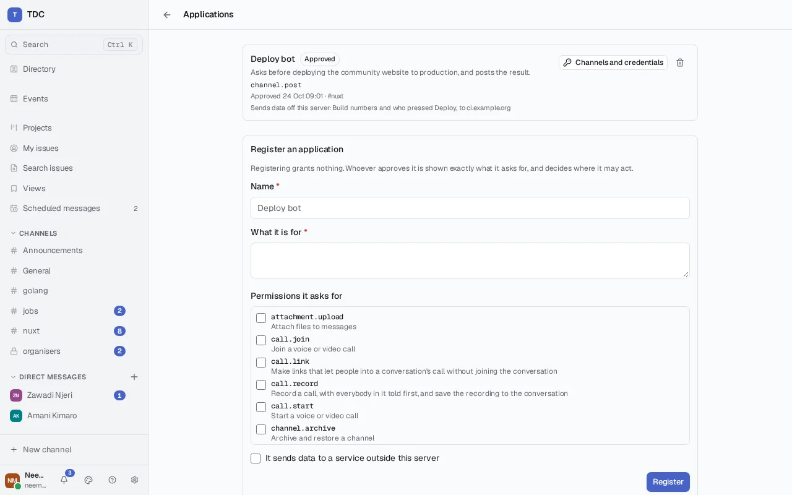
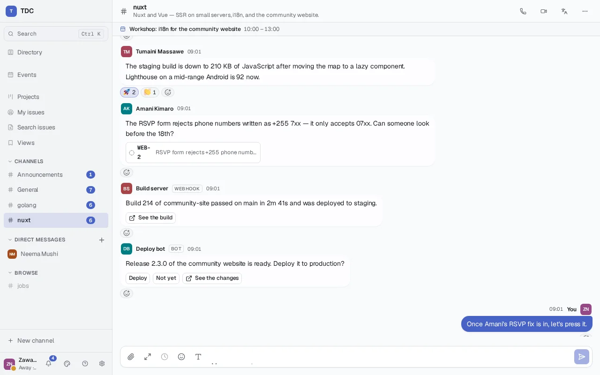

# Webhooks and applications

How other systems take part in a TDC server without anybody holding a session:
being told what happens in a channel, posting into one from outside, and acting
as an application with permissions of its own.

Everything here is HTTP. The [integration guide](integrating.md) covers the API
these build on — authentication, rooms, messages, the live connection — and
[signed deliveries](integrating.md#signed-deliveries), which every outgoing
request described here carries. Examples run against `http://localhost:8080`.

## Outgoing webhooks

An outgoing webhook sends a channel's events to an endpoint you choose, as they
happen. It belongs to the person who makes it: it can only be made for a channel
they can read, and it stops delivering the moment they cannot.



### Subscribing

<!-- demo: subscribe -->

```sh
curl -X POST http://localhost:8080/api/me/webhooks \
  -H "Authorization: Bearer $TOKEN" \
  -H 'Content-Type: application/json' \
  -d '{
    "roomId": "'"$ROOM"'",
    "label": "Build notifications",
    "url": "https://ci.example.test/hooks/tdc",
    "eventTypes": ["message.sent", "action.pressed"]
  }'
```

```json
{
  "id": "0199f2a0-…",
  "label": "Build notifications",
  "url": "https://ci.example.test/hooks/tdc",
  "roomId": "5a1c…",
  "eventTypes": ["message.sent", "action.pressed"],
  "payloadVersion": 1,
  "state": "active",
  "consecutiveFailures": 0,
  "rateLimited": 0,
  "created": "2026-09-23T09:00:00Z",
  "secret": "whsec_…"
}
```

**`secret` is shown once.** It keys the HMAC on every delivery; copy it into
your receiver now. Nobody can retrieve it later, including you — a lost one is
replaced by making a new webhook.

What can go wrong when subscribing, and what each looks like:

| Answer  | Why                                                                        |
| ------- | -------------------------------------------------------------------------- |
| **404** | The channel does not exist, or you cannot read it — the two look the same  |
| **403** | The endpoint is on a private network, which the server does not deliver to |
| **400** | An unknown event type, no event types, no label, or not an http(s) address |

`GET /api/webhooks/event-types` lists what can be asked for. Today:
`message.sent`, `message.edited`, `message.deleted`, `message.updated`,
`action.pressed`, `member.joined`, `member.left`, `member.removed`,
`room.renamed`, `room.archived`, `room.restored` and
`room.visibility_changed` — everything somebody
reading a channel sees happen in it, and nothing they do not.

`GET /api/me/webhooks` lists yours, never with secrets. `DELETE
/api/me/webhooks/{id}` removes one with its history. The interface for all of
this is **Settings → Integrations** in the web client.

### What arrives

Each event is a `POST` of JSON, signed as described in
[signed deliveries](integrating.md#signed-deliveries), with `TDC-Event` naming
the event type:

```json
{
  "version": 1,
  "id": "0199f2a1-…",
  "type": "message.sent",
  "occurredAt": "2026-09-23T09:14:03.21Z",
  "subscription": "0199f2a0-…",
  "server": "chat.example.org",
  "room": { "id": "5a1c…", "address": "builds@chat.example.org" },
  "event": {
    "id": "$Yx3K…",
    "type": "message.sent",
    "sequence": 412,
    "sender": "juma@chat.example.org",
    "content": { "body": "Build 41 passed" },
    "createdAt": 1790152443210
  }
}
```

| Field            | Meaning                                                                 |
| ---------------- | ----------------------------------------------------------------------- |
| `version`        | The payload version this subscription was made against                  |
| `id`             | This delivery — the same as `TDC-Delivery`, and the same across retries |
| `occurredAt`     | When the event happened, RFC 3339 in UTC                                |
| `event`          | The event as the timeline gives it; `createdAt` is epoch milliseconds   |
| `event.sequence` | The event's position in its room, which is how to recover order         |

**Answer 2xx to accept.** Anything else — including a 3xx, since redirects are
never followed — is a failure and is retried. Answer quickly: an attempt that
takes longer than `integrations.delivery_timeout_seconds` (five by default) has
failed. Do your work after answering, not before.

**Delivery is at least once.** A delivery whose 2xx was lost on the way back is
sent again, with the same `id`. Remember the identifiers you have handled and
ignore a repeat.

**Order is not guaranteed across retries.** Deliveries to one subscription are
sent one at a time, oldest first, so ordinarily they arrive in order. But a
failing delivery does not hold back the ones behind it — otherwise one bad
payload would stall everything after it for a day — so after a retry, events
can arrive out of order. Use `event.sequence` when order matters.

### Versions

A subscription keeps receiving the payload version it was made against. A
change that would break a receiver — a renamed field, a changed meaning — is
published as a new version, and existing subscriptions keep receiving the old
one until their owner makes a new subscription. Adding a field is not a breaking
change: ignore fields you do not know. The current version is `payloadVersion`
from `GET /api/webhooks/event-types`.

### When a receiver fails

A failed delivery is retried with a growing delay: one minute, then two, four,
eight, doubling up to six hours, each shortened by up to a quarter at random so
receivers that failed together are not retried together. After **twelve
attempts** — most of a day — it is abandoned.

A subscription is **turned off** when a delivery is abandoned, or sooner when
**twenty-four attempts in a row** have failed, whatever they were for. Nothing
more is queued for it and anything waiting is cancelled. Its owner is told
through their ordinary notifications, and `state`, `disabledAt` and
`disabledReason` say what happened. Fix the receiver, then turn it back on:

```sh
curl -X POST http://localhost:8080/api/me/webhooks/$ID/enable -H "Authorization: Bearer $TOKEN"
```

The limits are the operator's to change: `integrations.webhook_max_attempts`,
`integrations.webhook_retry_base_seconds`, `integrations.webhook_retry_cap_seconds`
and `integrations.webhook_disable_after_failures`.

### Seeing what happened

`GET /api/me/webhooks/{id}` answers with the subscription and its recent
history — the last hundred deliveries and attempts, newest first:

```json
{
  "id": "0199f2a0-…",
  "state": "active",
  "consecutiveFailures": 2,
  "rateLimited": 0,
  "deliveries": [
    {
      "id": "0199f2a1-…",
      "kind": "message.sent",
      "state": "pending",
      "attempts": 2,
      "nextAttemptAt": "2026-09-23T09:18:03Z",
      "created": "2026-09-23T09:14:03Z"
    }
  ],
  "attempts": [
    {
      "delivery": "0199f2a1-…",
      "attempt": 2,
      "at": "2026-09-23T09:16:03Z",
      "outcome": "failed",
      "status": 503,
      "response": "maintenance",
      "durationMs": 41
    },
    {
      "delivery": "0199f2a1-…",
      "attempt": 1,
      "at": "2026-09-23T09:14:03Z",
      "outcome": "failed",
      "error": "the endpoint refused the connection",
      "durationMs": 2
    }
  ]
}
```

A delivery's `state` is `pending`, `delivering`, `delivered`, `abandoned`, or
`cancelled` — not sent because the subscription was turned off or its owner could
no longer read the channel. An attempt's `outcome` is `delivered`, `failed`, or
`rate_limited`; `status` is what the receiver answered, and `error` what stopped
it answering at all. `response` is the first kilobyte of what it said. History
is kept for thirty days (`integrations.delivery_history_days`).



### Limits, and what exceeding them looks like

Each subscription is sent at most **120 deliveries a minute**
(`integrations.webhook_deliveries_per_minute`). A delivery past that is **held
back, not dropped**: it waits for the limit, the history records a
`rate_limited` attempt, and the subscription's `rateLimited` count and
`lastRateLimited` time say that it happened.

Each subscription has **one delivery in flight at a time**, and the whole server
no more than `integrations.delivery_workers` (four by default). A slow or silent
receiver therefore occupies one worker for at most the timeout and cannot hold
up anybody else's deliveries — or the channel itself: queuing happens after a
message is stored and off the request that stored it, so posting never waits on
a webhook.

### What it can carry

Measured by `TestDeliveryLoadLeavesChatUnaffected` (run on its own with
`TDC_LOAD_TESTS=1`, since beside the rest of the suite it would measure the
machine's load instead) and `TestDeliveryPoolFitsItsMemoryTarget`. CI runs both
in the job that reports the server's memory, on every pull request to a release
branch: the first fails if a target is missed, the second is reported with its
change from the base commit.

| What                                                          | Target              | Measured when this was written                 |
| ------------------------------------------------------------- | ------------------- | ---------------------------------------------- |
| Deliveries a second, four workers, receivers on the same host | at least 50         | 157–262                                        |
| Posting's median beside a receiver that never answers         | within 1.5× or 5 ms | 10.1 → 10.2 ms, 12.6 → 14.0 ms, 15.3 → 15.8 ms |
| Posting's 95th percentile while the pool is busy              | within 3× + 10 ms   | 18–35 ms, against 11–16 ms quiet               |
| Memory after 1,000 deliveries beside a stalled receiver       | reported            | +1.8 MiB, with goroutines back to idle         |

Those were measured on a twelve-core machine with Postgres in a container
shared with other work; a production host differs, and the shape is the point.
Throughput is bounded by database commits more than by the network — each
attempt's outcome is recorded in one statement, and deliveries are claimed a
batch at a time, because doing either row by row made the pool queue for
commits and deliver a tenth as much.

### When access is lost

Every delivery checks, at the moment it is sent, that the subscription's owner
can still read the channel. Somebody removed from a private channel stops being
told about it immediately — including about events that happened before they
left and were still waiting. The subscription and its history are kept, marked
with `accessLost`; deliveries resume if they regain access.

## Incoming webhooks

An incoming webhook is an address an outside system posts into one channel
through — a build server announcing results, an alerting tool reporting a disk
filling up. It needs nothing but the address: no account, no token, no
signature. That is what makes it easy to connect anything to, and why it is
built on the assumption that the address will leak.



### Making one

Somebody holding `channel.webhooks.manage` in the channel — administrators, by
default — makes one, from **Settings → Integrations** or:

<!-- demo: create-incoming -->

```sh
curl -X POST "http://localhost:8080/api/rooms/$ROOM/incoming-webhooks" \
  -H "Authorization: Bearer $TOKEN" \
  -H 'Content-Type: application/json' \
  -d '{"label": "Build server"}'
```

```json
{
  "id": "0199f3b0-…",
  "label": "Build server",
  "roomId": "5a1c…",
  "posted": 0,
  "refused": 0,
  "sender": "webhook-0199f3b0e1a2@chat.example.org",
  "url": "https://chat.example.org/api/hooks/tdc_hook_…",
  "token": "tdc_hook_…"
}
```

**`url` is shown once.** It contains the credential, which is stored only as a
hash; nobody can retrieve it afterwards. It starts `tdc_hook_` so a secret
scanner that finds one in a public repository knows what it has found.

`GET` on the same path lists a channel's webhooks — how many posts each has
made, when it was last used, how many calls the rate limit refused — and never
their addresses. `DELETE …/incoming-webhooks/{id}` revokes one.

### Posting

<!-- demo: post-incoming -->

```sh
curl -X POST "$WEBHOOK_URL" \
  -H 'Content-Type: application/json' \
  -d '{
    "text": "**Build 41 failed** on `main` — 3 tests broke in `payments/`.",
    "actions": [
      {"name": "log", "label": "See the log", "capability": "open",
       "url": "https://ci.example.test/builds/41"}
    ]
  }'
```

Answers **201** with the message's `id`. `body` and `text` mean the same thing;
`text` is accepted because a great many tools already send it.

The message reads as the webhook's, never a person's: it shows the webhook's
label in place of a name, marked **Webhook**, and its content carries
`"via": {"kind": "webhook", "id": "…", "name": "Build server"}` — set by the
server, so nothing a caller sends can add it or take it away. Its sender is an
address like `webhook-0199f3b0e1a2@chat.example.org`, which belongs to no
account.

**It posts into one channel and nothing else.** A request naming a different
channel — `"room"` with another channel's identifier, or `"channel"` with
another's name — is refused with **403** and nothing is posted. Naming its own
channel is accepted, for tools that insist on sending one.

### Formatting build results and alerts

The body is Markdown, rendered exactly as somebody's typed message is: **bold**,
_emphasis_, `code`, fenced code blocks, lists and links. Lead with the outcome
on the first line, because that is what a notification shows; put detail after
it. Up to 8,000 characters.

Buttons may be offered, but only buttons that open a link (`"capability":
"open"` with an `http` or `https` `url`) — "See the log", "Open the dashboard".
A webhook cannot answer a press, so a button that asked a question is refused
with **400**. To ask questions and act on the answers, use an
[application](#applications) instead.

**What it posts is treated as a person's post is.** The operator's word filter
applies — masking, flagging or blocking exactly as it would for somebody
typing — and clients render it with the same protection against markup and
scripts, because it is stored and delivered as an ordinary message.

### When it is called too often

Each webhook may post sixty times a minute
(`integrations.incoming_webhook_posts_per_minute`). Past that a call is
refused with **429**, a `Retry-After` header, and the same in the body:

```json
{
  "message": "this webhook is posting faster than the channel allows; wait and send again",
  "retryAfterSeconds": 42
}
```

Each refusal is counted on the webhook — `refused` and `lastRefused` in the
listing — so whoever manages the channel sees that calls were turned away
rather than finding messages missing.

### When it leaks

Assume it will. What somebody holding a leaked address can do is post into that
one channel, slowly, marked as the webhook. They cannot read the channel, act
anywhere else, or turn it into anything more. Revoke it and **the very next
call is refused** — there is no cache in front of the check — and make a new
one for the system that should have it. Creating and revoking are both in the
audit log with who did them, and every message it posted names it, so unexpected
activity in a channel traces to one webhook rather than to a guess.

## Applications

An application is a program installed on the server as itself: a deploy bot, a
triage assistant, a bridge to a ticket tracker. Unlike a webhook it can read as
well as post, and unlike an [API token](integrating.md#api-tokens) it is not
somebody acting through a program — it has an account of its own, permissions
of its own, and holds none of the authority of whoever installed it.

Installing one takes two steps, and they may be two people: somebody registers
it, saying what it needs; somebody holding `server.applications.manage` —
administrators, by default — approves it, having been shown exactly that. Both
are in **Settings → Applications**, and both are in the audit log.



### Registering

<!-- demo: register-application -->

```sh
curl -X POST http://localhost:8080/api/admin/applications \
  -H "Authorization: Bearer $TOKEN" \
  -H 'Content-Type: application/json' \
  -d '{
    "name": "Deploy bot",
    "purpose": "Posts the result of each deployment.",
    "permissions": ["channel.post"],
    "sendsDataExternally": true,
    "externalDisclosure": "Build numbers, to ci.example.org"
  }'
```

```json
{
  "id": "0199f4c2-…",
  "name": "Deploy bot",
  "purpose": "Posts the result of each deployment.",
  "state": "registered",
  "requested": ["channel.post"],
  "granted": [],
  "sendsDataExternally": true,
  "externalDisclosure": "Build numbers, to ci.example.org",
  "registered": "2026-10-02T09:14:03.120Z",
  "channels": [],
  "rateLimited": 0
}
```

**Registering grants nothing.** `permissions` are the names
`GET /api/admin/applications/permissions` lists, each with what it allows,
whether it is held per channel, and whether it is administrative. A name that is
not one of them is refused with **400**. If the application sends anything off
the server, `externalDisclosure` must say what and where: it is shown to whoever
approves it, before they do, and to everybody on the server afterwards.

### Approving

<!-- demo: approve-application -->

```sh
curl -X POST "http://localhost:8080/api/admin/applications/$APP/approve" \
  -H "Authorization: Bearer $TOKEN" \
  -H 'Content-Type: application/json' \
  -d "{\"permissions\": [\"channel.post\"], \"channels\": [\"$CHANNEL\"]}"
```

**What is approved is what was shown.** `permissions` repeats the list the
approver saw, and must be exactly what the application asks for — a request
changed between being read and being approved is refused with **409** rather
than granted unseen. The page lists each permission with what it allows, marks
the administrative ones, states what leaves the server before the button rather
than after it, and names on the button how many permissions it grants. Nobody
can grant an application a permission they do not hold themselves; trying is
refused with **403**.

`channels` are where its per-channel permissions hold. An application that asks
for any must be given at least one channel; it joins them as it is approved, and
it is in no others.

The answer is the application, now `approved`, with its first credential:

```json
{
  "id": "0199f4c2-…",
  "state": "approved",
  "granted": ["channel.post"],
  "account": "app-deploy-bot-0199f4@chat.example.org",
  "channels": [{ "id": "5a1c…", "name": "deploys" }],
  "credential": { "id": "0199f4c3-…", "label": "Deploy bot", "token": "tdc_…" }
}
```

**The credential is shown once**, stored only as a hash, exactly as an
[API token](integrating.md#api-tokens) is. Put it in the application's
configuration then.

### Acting as the application

The credential is a bearer token like any other:

<!-- demo: post-as-application -->

```sh
curl -X POST "http://localhost:8080/api/rooms/$CHANNEL/messages" \
  -H "Authorization: Bearer $APP_TOKEN" \
  -H 'Content-Type: application/json' \
  -d '{"body": "Deployed build 41 to production."}'
```

Its messages come from its own account —
`app-deploy-bot-0199f4@chat.example.org`, named for the application — never from
whoever approved it. `GET /api/applications/me` tells it who it is, what it was
granted and where.

**It is held to its grant on every request.** The permissions a request made
with its credential carries are replaced with the application's, so it holds
what it was granted and nothing besides — not its approver's role, not a
server-wide default. Then:

- **In a channel**, the channel must be one of its own, and the request one its
  grant allows there: reading needs `channel.read`, uploading
  `attachment.upload`, everything else `channel.post`. Anything else is refused
  with **403**, and a channel it was not given is refused the same way whether
  or not it exists.
- **Joining and leaving** are refused: its channels are what its approver chose.
- **Outside a channel**, it may use only an allowlist — who it is, the live
  connection, attachments, and the server's own description. A route added to
  the server later is closed to applications until somebody decides otherwise.
- **Administrative routes** each check their own permission, against its grant.
  An application approved with an administrative permission can do that one
  thing, and the page marks such a permission before approval.

### A bot in the conversation

An application takes part in its channels as a participant of its own kind: a
bot. Everything it writes — a message, a reply in a thread, a forward — carries
`"via": {"kind": "bot", "id": "…", "name": "Deploy bot"}` in its content, set
by the server from who sent it, never from anything in the request. Clients show
its name with a **Bot** mark beside it, in words, so nobody reads a program's
message as a person's; a person's message can neither claim the mark nor shed
it.



**It is moderated as anybody is.** Its account is an ordinary account —
`accountId` in `GET /api/admin/applications/{id}` — and every moderation action
applies to it unchanged. A moderator who suspends it
(`POST /api/admin/users/{accountId}/suspend`) stops it at once: its next request
is refused with **401**, as a suspended person's would be, until the suspension
is lifted. Its messages are removed, it is banned from a channel, and it is
restricted from posting in one, exactly as anybody is — and a ban stops it
posting there even though the channel is still on its list.

**It reads and posts only where it was put.** A channel it was not given is
refused with **403**, even a public one any person on the server could read.

### Being told about presses at an address

An application that holds a live connection hears presses on its messages as
they happen, like any other event. One that cannot — a function that runs only
when called, a service behind a proxy that cuts long connections — is given an
address instead, and every press on one of its messages is delivered there:

<!-- demo: set-invocation -->

```sh
curl -X PUT "http://localhost:8080/api/admin/applications/$APP/invocation" \
  -H "Authorization: Bearer $TOKEN" \
  -H 'Content-Type: application/json' \
  -d "{\"url\": \"$INVOCATION_URL\"}"
```

```json
{ "url": "https://bot.example.org/presses", "secret": "whsec_…" }
```

**The secret is shown once.** Each invocation is signed exactly as a
[webhook's delivery](integrating.md#signed-deliveries) is — verifiable from the
server's published keys alone, and by the HMAC keyed with this secret — and
retried the same way when the address does not answer 2xx, with the same growing
delay and the same limit. An address that cannot be reached holds one delivery
worker, never the pool.

What arrives is a webhook payload naming the application where a delivery
names its subscription:

```json
{
  "version": 1,
  "id": "0199f5a0-…",
  "type": "action.pressed",
  "occurredAt": "2026-10-02T09:20:11.482Z",
  "application": "0199f4c2-…",
  "server": "chat.example.org",
  "room": { "id": "5a1c…", "address": "#deploys:chat.example.org" },
  "event": {
    "id": "$Hk2…",
    "type": "action.pressed",
    "sequence": 42,
    "sender": "juma@chat.example.org",
    "content": { "action": "deploy", "pressed": "$9Qa…", "version": 1 },
    "createdAt": 1790932811482
  }
}
```

`event.sender` is the person who pressed. Answer with the application's
credential, through the same requests a connected application uses — post a
reply, [replace the controls](integrating.md#answering-a-press), or answer the
presser privately.

**Who may press is decided before anything is sent.** A control that
[requires a permission](integrating.md#offering-a-choice) is checked against
the person pressing, never the application; somebody without it is refused, and
no invocation is queued at all.

**An invocation still waiting when things change is not sent.** Removing the
application, taking the channel off its list, or clearing its address with
`{"url": ""}` cancels whatever is queued at its next attempt.
`GET /api/admin/applications/{id}/invocations` lists the recent ones — waiting,
delivered, given up or cancelled — with how many attempts each took and the last
status the address gave. The address's host is listed with the installed
application for everybody, because where a press goes is part of what an
application sends off the server.

### Credentials, and rotating them

`POST /api/admin/applications/{id}/credentials` issues another, shown once;
`DELETE /api/admin/applications/{id}/credentials/{credentialId}` revokes one,
refused from the very next request. To rotate without a gap, issue the new one,
put it in place, then revoke the old. `GET /api/admin/applications/{id}` lists
its credentials with when each was issued and last used — never the credentials
themselves.

`PUT /api/admin/applications/{id}/channels` with `{"channels": [...]}` changes
where it acts; it joins and leaves accordingly, and the change holds from its
next request.

### Who can see what is installed

**Anybody on the server.** An application that can read a conversation is
something the people in it are entitled to know about, so this needs no
administrator:

- `GET /api/applications` lists every approved application — its name, purpose,
  permissions, when it was approved, what it sends off the server, and in how
  many channels it acts, without naming channels the reader may not see.
- `GET /api/rooms/{id}/applications` lists the applications that can act in a
  channel, to anybody who can see the channel.

Both are under **Installed applications** in **Settings → Integrations**.

### When it is called too often

Each application may make 600 requests a minute
(`integrations.application_requests_per_minute`), counted across all its
credentials, so issuing itself more does not buy it more. Past that it is
refused with **429** and a `Retry-After` header, and each refusal is counted on
the application — `rateLimited` and `lastRateLimited` — so whoever manages it
sees that it was throttled.

### Removing

<!-- demo: remove-application -->

```sh
curl -X POST "http://localhost:8080/api/admin/applications/$APP/remove" \
  -H "Authorization: Bearer $TOKEN" \
  -H 'Content-Type: application/json' \
  -d '{"content": "retain"}'
```

`content` is required, because both answers are legitimate and only the person
removing it knows which this is: `"retain"` leaves what it posted where it is,
still marked as its; `"remove"` takes each of its messages down as a moderator's
removal would, leaving a placeholder. Either way every credential stops working
at once and it leaves its channels. The answer says how many messages were
removed, and the audit log records the removal with who did it and which was
chosen.
